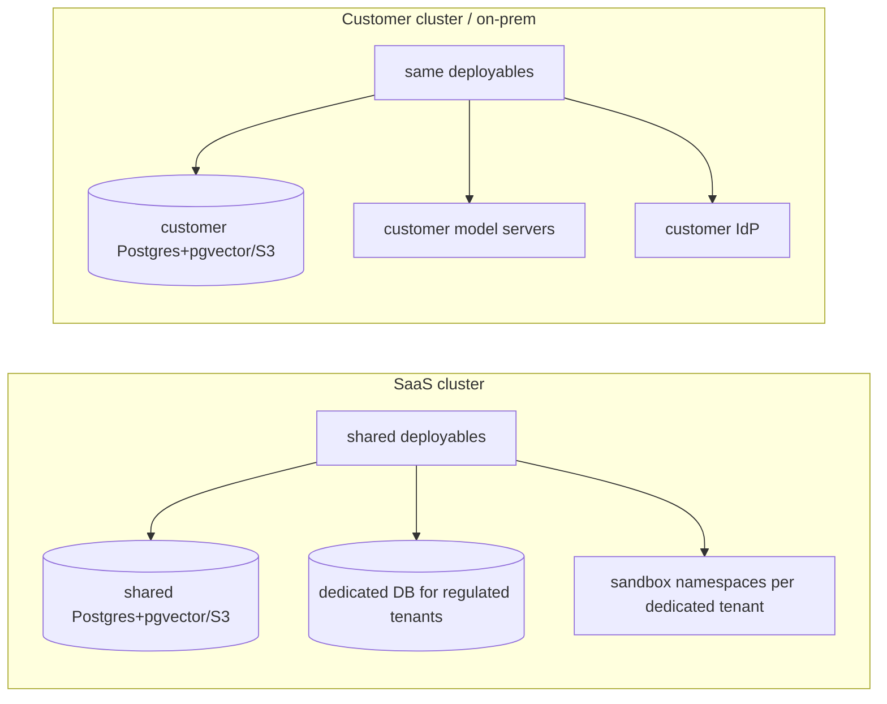

# Deployment modes

One codebase, one set of container images, one Helm chart ([ADR-0016](../02-architecture/adr/ADR-0016-single-codebase-deployment-modes.md)). Mode is selected by `AR_DEPLOYMENT_MODE` (`saas` | `single_tenant`, default `single_tenant`), read only through `ar_common.settings.mode` (helpers `is_saas()`, `is_single_tenant()`).

## 1. Behaviour matrix

| Behaviour | `saas` | `single_tenant` |
|---|---|---|
| Tenants | Many; created by platform admins (`POST /api/v1/platform/tenants`) | Exactly one, created at install by `TenantProvisioningWorkflow` from `AR_BOOTSTRAP_TENANT_SLUG`, `AR_BOOTSTRAP_TENANT_NAME`, `AR_BOOTSTRAP_ADMIN_EMAIL` (idempotent Helm `bootstrap` Job running `python -m ar_domain.bootstrap`) |
| Login | `/login` asks for the tenant (slug or email domain → `tenant_domains`) | Tenant fixed; org selection skipped |
| Platform admin UI (`/platform/*`) and `/api/v1/platform/*` | Enabled for realm role `platform_admin` | Platform pages limited to model providers, health and plans; tenant CRUD returns 404 |
| Support access to tenant content | Only via support-access grants | Not applicable (install owners are tenant admins) |
| Isolation tiers | `shared`, `dedicated_db` | Implicitly `dedicated_cluster` (stored as `dedicated_cluster`) |
| Content capture in traces (`observability.capture_content`) | Default `false`, tenant may enable | Default `false`, tenant admin may enable |
| Plans and quotas | Plans assigned per tenant | Single plan `self_hosted` with generous default limits, adjustable by the tenant admin |
| Billing currency / unit prices | Per plan | Per plan (used only for cost attribution) |
| Model providers | Registered by platform admins; tenants may add tenant-scoped providers when the plan's `features` include `tenant_model_providers` | Registered by tenant admin (who is also platform admin of the install) |
| Telemetry to operator | Platform-wide dashboards | Local only |
| Egress for sandboxes | Platform allowlist ∩ tenant allowlist | Tenant allowlist |
| Default secrets backend (`AR_SECRETS_BACKEND`) | `vault` | `vault`, or `db_encrypted` for small installs |

## 2. Topologies

## 3. Sizing profiles (Helm values presets)

| Profile | Values file | Users | Notes |
|---|---|---|---|
| `dev` | `values-dev.yaml` | 1–5 | Single replicas, embedded Postgres/Valkey/SeaweedFS/Keycloak/Temporal (no Qdrant: retrieval on pgvector), `db_encrypted` secrets, Docker sandbox driver allowed (`AR_SANDBOX_DRIVER=docker`, only when `AR_ENV=dev`) |
| `small` | `values-small.yaml` | ≤ 500 | 2 replicas of stateless services, external or bundled stateful services |
| `large` | `values-large.yaml` | ≤ 10,000 | HPA, external managed/HA stateful services, dedicated sandbox node pool |
| `saas` | `values-saas.yaml` | multi-tenant | `large` + `AR_DEPLOYMENT_MODE=saas`, platform admin |

Details: [helm-k8s](../07-ops/helm-k8s.md), [scaling](../07-ops/scaling.md), [environments](../07-ops/environments.md).

## 4. Air-gapped installs

Single-tenant mode must work without internet: images from a private registry (`global.imageRegistry`), Python/npm packages for sandboxes from private mirrors (`AR_SANDBOX_PACKAGE_MIRRORS`), `web.fetch` and browser limited to allowlisted internal hosts, no telemetry phoning home (none exists). A web search tool is not part of v1 ([open-questions](../open-questions.md)).

## 5. Tests

CI runs the e2e smoke suite in both modes (`AR_DEPLOYMENT_MODE` matrix) ([ci-cd](../07-ops/ci-cd.md)). Unit tests cover every `is_saas()` branch.
