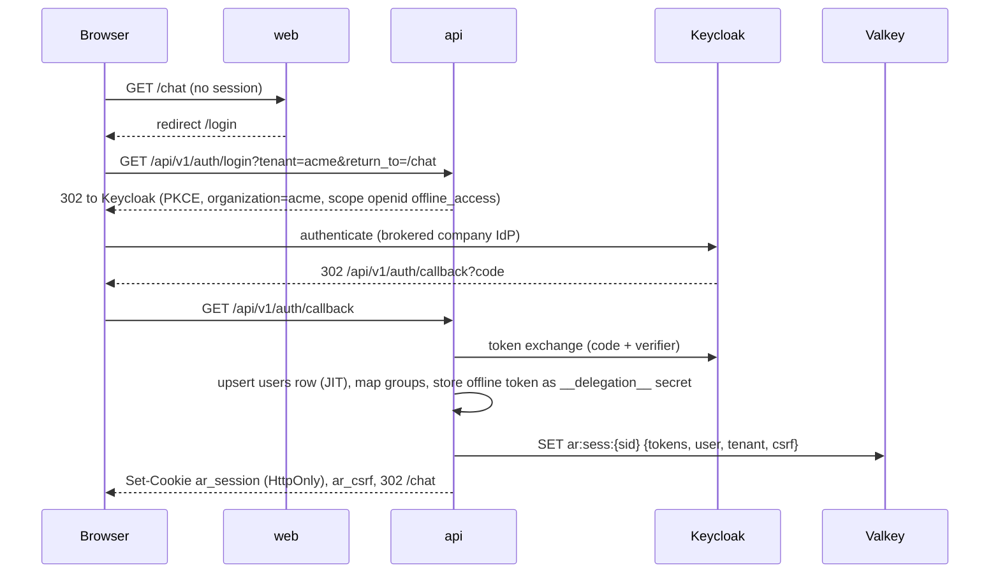
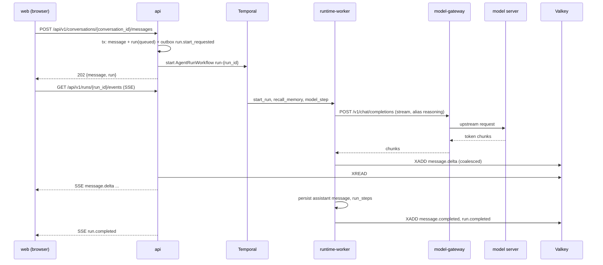
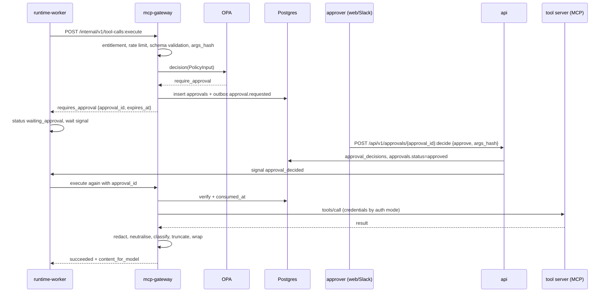
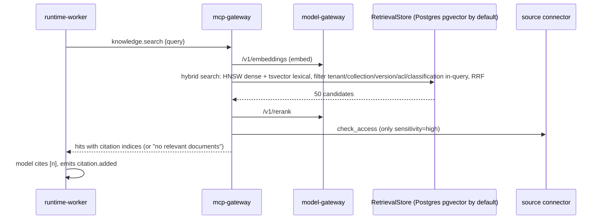
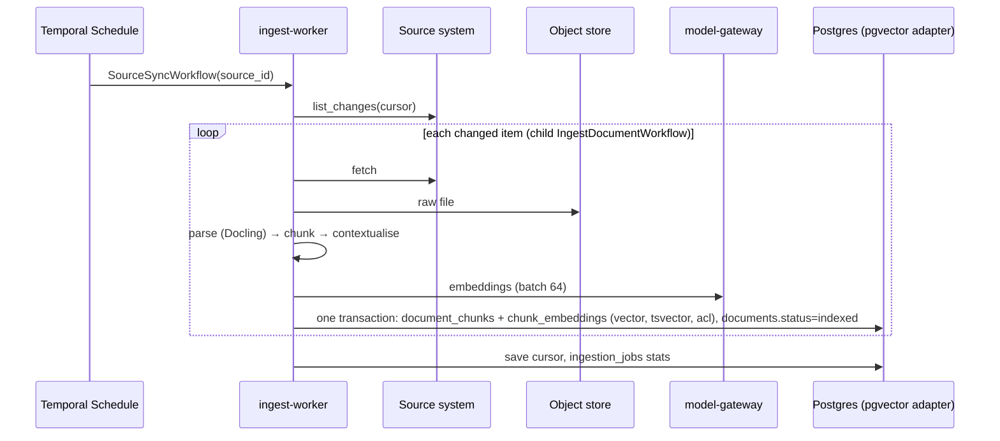
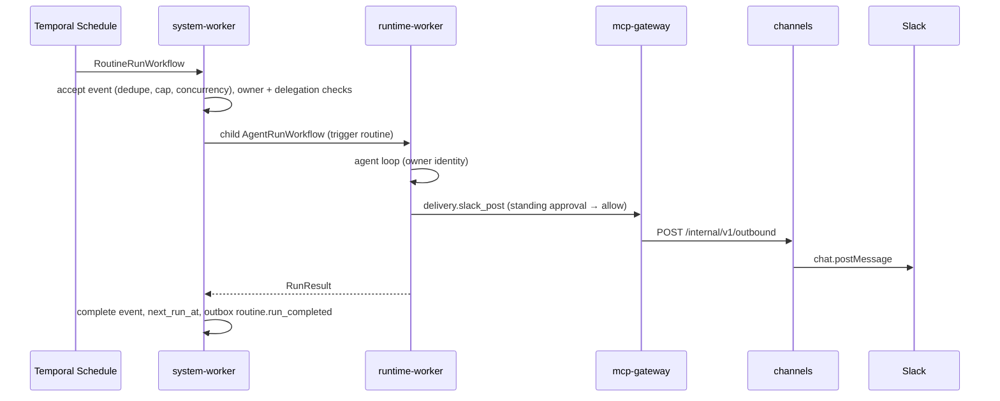
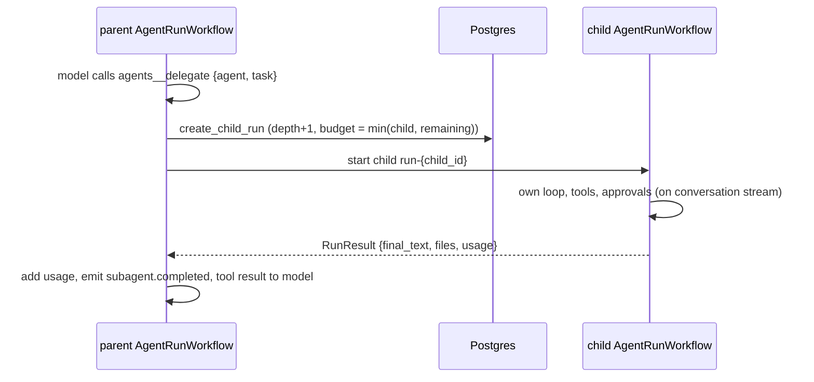
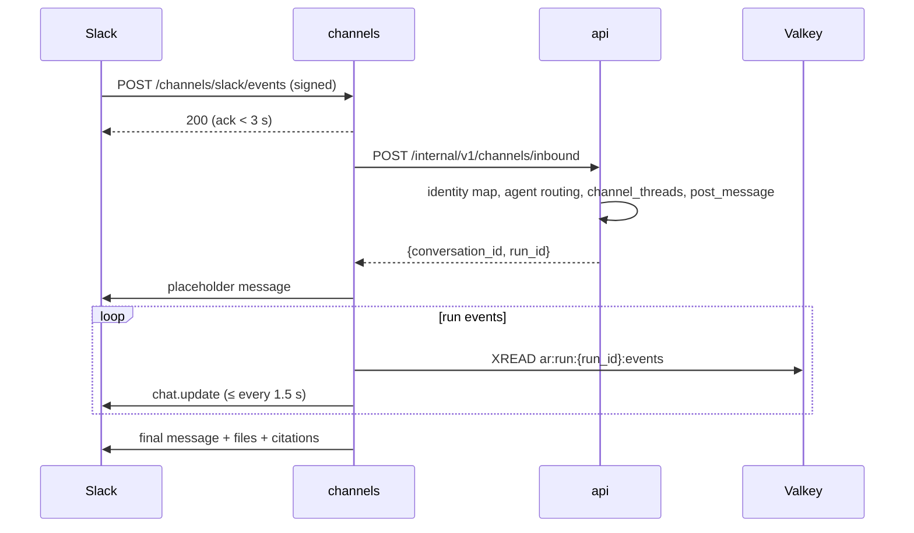
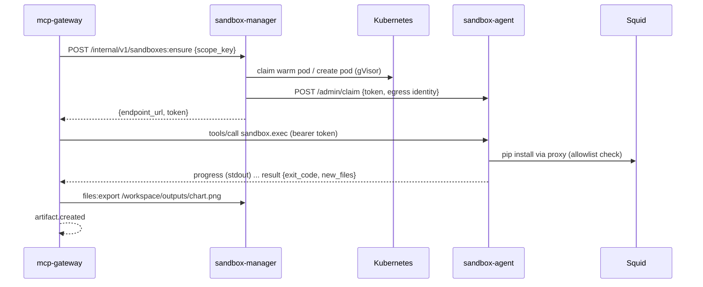

# Request flows

Sequence diagrams for the main flows. Endpoint and table names are those of the specs linked in each section.

## 1. Login (BFF)

Specs: [spec 01](../03-specs/01-api-bff.md), [spec 02](../03-specs/02-identity-tenancy.md).

## 2. Chat turn with streaming

Specs: [spec 06](../03-specs/06-conversations-runs.md), [spec 07](../03-specs/07-agent-runtime.md).

## 3. Tool call requiring approval

Specs: [spec 08](../03-specs/08-tool-registry-mcp.md), [spec 09](../03-specs/09-policy-approvals.md).

## 4. Knowledge-grounded answer (RAG)

Specs: [spec 10](../03-specs/10-knowledge.md).

## 5. Document ingestion

Specs: [spec 10 §4](../03-specs/10-knowledge.md#4-ingestion-workflows-ingest-worker).

## 6. Routine run with delivery

Specs: [spec 15](../03-specs/15-routines-triggers.md).

## 7. Subagent delegation

Specs: [spec 07 §7](../03-specs/07-agent-runtime.md#7-subagents-agentsdelegate).

## 8. Slack message

Specs: [spec 16](../03-specs/16-channels.md).

## 9. Sandbox code execution

Specs: [spec 12](../03-specs/12-sandbox-manager.md).

