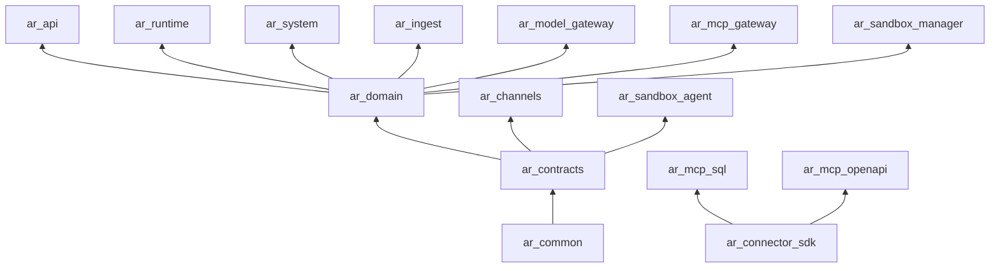

# Service decomposition and repository layout

This file is the **canonical list of deployables, packages and domain modules**. Every other document uses exactly these names. If you add a module or service, add it here first.

Architecture style: a **modular monolith with several deployables** ([ADR-0001](adr/ADR-0001-modular-monolith.md)). All Python business logic lives in one domain library (`ar_domain`) organised into modules with explicit boundaries; deployables are thin processes that host HTTP endpoints or Temporal workers on top of it. One Postgres database, one schema (`public`), one Alembic history.

## 1. Deployables

| Deployable (k8s Deployment / Compose service) | Package (Python import name) | Source path | Kind | Responsibility | Talks to |
|---|---|---|---|---|---|
| `web` | `@ar/web` | `apps/web` | Next.js server | All user and admin screens; server components call `api`; browser calls `/api/*` (same origin). No business logic. | `api` |
| `api` | `ar_api` | `services/api` | FastAPI (HTTP) | Public REST API `/api/v1/*`, SSE run streams, BFF login/session, SCIM, inbound webhooks (`/api/v1/hooks/*`), OPA bundle endpoint, internal endpoints used by other services (`/internal/v1/*`). Starts Temporal workflows. | Postgres, Valkey, Temporal, S3, Keycloak, secrets backend, `model-gateway` (for test calls) |
| `runtime-worker` | `ar_runtime` | `services/runtime` | Temporal worker, task queue `ar-runtime` | Agent loop: `AgentRunWorkflow` (turns, subagents), context assembly, model calls, tool-call orchestration, approvals waits, compaction, streaming events. | Postgres, Valkey, Temporal, `model-gateway`, `mcp-gateway`, OPA |
| `system-worker` | `ar_system` | `services/system` | Temporal worker, task queues `ar-system`, `ar-eval` | Routines (`RoutineRunWorkflow`), memory extraction, retention sweeps, erasure, usage rollups, outbox relay, outbound webhook delivery, evaluation runs, sandbox reaping, notification fan-out. | Postgres, Valkey, Temporal, S3, `model-gateway`, `sandbox-manager`, `channels` |
| `ingest-worker` | `ar_ingest` | `services/ingest` | Temporal worker, task queue `ar-ingest` | Knowledge ingestion: connector sync, parsing (Docling), chunking, enrichment, embedding, indexing through the `RetrievalStore` port (pgvector by default, Qdrant optional), ACL sync, tombstones, re-index. | Postgres, S3, Qdrant (optional), `model-gateway`, secrets backend, source systems |
| `model-gateway` | `ar_model_gateway` | `services/model_gateway` | FastAPI (HTTP, internal) | OpenAI-compatible endpoint `/v1/chat/completions`, `/v1/embeddings`, `/v1/rerank`, `/v1/models`; alias resolution per tenant, routing, fallbacks, circuit breakers, quotas, metering. | Postgres (read), Valkey, upstream engines (vLLM, TEI, any OpenAI-compatible endpoint) |
| `mcp-gateway` | `ar_mcp_gateway` | `services/mcp_gateway` | FastAPI (HTTP, internal) + MCP client | Single choke point for every tool call: catalogue resolution, schema validation, policy re-check, approval verification, credential injection, MCP `tools/call` to upstream servers, built-in tools, result redaction/truncation/offload, metering, audit. | Postgres, Valkey, S3, OPA, secrets backend, Keycloak (token exchange), `sandbox-manager`, MCP servers |
| `sandbox-manager` | `ar_sandbox_manager` | `services/sandbox_manager` | FastAPI (HTTP, internal) | Allocates, resumes, suspends and destroys sandboxes ("computers"); warm pools; drivers `docker` and `kubernetes`; workspace volumes and snapshots; egress allowlists. | Postgres, Kubernetes API or Docker, S3 |
| `sandbox-agent` | `ar_sandbox_agent` | `services/sandbox_agent` | MCP server inside every sandbox (port 8080) | Executes code (python, bash, node), file operations, headless browser (Playwright) inside the sandbox. Ships in the image `ar-sandbox`. | Local filesystem, egress proxy |
| `channels` | `ar_channels` | `services/channels` | Async process (+ small HTTP server) | Slack (Socket Mode), Microsoft Teams (HTTP endpoint), email (IMAP poll + SMTP); maps external users and threads to conversations; renders approval cards; delivers routine outputs. | `api` (internal endpoints), Valkey, Slack/Teams/mail servers |
| `mcp-sql` | `ar_mcp_sql` | `connectors/mcp_sql` | MCP server (connector runtime) | Read-only text-to-SQL tools over registered `data_connections` with the sqlglot safety core. | Target databases, secrets backend (via injected credentials) |
| `mcp-openapi` | `ar_mcp_openapi` | `connectors/mcp_openapi` | MCP server (connector runtime) | Exposes operations of a registered OpenAPI document as MCP tools. | Target internal APIs |
| `fake-llm` | `ar_fake_llm` | `services/fake_llm` | FastAPI (dev/test only) | Deterministic OpenAI-compatible chat/embeddings/rerank server driven by scripts, used by tests, CI and local development without GPUs. Never deployed to production. | none |
| `migrate` (Job) | `ar_domain.migrations` | `libs/ar_domain` | One-shot job | Runs `alembic upgrade head` and seeds system roles/plans before a release rolls out. | Postgres |
| `opa` | (upstream image) | `policies/` (Rego) | OPA server | Evaluates the `ar.policy` Rego package (`policies/rego/ar/policy.rego`, decision `data.ar.policy.decision`); pulls bundle `GET /internal/v1/opa/bundles/ar.tar.gz` from `api`. | `api` |

Third-party runtime dependencies (not built by us): Postgres (+ pgvector), Valkey, Temporal, Qdrant (optional retrieval backend, off by default), Keycloak, OPA, OpenBao/Vault, S3 store, OpenTelemetry Collector, Langfuse, Prometheus/Tempo/Loki/Grafana, vLLM/TEI, Squid egress proxy.

## 2. Libraries

| Library | Path | Responsibility | May depend on |
|---|---|---|---|
| `ar_common` | `libs/ar_common` | Settings base, logging, OpenTelemetry bootstrap, error types, ids (UUIDv7), time, canonical JSON hashing, pagination cursors, internal JWT sign/verify, HTTP client factory, Valkey client factory, S3 client wrapper. No DB models. | third-party only |
| `ar_contracts` | `libs/ar_contracts` | Pydantic models that cross process boundaries: definition schemas (Agent, ToolServer, Routine, Policy, Skill, KnowledgeSource, Bundle), stream events, internal service request/response models, domain event payloads. Exports JSON Schema for TS. | `ar_common` |
| `ar_domain` | `libs/ar_domain` | All SQLAlchemy models, repositories and domain services, organised by module (section 3). Owns Alembic migrations. | `ar_common`, `ar_contracts` |
| `ar_connector_sdk` | `libs/ar_connector_sdk` | Public SDK for customers to build MCP tool servers and knowledge connectors that plug into the platform (auth helpers, context headers, ACL-aware document emission, test harness). | `mcp`, `pydantic` |
| `ar_client` | `libs/ar_client` | Generated public Python SDK for `/api/v1` (openapi-python-client). Generated code only. | generated |
| `ar_testing` | `libs/ar_testing` | Shared pytest fixtures: testcontainers (Postgres, Valkey, Qdrant for the optional adapter's conformance run), the `retrieval_store` conformance fixture, tenant/user factories, Temporal test env, fake-llm scripts, auth helpers. Dev dependency only. | all of the above |

TypeScript packages:

| Package | Path | Responsibility |
|---|---|---|
| `@ar/web` | `apps/web` | The web application. |
| `@ar/api-client` | `packages/api-client` | Generated client + TanStack Query hooks from `openapi.json`, plus generated stream event types from `ar_contracts` JSON Schema. Also published as the public TypeScript SDK. |
| `@ar/tsconfig` | `packages/tsconfig` | Shared `tsconfig` bases. |

Layering (enforced by import-linter, see [08-quality/coding-standards-python.md](../08-quality/coding-standards-python.md)):



Arrows point from dependency to dependant. Services never import other services. `ar_channels` and `ar_sandbox_agent` do **not** import `ar_domain` (they have no DB access); they talk to `api` / are called over HTTP.

## 3. Domain modules (`ar_domain.<module>`)

Each module has `models.py` (SQLAlchemy), `schemas.py` (Pydantic DTOs for the public API), `repository.py` (queries; always tenant-scoped), `service.py` (business rules, emits audit and outbox events), `errors.py`. Public API routers in `ar_api.routers.<module>` call only `service.py`.

| Module | Owns tables (see [04-data/schema.md](../04-data/schema.md)) | Spec |
|---|---|---|
| `identity` | `tenants`, `tenant_domains`, `identity_providers`, `users`, `groups`, `group_members`, `teams`, `team_members`, `roles`, `role_assignments`, `service_accounts`, `api_keys`, `scim_tokens`, `invitations`, `support_access_grants`, `plans` | [02-identity-tenancy](../03-specs/02-identity-tenancy.md) |
| `secrets` | `secret_refs`, `encrypted_secrets`, `credential_providers`, `credential_grants` | [03-secrets-credentials](../03-specs/03-secrets-credentials.md) |
| `models` | `model_providers`, `models`, `model_aliases` | [04-model-gateway](../03-specs/04-model-gateway.md) |
| `agents` | `agents`, `agent_versions`, `agent_version_bindings` | [05-agent-registry](../03-specs/05-agent-registry.md) |
| `conversations` | `conversations`, `conversation_shares`, `messages`, `message_feedback` | [06-conversations-runs](../03-specs/06-conversations-runs.md) |
| `runs` | `runs`, `run_steps`, `run_events` | [06-conversations-runs](../03-specs/06-conversations-runs.md), [07-agent-runtime](../03-specs/07-agent-runtime.md) |
| `tools` | `tool_servers`, `tool_server_versions`, `tools`, `tool_versions`, `tool_calls`, `data_connections` | [08-tool-registry-mcp](../03-specs/08-tool-registry-mcp.md) |
| `policy` | `policies`, `policy_versions` | [09-policy-approvals](../03-specs/09-policy-approvals.md) |
| `approvals` | `approvals`, `approval_decisions`, `standing_approvals` | [09-policy-approvals](../03-specs/09-policy-approvals.md) |
| `knowledge` | `knowledge_collections`, `knowledge_sources`, `documents`, `document_chunks`, `ingestion_jobs` | [10-knowledge](../03-specs/10-knowledge.md) |
| `memory` | `memory_facts` | [11-memory](../03-specs/11-memory.md) |
| `sandboxes` | `sandbox_templates`, `sandboxes` | [12-sandbox-manager](../03-specs/12-sandbox-manager.md) |
| `files` | `files` | [13-files-artifacts](../03-specs/13-files-artifacts.md) |
| `skills` | `skills`, `skill_versions` | [14-skills](../03-specs/14-skills.md) |
| `routines` | `routines`, `routine_events` | [15-routines-triggers](../03-specs/15-routines-triggers.md) |
| `channels` | `channel_integrations`, `channel_identities`, `channel_threads` | [16-channels](../03-specs/16-channels.md) |
| `audit` | `audit_events` | [17-audit-usage-metering](../03-specs/17-audit-usage-metering.md) |
| `usage` | `usage_events`, `usage_daily`, `quotas` | [17-audit-usage-metering](../03-specs/17-audit-usage-metering.md) |
| `evals` | `eval_suites`, `eval_cases`, `eval_runs`, `eval_results` | [18-observability-eval](../03-specs/18-observability-eval.md) |
| `events` | `outbox_events`, `outbound_webhooks`, `webhook_deliveries`, `notifications`, `idempotency_keys` | [20-notifications-events](../03-specs/20-notifications-events.md) |

Cross-module rule: a module may call another module's `service.py` but never its `repository.py` or models directly (exception: read-only joins declared in the owning module's repository as named query functions).

## 4. Repository layout

```text
agentic_runtime/
├── README.md, AGENTS.md
├── docs/                         # this specification set
├── pyproject.toml                # uv workspace root (members: libs/*, services/*, connectors/*)
├── uv.lock
├── package.json, pnpm-workspace.yaml, pnpm-lock.yaml, turbo.json, biome.json
├── compose.yaml                  # local stack (see docs/07-ops/local-dev.md)
├── Makefile                      # task entry points (make dev, make test, make gen, ...)
├── lefthook.yml
├── .github/workflows/            # CI (see docs/07-ops/ci-cd.md)
├── apps/web/                     # Next.js app
├── packages/api-client/          # generated TS client
├── packages/tsconfig/
├── libs/ar_common/  libs/ar_contracts/  libs/ar_domain/  libs/ar_connector_sdk/  libs/ar_client/  libs/ar_testing/
├── services/api/  services/runtime/  services/system/  services/ingest/
├── services/model_gateway/  services/mcp_gateway/  services/sandbox_manager/  services/sandbox_agent/
├── services/channels/  services/fake_llm/
├── connectors/mcp_sql/  connectors/mcp_openapi/
├── policies/rego/ar/             # Rego: policy.rego, jsonpath.rego + *_test.rego (opa test policies/)
├── images/                       # Dockerfiles: python-service.Dockerfile, web.Dockerfile, sandbox/Dockerfile, squid/ (egress proxy + ar-egress-helper), ingest/ (adds LibreOffice, OCR models)
├── deploy/helm/agentic-runtime/  # umbrella chart
├── deploy/compose/               # compose overrides, keycloak realm export, seed data
├── evals/                        # golden datasets, red-team corpus (YAML)
└── scripts/                      # dev scripts (gen-openapi, seed, reset-db)
```

Each Python project under `libs/`, `services/`, `connectors/` uses a `src/` layout: `services/api/src/ar_api/...`, tests in `services/api/tests/{unit,integration}`.

## 5. Process ↔ Temporal task queues

| Task queue | Worker | Workflows |
|---|---|---|
| `ar-runtime` | `runtime-worker` | `AgentRunWorkflow` (chat turns, API runs, subagents as child workflows) |
| `ar-system` | `system-worker` | `RoutineRunWorkflow`, `MemoryExtractionWorkflow`, `RetentionSweepWorkflow`, `ErasureWorkflow`, `TenantProvisioningWorkflow`, `TenantDeletionWorkflow`, `UsageRollupWorkflow`, `OutboxRelayWorkflow`, `WebhookDeliveryWorkflow`, `SandboxReaperWorkflow`, `NotificationFanoutWorkflow`, `AuditExportWorkflow`, `ToolDriftCheckWorkflow`, `RoutinePollWorkflow` |
| `ar-eval` | `system-worker` | `EvalRunWorkflow` |
| `ar-ingest` | `ingest-worker` | `SourceSyncWorkflow`, `IngestDocumentWorkflow`, `AclSyncWorkflow`, `ReindexCollectionWorkflow`, `DeleteDocumentWorkflow`, `FileProcessWorkflow`, `MigrateRetrievalStoreWorkflow`, `RetrievalStoreAuditWorkflow` (qdrant adapter only) |

Workflow ids are deterministic (see each spec), which gives idempotent starts.

## 6. Ports (local development)

| Service | Port |
|---|---|
| web | 3000 |
| api | 8000 |
| model-gateway | 8001 |
| mcp-gateway | 8002 |
| sandbox-manager | 8003 |
| channels | 8004 |
| mcp-sql | 8010 |
| mcp-openapi | 8011 |
| fake-llm | 8099 |
| sandbox-agent (inside sandbox) | 8080 |
| runtime-worker (health) | 8012 |
| system-worker (health) | 8013 |
| ingest-worker (health) | 8014 |
| Postgres | 5432 |
| Valkey | 6379 |
| Temporal gRPC / UI | 7233 / 8233 |
| Keycloak | 8180 |
| Qdrant HTTP / gRPC (optional compose profile `qdrant`) | 6333 / 6334 |
| SeaweedFS S3 | 8333 |
| OpenBao | 8200 |
| OPA | 8181 |
| Langfuse | 3100 |
| OTel Collector OTLP gRPC / HTTP | 4317 / 4318 |
| Grafana | 3001 |
| Squid egress proxy | 3128 |
| Mailpit (SMTP / UI) | 1025 / 8025 |

The host side of each port is `${VAR:-default}` in `compose.yaml`. Defaults are the numbers above. `AR_PORT` is the API. Database ports keep the container port fixed and only the host mapping moves. See [local-dev host ports](../07-ops/local-dev.md#5-host-ports).

## 7. Records module and packs

`ar_domain.records` owns the immutable evidence store, legal holds, retention schedules, disposition certificates and binders ([spec 21](../03-specs/21-records-governance.md)). It is added by M14, not by M1. Guest tables stay in `ar_domain.identity` and are also M14.

Solution packs live in `packs/<pack_id>/` (package `ar_pack_<pack_id>`). They are optional workspace members. Core projects do not import them ([extension-framework](../05-contracts/extension-framework.md)). Workflows added with records, on queue `ar-system`: `EvidenceCaptureWorkflow`, `RetentionScheduleWorkflow`, `BinderBuildWorkflow`, `RunRecordSealWorkflow`.
