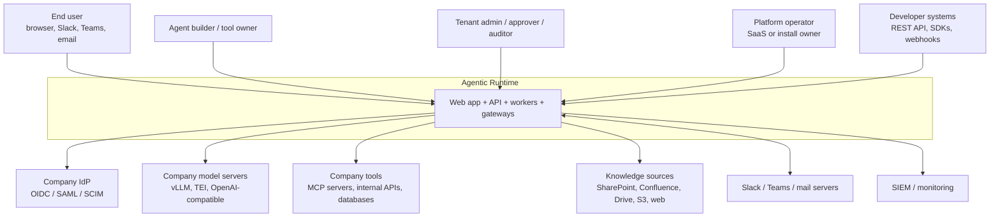
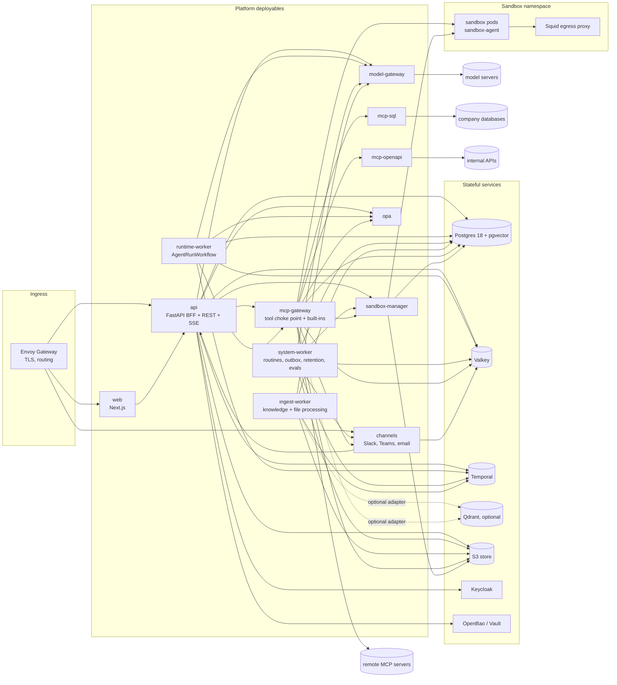

# System context and containers

Product: **Agentic Runtime**, a web platform where companies define agents (persona, instructions, model, tools, knowledge, memory, policies, routines, skills, channels, sandboxes) and their people chat with them. Agents plan, call tools, run code, browse, create files, remember, delegate to subagents and run unattended routines, all on the company's infrastructure and models. Names of deployables are canonical in [service-decomposition.md](service-decomposition.md).

## 1. System context

Trust boundaries: (1) internet/corporate network → ingress (TLS, WAF optional); (2) platform services ↔ data stores (mTLS optional, NetworkPolicies); (3) platform → sandboxes (untrusted code; egress via proxy only); (4) platform → tool servers and model servers (credentials minted per call); (5) tenant ↔ tenant (RLS, payload filters, namespaces). Threats per boundary: [threat-model](../06-security/threat-model.md).

## 2. Containers

Observability sidecars are omitted: every deployable exports OTLP to the OpenTelemetry Collector ([spec 18](../03-specs/18-observability-eval.md)).

## 3. Key properties

| Property | How |
|---|---|
| Durability | Every run is a Temporal workflow; activities idempotent ([ADR-0003](adr/ADR-0003-temporal-durable-runs.md)). |
| Single enforcement point for tools | `mcp-gateway` ([ADR-0006](adr/ADR-0006-mcp-tool-protocol.md)). |
| Tenant isolation | RLS (including knowledge vectors in `chunk_embeddings`) + mandatory tenant filters in every `RetrievalStore` query + per-tenant object prefixes + sandbox network isolation ([tenancy-isolation](tenancy-isolation.md)). |
| Company-hosted models | `model-gateway` only calls registered providers; no internet egress from the model namespace. |
| Two deployment modes | Same images; `AR_DEPLOYMENT_MODE` ([deployment-modes](../00-overview/deployment-modes.md)). |

Request-level sequences: [request-flows.md](request-flows.md).
