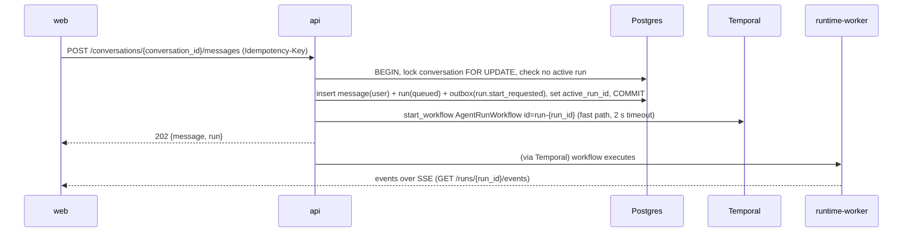
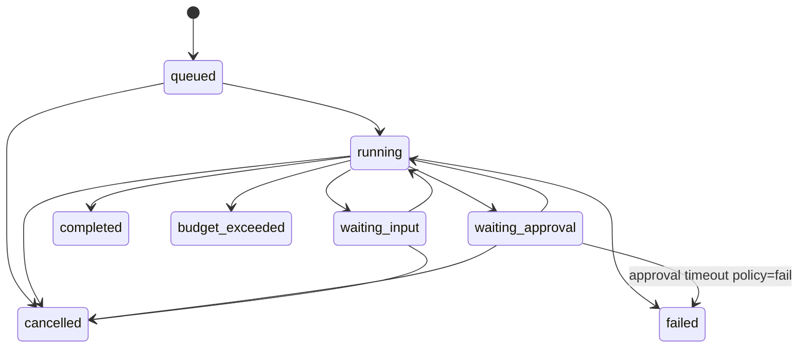

# Spec 06: Conversations, messages and runs API (`ar_domain.conversations`, `ar_domain.runs`)

Hosted in `api`. Owns `conversations`, `conversation_shares`, `messages`, `message_feedback`, `runs`, `run_steps`, `run_events` ([schema §5](../04-data/schema.md#5-conversations-messages-runs-ar_domainconversations-ar_domainruns)); `tool_calls` are written by the runtime/tool module ([spec 08](08-tool-registry-mcp.md)) and read here. The run loop itself is [spec 07](07-agent-runtime.md). Stream contract: [stream-events.md](../05-contracts/stream-events.md). PRD: [04-chat](../01-prd/04-chat.md), [05-runs-subagents](../01-prd/05-runs-subagents.md).

## 1. Responsibilities

1. Conversation lifecycle (create, list, search, rename, pin, archive, soft delete, share read-only, export).
2. Accept user messages and start runs reliably (transactional outbox + fast path).
3. Message branching (edit and regenerate create sibling branches; one active branch per conversation).
4. Run read API (detail, steps, tool calls, children), cancellation, input for `waiting_input`, programmatic run creation (`trigger='api'`).
5. SSE endpoints for run and conversation streams.
6. Feedback on assistant messages.

## 2. Access rules

- Conversation owner (`conversations.user_id`) has full access. Shared principals have `view` (read messages, open runs, see artifacts; cannot post).
- `conversations:read_all` (no default role; auditor-type custom roles only) allows read of any conversation; every such read writes audit `conversation.read_privileged`.
- A run is visible if its conversation is visible, or the caller is `runs.user_id`, or (routine runs without conversation) the caller owns the routine or has `routines:manage_all`.
- Posting requires `chat:use`, visibility of the agent and agent not disabled.

## 3. Message posting and run start

Rules (`conversations.service.post_message`):
1. If `conversations.active_run_id` is non-terminal → 409 `run_in_progress` (the UI disables the composer; the user may cancel first). Exception: `interrupt: true` in the body cancels the active run (signal `cancel`) and then proceeds.
2. Attachments: every `file_id` must belong to the caller (or the conversation) and be `status='ready'`; file parts are copied as `ContentPart{type:"file"}`.
3. The agent version: `conversations.agent_version_id` if pinned (draft testing in the builder), else the agent's `published_version_id` at this moment (recorded in `runs.agent_version_id`).
4. Budget: `definition.budget` merged with tenant caps (minimum wins) → `runs.budget`.
5. Title: if the conversation has no title, a `system-worker`-free inline step inside the run (`finalize` step) sets it with the `fast` alias (≤ 60 chars).

#### GET /api/v1/conversations
Permission `chat:use`. Query: `q` (title trigram + message full-text over the caller's conversations), `agent_id`, `status` (`active|archived`, default `active`), `pinned`, `channel`, `shared_with_me=true`, `include_previews` (default `false`; preview conversations have `is_preview=true` and are created by builders from the AgentBuilder test panel). Sorted by `pinned DESC, last_message_at DESC`. Item `ConversationSummary {id, title, agent: {id, name, avatar_url}, channel, pinned, status, last_message_at, active_run: {id, status}|null, shared: bool}`.

#### POST /api/v1/conversations
Body `{agent_id, agent_version_id?, title?, message?: PostMessageBody}`. `agent_version_id` of a draft requires edit rights on the agent (builder preview) and sets `is_preview=true`; preview conversations are visible only to the agent's editors. When `message` is present, behaves like create + post (response `201 {conversation, message, run}`).

#### GET /api/v1/conversations/{conversation_id}
Response `Conversation` = summary + `{agent_version_id, plan: PlanItem[], classification, retention_class, permissions: {can_post, can_share, can_delete}}`.

#### PATCH /api/v1/conversations/{conversation_id}
Owner. `{title?, pinned?, status?, classification?, retention_class?}`. `retention_class='legal_hold'` requires `tenant:manage`.

#### DELETE /api/v1/conversations/{conversation_id}
Owner. Soft delete (`deleted_at`); hard delete by `RetentionSweepWorkflow` after `tenant.settings.retention.deleted_conversation_days` (default 30). Active run cancelled.

#### GET /api/v1/conversations/{conversation_id}/messages
Query `branch` (`active` default | `all`), `include` (`tool` adds role `tool` messages), cursor pagination ascending by `created_at`, `limit` ≤ 200. Item `Message {id, role, content: ContentPart[], status, parent_message_id, is_active_branch, sibling_ids: uuid[], run_id, model_alias, author: {id, display_name}|null, feedback: {rating}|null, created_at}`.

#### POST /api/v1/conversations/{conversation_id}/messages
Permission `chat:use` + owner. Header `Idempotency-Key` recommended (the web app always sends one). Body `PostMessageBody {content: ContentPart[] (text ≤ 100,000 chars total), attachments?: uuid[] (≤ 20), parent_message_id?: uuid, interrupt?: bool, client_context?: {timezone, locale}}`. Response `202 {message: Message, run: RunSummary}`. Errors: 409 `run_in_progress`, 423 `resource_disabled`, 429 `quota_exceeded`, 403 `forbidden`.

#### POST /api/v1/conversations/{conversation_id}/messages/{message_id}:regenerate
Owner; `message_id` is an assistant message. Marks it and descendants `is_active_branch=false`, starts a new run with the same input message; the new assistant message becomes a sibling (same `parent_message_id`). Response `202 {run}`.

#### POST /api/v1/conversations/{conversation_id}/messages/{message_id}:edit
Owner; `message_id` is a user message. Body `{content, attachments?}`. Creates a sibling user message (same parent), deactivates the old branch, starts a run. Response `202 {message, run}`.

#### POST /api/v1/conversations/{conversation_id}/messages/{message_id}:activate
Owner. Switches the active branch to the branch containing `message_id` (recomputes `is_active_branch` along the path). Response `204`.

#### PUT /api/v1/messages/{message_id}/feedback
Any viewer of the conversation. Body `{rating: "up"|"down", reasons?: [...], comment?}`. Upserts `message_feedback`; emits `feedback.created` (consumed by eval: "add to dataset" suggestions, [spec 18](18-observability-eval.md)).

#### DELETE /api/v1/messages/{message_id}/feedback

#### GET /api/v1/conversations/{conversation_id}/events
SSE, conversation stream ([stream-events §2](../05-contracts/stream-events.md#2-sse-framing-and-resume)).

#### GET /api/v1/conversations/{conversation_id}/shares
Owner. Items `{principal_type, principal_id, display_name, permission, created_at}`.

#### POST /api/v1/conversations/{conversation_id}/shares
Owner, if `tenant.settings.chat.allow_sharing` (default true) and classification ≠ `restricted`. Body `{principal_type, principal_id}`. Emits notification `conversation_shared` to the principal(s).

#### DELETE /api/v1/conversations/{conversation_id}/shares/{principal_type}/{principal_id}

#### GET /api/v1/conversations/{conversation_id}/export
Viewer. Query `format=markdown|json`. Returns the active branch with artifacts as links. Audit `conversation.exported`.

#### POST /api/v1/runs
Programmatic run (API channel). Permission `chat:use` (service accounts need it via role). Body `CreateRunBody {agent_id, input: ContentPart[] | string, conversation_id?: uuid, attachments?, metadata?: object (≤ 4 KiB), stream?: bool, wait?: bool, callback_url?: https URL, notify?: bool, on_behalf_of_user_id?: uuid}`. `callback_url` and `notify` are stored in `runs.callback_url` / `runs.notify_on_complete`.
- Without `conversation_id` a new conversation with `channel='api'` is created (owner = caller, or `on_behalf_of_user_id` when the caller is a service account with `service_accounts.allow_on_behalf_of=true`).
- `stream=true` → response is the SSE stream of the run directly. `wait=true` → blocks up to 120 s then returns `200 Run` (or `202 Run` if still running). Default → `202 RunSummary`.
- `callback_url` → on completion a signed POST (same signing as outbound webhooks, tenant run-callback secret, [spec 20 §3.1](20-notifications-events.md#31-run-callback-secret)) with `Run` body. `notify: true` → in-app notification `run_completed` to the run user.
Response `RunSummary {id, conversation_id, agent_id, agent_version_id, status, trigger, created_at}`.

#### GET /api/v1/runs
Query `agent_id`, `status`, `trigger`, `routine_id`, `conversation_id`, `user_id` (requires `conversations:read_all` or `agents:manage_all` for others), `created_after`, `created_before`. Default lists the caller's runs. Item `RunSummary` + `{usage: RunUsage, duration_ms, error_code}`.

#### GET /api/v1/runs/{run_id}
Response `Run {..., budget: RunBudget, usage: RunUsage {steps, tokens_in, tokens_out, cached_tokens, cost_micros, tool_calls, wall_clock_ms}, parent_run_id, root_run_id, depth, result_summary, error, trace_id, trace_url (Grafana/Tempo link if `AR_TRACE_UI_URL` set), langfuse_url?, started_at, ended_at}`.

#### GET /api/v1/runs/{run_id}/steps
Items `RunStep {id, seq, kind, status, model_alias, tokens_in, tokens_out, cached_tokens, latency_ms, detail, started_at, ended_at}`. `detail` never contains raw prompts; for `model_call` it has `{finish_reason, tool_call_count}`; for `compaction` `{tokens_before, tokens_after}`; for `delegation` `{child_run_id}`.

#### GET /api/v1/runs/{run_id}/tool-calls
Items `ToolCall {id, qualified_name, risk_class, status, policy_decision, policy_reasons, approval_id, arguments_redacted, result_preview, result_file_id, is_error, error, latency_ms, started_at, ended_at}`.

#### GET /api/v1/runs/{run_id}/children
Child runs (subagents) summary list.

#### GET /api/v1/runs/{run_id}/events
SSE run stream. Query `after_seq`; header `Last-Event-ID`. With `Accept: application/json` returns the persisted `run_events` page (cursor by seq) for replay/inspection.

#### POST /api/v1/runs/{run_id}:cancel
Owner of the run, conversation owner, routine owner, or `agents:manage_all`. Sends Temporal signal `cancel {reason, by}`; returns `202`. Idempotent; terminal runs → `200` unchanged.

#### POST /api/v1/runs/{run_id}:input
Run user only, run `status='waiting_input'`. Body `{request_id, action: "accept"|"decline"|"cancel", content?: object}` (MCP elicitation response shape). Sends signal `user_input`. Errors 409 `invalid_state`.

## 4. Run status transitions (owned by the runtime; read here)

Terminal: `completed`, `failed`, `cancelled`, `budget_exceeded`. On terminal: `conversations.active_run_id = NULL`, `runs.ended_at`, outbox `run.completed|run.failed|run.cancelled` (public topics).

## 5. Events and audit

Outbox topics: `run.start_requested` (internal), `run.completed`, `run.failed`, `run.cancelled`, `conversation.shared`, `feedback.created`. Audit: `conversation.deleted`, `conversation.shared`, `conversation.unshared`, `conversation.exported`, `conversation.read_privileged`, `run.cancelled`, `run.created_api`.

## 6. Limits

| Limit | Default | Config |
|---|---|---|
| Concurrent active top-level runs per user | 5 | `tenant.settings.limits.max_active_runs_per_user` |
| Concurrent active runs per tenant | plan `max_concurrent_runs` (default 100) | plan |
| Message text | 100,000 chars | `AR_MAX_MESSAGE_CHARS` |
| Attachments per message | 20 | |
| Conversations per user | unlimited | |

Exceeding concurrency → 429 `rate_limited` with `Retry-After: 5`.

## 7. Failure modes

| Failure | Behaviour |
|---|---|
| Fast-path workflow start fails | Response still 202 (run `queued`); `OutboxRelayWorkflow` starts it within ~5 s. |
| Workflow already exists (duplicate) | Treated as success. |
| Run stuck `queued` > 60 s | Alert `ARRunsStuckQueued` ([runbooks](../07-ops/runbooks.md#rb-03-runs-stuck-in-queued)). |
| SSE client disconnect | No effect on the run. |

## 8. Metrics

`ar_runs_started_total{trigger}`, `ar_runs_finished_total{trigger,status}`, `ar_run_duration_seconds{trigger}`, `ar_run_start_latency_seconds` (message accepted → `run.started`), `ar_messages_posted_total{channel}`, `ar_feedback_total{rating}`.

## 9. Test plan

- Unit: branch activation algorithm (tree property tests), budget merge, access predicate table.
- Integration: post → 202 → run row + outbox in same transaction (fault injection: Temporal down → relay starts later); idempotent post with same key returns same response; second post while active → 409; interrupt cancels; regenerate/edit produce siblings; share read-only (viewer post → 403); privileged read writes audit; `/runs` with `wait=true` against `fake-llm`.
- E2E (Playwright): send message, observe streaming tokens, cancel mid-stream, regenerate, switch branch, thumbs-down with reason.
