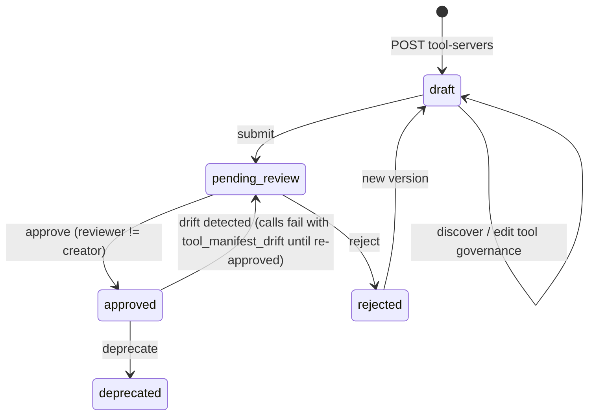
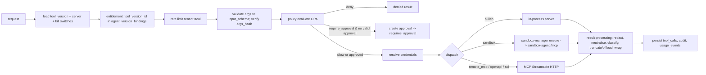

# Spec 08: Tool registry, data connections and MCP host (`ar_domain.tools`, `mcp-gateway`)

Registry endpoints are served by `api`. Execution is done by `mcp-gateway` (`services/mcp_gateway`, package `ar_mcp_gateway`, port 8002), the **only** component that talks to tool servers. The connector runtimes `mcp-sql` and `mcp-openapi` were removed (§10–§11). Owns `data_connections`, `tool_servers`, `tool_server_versions`, `tools`, `tool_versions`, `tool_calls` ([schema §6](../04-data/schema.md#6-tools-ar_domaintools)). Contract: [mcp-integration.md](../05-contracts/mcp-integration.md), [internal-apis §3](../05-contracts/internal-apis.md#3-mcp-gateway-base-httpmcp-gateway8002). Decision: [ADR-0006](../02-architecture/adr/ADR-0006-mcp-tool-protocol.md). PRD: [02-tool-registry](../01-prd/02-tool-registry.md).

## 1. Responsibilities

1. Register tool servers (`remote_mcp`, `openapi`, `sql`) with versions, discovery, manifest hashing, review (four-eyes), approval, deprecation, kill switches. **As built (2026-11-24):** `remote_mcp` and `openapi` can be registered. `kind=sql` is refused with a message that points to data connections: a customer's database is read through a data connection and the `data.*` tools (§3), and there is no SQL tool server. `openapi` is refused unless the version carries its OpenAPI document or a base URL. An address inside the process (`memory://...`) is accepted only when a pack has registered an endpoint there.
2. Register data connections (SQL) with allowlists, identity mode and limits. From revision `0025` the DSN is ciphertext in `data_connections` and service connections are a tenant table. `data.query` is the read-only tool. See [m23-database](../06-security/m23-database.md).
3. Provide the entitlement-filtered tool catalogue to the runtime (`catalog:resolve`), including semantic tool search.
4. Execute tool calls: validate → policy → approval → credentials → dispatch → result processing → persistence → audit/usage.
5. Host the built-in tool servers in-process (knowledge, memory, files, skills, conversations, web, documents, image) and forward `sandbox`/`browser` tools to the sandbox. Document and image tools are specified in [spec 24](24-documents.md).
6. Detect manifest drift (`ToolDriftCheckWorkflow`).

## 2. Lifecycle

`tool_servers.status` mirrors the latest version's review state; `current_version_id` points at the latest **approved** version. Kill switches (`tool_servers.disabled_at`, `tools.disabled_at`) are orthogonal and take effect within 1 s (Valkey invalidation `ar:invalidate:tool_server:{id}`).

## 3. Public API (served by `api`)

Permissions: `tools:read` (list/get), `tools:create` (create servers/versions; owner may edit own drafts), `tools:review` (approve/reject), `tools:disable` (kill switch). Data connections: `secrets:manage` + `tools:create`.

#### GET /api/v1/tool-servers
Query `q`, `kind`, `status`, `owner=me`, `include_builtin` (default true). Item `ToolServer {id, slug, name, description, kind, scope: "tenant"|"platform", status, disabled, owner: {...}, owner_team, current_version: {id, version}|null, tool_count, updated_at}`.

#### POST /api/v1/tool-servers
`tools:create`. Body `CreateToolServer {slug, name, description?, kind, owner_team_id?, version: {version: "1.0.0", endpoint_url?, config, auth_mode, secret_id?, credential_provider_id?}}`. Validation per kind: `remote_mcp` requires `https` URL (or allowed internal http, [mcp-integration §2](../05-contracts/mcp-integration.md)); `openapi` requires `config.openapi.spec_file_id` (an uploaded `files.kind='openapi_spec'`), `base_url`, `operations[]`; `sql` requires `config.sql.data_connection_id`. For `openapi`/`sql` the `endpoint_url` is set by the platform (`AR_MCP_OPENAPI_URL`, `AR_MCP_SQL_URL`) and `auth_mode` for gateway→connector is `internal_jwt`; the configured auth mode in `config.upstream_auth` applies connector→upstream. Response `ToolServer` + `versions[0]`. Then discovery runs automatically (async via `mcp-gateway` `discover`; status visible on the version).

#### GET /api/v1/tool-servers/{server_id}
#### PATCH /api/v1/tool-servers/{server_id}
Owner or `tools:review`. `{name?, description?, owner_team_id?, owner_user_id?}`.
#### DELETE /api/v1/tool-servers/{server_id}
Allowed if no published agent version binds any of its tool versions (409 otherwise with `where_used`).

#### GET /api/v1/tool-servers/{server_id}/versions
Items `ToolServerVersion {id, version, endpoint_url, auth_mode, review_status, manifest_hash, discovered_at, reviewed_by, reviewed_at, review_notes, created_by, created_at, tool_count, discovery_error?}`.

#### POST /api/v1/tool-servers/{server_id}/versions
`tools:create` (owner). Body like `CreateToolServer.version`; `version` must be greater (semver) than all existing. Copies governance overrides from the previous version for tools with identical `name` and `description_hash`.

#### GET /api/v1/tool-servers/{server_id}/versions/{version_id}
Includes `tools: ToolVersion[]` (`{id, tool_id, name, qualified_name, title, description, input_schema, output_schema, annotations, risk_class, proposed_risk_class, data_classification, timeout_s, rate_limit_per_minute, max_result_bytes, idempotent, approval_preview, changed_since_previous: bool}`) and `manifest_diff` vs the previous approved version.

#### POST /api/v1/tool-servers/{server_id}/versions/{version_id}:discover
Owner. Re-runs discovery for a `pending`/draft version (calls `mcp-gateway` `POST /internal/v1/discover`). Response `{tool_count, manifest_hash, errors: []}`. Errors: 502 `upstream_error` with server message, 504 `upstream_timeout`.

#### PATCH /api/v1/tool-servers/{server_id}/versions/{version_id}/tools/{tool_version_id}
Owner (draft) or reviewer (pending). Body `{risk_class?, data_classification?, timeout_s?, rate_limit_per_minute?, max_result_bytes?, idempotent?, approval_preview?, description_override?}`. `description_override` replaces the model-facing description (reviewed text) and recomputes `description_hash`; the upstream description hash is kept in `annotations._upstream_description_hash` for drift checks. Not allowed on approved versions (create a new version).

#### POST /api/v1/tool-servers/{server_id}/versions/{version_id}:submit
Owner. Requires at least one tool and every tool to have `risk_class` confirmed (proposed classes are pre-filled but must be saved once; the UI does it on "Confirm all"). Notification `tool_review_requested` to holders of `tools:review`; outbox `tool_server.review_requested` (reason `new_version`).

#### POST /api/v1/tool-servers/{server_id}/versions/{version_id}:approve
`tools:review`; reviewer ≠ `created_by` (four-eyes, 403 `forbidden` with reason `four_eyes`), except single-admin installs where `tenant.settings.security.allow_self_review=true` (default false). Body `{notes?}`. Sets `review_status='approved'`, server `status='approved'`, `current_version_id`; computes tool embeddings (async, `embed` alias, `dimensions=1024`) for tool search. Emits `tool_server.review_decided`. Audit.

#### POST /api/v1/tool-servers/{server_id}/versions/{version_id}:reject
`tools:review`. Body `{notes}` (required).

#### POST /api/v1/tool-servers/{server_id}:deprecate
Owner or reviewer. Deprecated servers stay callable by already-published agent versions but cannot be newly bound.

#### POST /api/v1/tool-servers/{server_id}:disable
`tools:disable`. Body `{reason}`. Kill switch: all calls fail with `tool_disabled` immediately. Audit `tool_server.disabled`.

#### POST /api/v1/tool-servers/{server_id}:enable
`tools:disable`.

#### GET /api/v1/tools
Flattened catalogue of approved tools visible to the tenant. Query `q` (keyword), `semantic` (bool, uses embeddings), `server_id`, `risk_class`. Item `ToolSummary {tool_id, tool_version_id, qualified_name, title, description, risk_class, server: {id, slug, name}, disabled}`.

#### GET /api/v1/tools/{tool_id}
Current approved version detail + usage stats (calls 7d, error rate, p95 latency from `tool_calls`).

#### POST /api/v1/tools/{tool_id}:disable
`tools:disable`. Body `{reason}`.
#### POST /api/v1/tools/{tool_id}:enable

#### POST /api/v1/tools/{tool_id}:test
Owner or `tools:review`. Body `{tool_version_id?, arguments, dry_run?: bool}`. Calls `mcp-gateway` `POST /internal/v1/tool-calls:test` as the caller (user credentials apply). W2/W3 tools are refused unless `dry_run=true` and the server advertises dry-run support (`config.supports_dry_run`). Response `{status, result_preview, structured, is_error, latency_ms, policy}`. Recorded as a `tool_calls` row with `run_id` of a synthetic test run (`runs.trigger='api'`, conversation NULL) so audit is uniform.

#### GET /api/v1/tool-calls
`audit:read` or `agents:manage_all`. Query `tool_id`, `agent_id`, `user_id`, `status`, `risk_class`, `created_after`, `created_before`. Item `ToolCall` (redacted, as in [spec 06](06-conversations-runs.md)) + `{run_id, agent_id, user_id}`.

#### GET /api/v1/data-connections
#### POST /api/v1/data-connections
Body `{name, engine, dsn: string (stored as secret) | dsn_secret_id, identity_mode, allowlist: {schemas: [], tables: ["schema.table"], columns_deny: ["schema.table.column"]}, row_limit?, statement_timeout_s?, classification?, schema_notes?}`. The DSN must use a **read-only** database role; `:test` verifies it.
#### GET /api/v1/data-connections/{connection_id}
#### PATCH /api/v1/data-connections/{connection_id}
#### DELETE /api/v1/data-connections/{connection_id}
409 if used by a tool server version.

#### POST /api/v1/data-connections/{connection_id}:test
Runs in `api` (`ar_domain.tools.database.probe`). As specified it checks: connectivity, read-only enforcement (`BEGIN READ ONLY` / attempting `CREATE TEMP TABLE` must fail on engines that support it), allowlisted objects exist. Response `{ok, checks: [{name, ok, detail}]}`.

#### GET /api/v1/data-connections/{connection_id}/schema
Introspected tables/columns within the allowlist (cached 10 min), merged with `schema_notes`.

## 4. `catalog:resolve`

Input `{agent_version_id, user_id, query?, loaded?: [tool_version_id]}` → `{tools: [{model_name: "jira__create_issue", tool_version_id, qualified_name, description, parameters (input_schema), risk_class}], tool_search_active: bool, ranked_by?: "meaning_and_words" | "words"}`.
Steps: read `definition.resolved.tools` → drop disabled tools/servers, tools whose `data_classification` exceeds the user's clearance (`users.attributes.clearance`, default `confidential`), and tools whose server requires `user_oauth` from a provider marked `extra.hide_until_connected=true` that the user has not connected → if tool search active, rank the tools against `query` and return top_k ∪ pinned ∪ `loaded`. Cached in Valkey `ar:catalog:{agent_version_id}:{user_id}` for 60 s.

**Ranking** (`ar_domain/tools/search.py`, used here and by `control.search`). Each tool is matched on its qualified name and description. The score is the cosine between the request and the tool, both embedded with the model the tenant's `embed` alias names, plus half the share of the request's words found in the tool's text. A word is a run of letters and digits in any script. With no embedding model, or when it does not answer, the ranking is by words alone. The result says which was used in `ranked_by`. No vector is made up for a tool.

A search never waits for the catalogue to be embedded, because a provider can take many seconds over a few hundred descriptions. The first search in a process starts that work on a thread of its own and is ranked by words; once the vectors are held, each search costs one embedding call for the request. The vectors are kept in the process's memory, keyed by embedding model and by a hash of the tool's text, so a changed description or a changed model is embedded again. `tool_versions.embedding` is not read or written (OQ-106).

`scripts/tool_search_eval.py --tenant <slug>` ranks one agent's tools, or with `--all` every tool the tenant can search, for 22 requests with the tenant's model and prints where the right tool came out.

## 5. Execution pipeline (`POST /internal/v1/tool-calls:execute`)

Details:
1. **Load**: `tool_versions` by id (cache 5 min, immutable) + server/tool disabled flags (live, Valkey-cached 1 s).
2. **Entitlement**: the tool version must be bound to the run's agent version (`agent_version_bindings kind='tool'`), or be a built-in implicitly allowed (control tools, `files.read` for offloaded results). Else `denied` with reason `not_entitled`.
3. **Rate limit**: token bucket `ar:rl:tool:{tenant_id}:{tool_id}` with `rate_limit_per_minute`; exceeded → `failed` code `tool_rate_limited` (retriable by the model later).
4. **Validation**: JSON Schema 2020-12 (`jsonschema` with format checks); errors are returned to the model as `is_error` with a compact message (no policy evaluation). `args_hash` recomputed (`rfc8785`) and must equal the request's.
5. **Policy**: `ar_domain.policy.service.evaluate(PolicyInput)` → [spec 09](09-policy-approvals.md). Standing approvals are honoured inside policy evaluation.
6. **Approval**: if `require_approval` and no `approval_id`: create `approvals` row (preview rendered from `approval_preview` template + arguments; approver rule from the policy decision), set `tool_calls.status='awaiting_approval'`, outbox `approval.requested`; return `requires_approval`. With `approval_id`: verify `approved`, `consumed_at IS NULL`, `expires_at > now()`, `args_hash` equal, then set `consumed_at`.
7. **Credentials**: by `auth_mode` ([mcp-integration §4](../05-contracts/mcp-integration.md#4-authentication-modes-tool_server_versionsauth_mode)); missing user grant → `credential_required` with `connect_url = {AR_PUBLIC_URL}/connections?provider={slug}`.
8. **Dispatch**: MCP client from the official SDK (`mcp.client.streamable_http`), stateless per call; connection pool per endpoint (`httpx.AsyncClient`, HTTP/2, max 100 connections per host). Progress notifications → relayed to the runtime via the response stream (`text/event-stream` from `tool-calls:execute` when `Accept: text/event-stream`: events `progress`, final `result`). Tasks extension polling as in the contract.
9. **Drift guard**: for remote MCP servers the gateway compares the upstream `tools/list` hash (cached 10 min per server version) to the approved manifest; mismatch → `failed` code `tool_manifest_drift`.
10. **Result processing**: [mcp-integration §7](../05-contracts/mcp-integration.md#7-result-handling-gateway--runtime). **Injection classifier** (when `safety.injection_classifier` and tenant feature on): for results from `openWorldHint=true` tools, `browser.snapshot`, knowledge results from sources with `trust='external'`, call the `fast` alias with `ar_mcp_gateway/prompts/injection_classifier.md` (purpose `classifier`, 1 s budget, fail-open); if flagged, prefix the wrapped result with a warning line and set `tool_calls.error.injection_suspected=true`; audit `tool_result.injection_suspected`.
11. **Persist**: `tool_calls` status, `result_preview` (≤ 2 KiB redacted), `result_file_id`, latency; audit event for risk ≥ W1 (`tool.called` with args hash, not arguments); `usage_events(metric='tool_calls')`.

## 6. Policy input (built by the gateway)

`PolicyInput {tenant_id, tool: {qualified_name, server_slug, risk_class, data_classification, annotations}, agent: {id, slug, risk_tier, overrides}, run: {id, trigger, channel, depth, routine_id}, user: {id, groups[], roles[], attributes}, args: <arguments>, time: {now, weekday, hour_local}, standing_approval_ids: []}` ([spec 09 §3](09-policy-approvals.md#3-policy-evaluation)).

## 7. Discovery (`POST /internal/v1/discover`)

Input `{tool_server_version_id, requested_by_user_id, compare_only?: bool}`. Calls `server/discover` + `tools/list` (remote MCP), or, for `openapi`, derives tools from the imported document. Normalises names, validates schemas, proposes risk classes (annotations; `openapi`: GET/HEAD → `R0`, POST/PUT/PATCH → `W2`, DELETE → `W3`; `sql`: `R1`; remote MCP: `readOnlyHint` → `R0`, otherwise `W2` so the call waits for approval), stores manifest/hash, upserts `tools` + `tool_versions`. `compare_only` returns `{manifest_hash, changed: bool, diff}` without writing (used by drift checks).

M22 adds owner-scoped service connections, OpenAPI import (`POST /api/v1/openapi-imports`), a described HTTP tool (`POST /api/v1/described-tools`) and `POST /api/v1/tool-servers/{id}:refresh`. A remote server may use streamable HTTP, SSE, or stdio inside the general-tool sandbox with network off. Tool results from those servers are untrusted data. See [m22-connections](../06-security/m22-connections.md).

## 8. `ToolDriftCheckWorkflow` (`system-worker`, `ar-system`)

Temporal Schedule `tool-drift-check` hourly (`AR_TOOL_DRIFT_INTERVAL`, default `1h`). For each approved remote MCP server version (batched 50 per activity): `discover(compare_only=true)`; if changed, no new version row is created automatically; instead mark the approved version's server `status='pending_review'`, store diff in `review_notes`, notify owner + reviewers (`tool_review_requested`), outbox `tool_server.review_requested` (reason `manifest_drift`). Workflow id `tool-drift-check-{yyyymmddhh}`.

## 9. Built-in tool schemas (platform servers, executed in-process by `mcp-gateway` unless noted)

| Tool | Input | Output / behaviour |
|---|---|---|
| `knowledge.search` | `{query: string, collections?: [slug], top_k?: 1..`AR_KNOWLEDGE_SEARCH_MAX_HITS` (default definition.knowledge.topK, else `AR_KNOWLEDGE_TOP_K`, 16), filters?: {source_ids?, modified_after?, mime_types?}}` | Hits `[{index, document_id, chunk_id, title, uri, snippet, score, collection}]`; ACL-filtered for the run's user ([spec 10](10-knowledge.md)); registers citation indices with the run |
| `knowledge.get_document` | `{document_id, offset?: int, limit?: int (chars, ≤ 20000)}` | Text page of a document the user can read |
| `knowledge.list_collections` | `{}` | Collections bound to the agent and readable by the user |
| `memory.search` | `{query, scopes?: [user, agent, team, agent_user], top_k?: ≤ 20}` | Facts visible to the run ([spec 11](11-memory.md)) |
| `memory.save` | `{content (≤ 500 chars), scope: user\|agent_user\|agent, category?: preference\|fact\|instruction}` | `agent` scope creates `pending_review` proposals; denied in child runs and when `user_writes=off` |
| `memory.forget` | `{fact_id}` or `{query}` | Deletes the user's own facts (W1) |
| `files.list` | `{scope: conversation\|mine, mime_prefix?}` | Files visible in the conversation / the user's files |
| `files.read` | `{file_id, offset?: int, limit?: int (bytes ≤ 64 KiB)}` | Text (extracted for PDFs/Office via the ingest extractor cache) |
| `files.attach_to_sandbox` | `{file_id, path?: "/workspace/inputs/<name>"}` | Copies into the sandbox |
| `skills.load` | `{skill: slug}` | Skill instructions + asset list; assets copied to `/workspace/.skills/<slug>/` when a sandbox exists ([spec 14](14-skills.md)) |
| `conversations.search_history` | `{query, limit?: ≤ 10}` | Snippets from the user's other conversations with this agent (R1) |
| `general.fetch` | `{url, max_chars?, if_none_match?, if_modified_since?}` | The page's title and readable text, with what was measured on the response; see "Reading public sites" below (R1) |
| `web.discover` | `{url, allow_hosts?: [host], limit?: ≤ 200 (default 50)}` | The addresses one URL publishes: a feed's items, a sitemap's entries, or a page's links; see "Reading public sites" below (R1) |
| `sandbox.*`, `browser.*` | see [spec 12 §7](12-sandbox-manager.md#7-sandbox-agent-tools) | Forwarded to `sandbox-agent` |
| `agents.delegate`, `plan.update`, `tools.search` | see [spec 07](07-agent-runtime.md) | Executed by `runtime-worker` |

Every built-in reads only the calling tenant's rows, and a call that names no caller returns nothing. `files.list` and `files.read` apply the file API's read rule: the file's owner, or the owner of the conversation it belongs to. A file id that fails the rule is `not_found`. `conversations.search_history` reads the caller's own conversations with the calling agent. `tools.search` ranks platform tools and the calling tenant's tools, on the current version of an approved server.

Demo fixtures are not part of the product. **As built (2026-11-25):** the `tickets`, `petstore` and `warehouse` servers, the `desk` agent and the approval test tool `proposals.propose_change` are built by the test library (`ar_testing.demo_tools`, `ar_testing.approval_tool`) for the demo tenant of a test. The built-in catalogue is the same in every environment and holds none of them.

**Reading public sites.** `general.fetch`, `web.discover` and `documents.ingest` with a `url` read a public address the same way (`ar_domain.tools.general.polite_get`, `ar_domain.tools.web`), for any site and any purpose:

- **Who is asking.** Every outbound request carries the install's User-Agent, `AR_HTTP_USER_AGENT`. An install that reads public pages puts a contact address in it.
- **robots.txt.** The site's robots.txt is read first and parsed as RFC 9309 says (`ar_common.robots`): the group for this install's product name wins over `*`; a missing file (4xx) allows everything; a file that cannot be read (5xx, or no answer) means nothing on that site is fetched until it can be. A disallowed address is never requested and the call returns `robots_disallowed`. The rules are kept for an hour in Valkey, so every replica shares them. The knowledge `web` source uses the same parser.
- **One site at a time.** One host gets at most `AR_FETCH_PER_HOST_PER_MINUTE` requests a minute from the whole install, less when its robots.txt asks for a `Crawl-delay`. Past that the call returns `rate_limited`. The count is the shared minute window in Valkey.
- **Refusals are final.** A 401, 403, 407 or 451 returns `access_refused` and is not retried. Nothing solves a challenge, signs in, or disguises the request. Another 4xx returns `upstream_error` with the status. 408, 429 and 5xx are retried three times, as before.
- **Size.** A body over 5 MB is not read to the end and returns `too_large`.

`general.fetch` returns, beside the text, what it measured, so a caller can tell whether a page changed between two calls: `status`, `etag`, `lastModified`, `contentType`, `bytes`, `sha256` (of the body), `textChars`, `textSha256` (of the readable text) and `scriptRatio` (the share of the page that is script and style; a high share with little text is a page that needs the browser tools). Sending back `if_none_match` or `if_modified_since` gets a 304 with `notModified: true` and no text when nothing changed. An address that holds a file rather than a page (a PDF, for example) returns its facts and names `documents.ingest`; it is not shown as text. `max_chars` lowers the amount of text returned, inside the tool's own limit.

`web.discover` reads one address and lists what it publishes, up to `limit`: the items of an RSS or Atom feed (`source: feed`), the entries of a sitemap or sitemap index (`source: sitemap`), or the links on a page (`source: page`) that point at the page's own host or at `allow_hosts`. Each item is `{url, title, date}`. It also returns the `feeds` a page advertises and the `sitemaps` the site's robots.txt names. It follows nothing: the caller decides what to read next.

A tool built to fail is test support, not product ([OQ-148](../open-questions.md)): the tool that fails the first time a run calls it lives in `ar_testing.retry_tool` and a test registers it from its own setup. A built-in catalogue is stored once, so when a release stops shipping a built-in tool, `refresh_builtins` marks the stored tool disabled on every load: it is not offered to a model and a call to it returns `tool_disabled`. Only the servers the release ships are looked at; a pack's server is left alone.

## 10. `mcp-sql` connector runtime

Removed on 2026-11-25. The service answered from a fixed table, opened no database, and was called by nothing (OQ-196). A customer's database is a data connection (§3), read by the `data.*` tools in `ar_domain.tools.database` for Postgres and MySQL, with the read-only SQL guard in `ar_domain.tools.sql_guard`. Identity modes other than the connection's own address, connection pools and engines beyond those two are not built.

## 11. `mcp-openapi` connector runtime

Removed on 2026-11-25. The service served a health check and nothing else (OQ-196). An imported OpenAPI 3.x document is turned into tools by `ar_domain.tools.openapi_import`, and the tool gateway calls each operation with the named connection's credentials (`ar_domain.tools.http_tools`).

## 12. Configuration (`mcp-gateway`)

| Variable | Default | Purpose |
|---|---|---|
| `AR_MCPG_PORT` | `8002` | |
| `AR_SANDBOX_MANAGER_URL` | `http://sandbox-manager:8003` | |
| `AR_OPA_URL` | `http://opa:8181` | |
| `AR_EGRESS_PROXY_URL` | `http://squid:3128` | For the page tools and remote MCP outside the cluster |
| `AR_MCP_INTERNAL_HTTP_ALLOWED_CIDRS` | cluster CIDRs | |
| `AR_TOOL_RESULT_MAX_FILE_BYTES` | `20971520` | 20 MiB |
| `AR_INJECTION_CLASSIFIER_TIMEOUT_MS` | `1000` | |
| `AR_TOOL_DRIFT_INTERVAL` | `1h` | |
| `AR_PUBLIC_URL` | `http://localhost:3000` | For `connect_url` |

## 13. Failure modes

| Failure | Behaviour |
|---|---|
| Upstream MCP server down | `failed` code `upstream_error`, retried per idempotency rules (runtime); circuit breaker per server (same parameters as model gateway) → fast-fail `tool_server_unavailable` while open. |
| OPA unreachable | **Fail closed**: matching deny rules win, then only the exact names `knowledge.search`, `knowledge.get_document`, `knowledge.list_collections`, `memory.search`, `files.list`, `files.read` and `plan.update` are allowed. A prefix match is `denied` with reason `policy_unavailable`. Alert. |
| Approval row conflict (double execute) | Second execution sees `consumed_at` set → returns stored result of the first (idempotency on `tool_calls.idempotency_key`). |
| Result > 20 MiB | Truncated; `warning tool_result_truncated`. |
| A handler raises | The call is `failed`. A typed refusal (`ArError`) keeps its code and message so the model can correct the call. Any other exception is `internal_error` with a fixed message. The log has the exception type and the file and line, and no message text. |
| A turn raises outside a tool call | The run ends `failed` with `internal_error` and `run.failed` is emitted. The worker activity returns, so the turn's tools are not run again by a retry. A run that is waiting for a person is left as it is. |

## 14. Metrics

`ar_tool_calls_total{server,tool,status,risk}`, `ar_tool_call_seconds{server,tool}`, `ar_policy_decisions_total{decision}`, `ar_tool_rate_limited_total`, `ar_tool_drift_detected_total`, `ar_injection_flags_total{server}`, `ar_mcp_upstream_errors_total{server,code}`.

## 15. Test plan

- Unit: name normalisation, schema validation, risk proposal mapping, args hash (JCS vectors from RFC 8785), SQL guard (table of ≥ 60 allowed/denied queries per dialect incl. comment tricks, CTE writes, `SELECT ... INTO`), result neutralisation (zero-width/bidi/ANSI), truncation/offload.
- Integration: discovery against `ar_testing.mcp_echo` (Streamable HTTP, 2026-07-28) and a legacy 2025-11-25 server; drift (change description → calls fail with `tool_manifest_drift` until re-approved); approval single-use and args mismatch rejection; credential_required path; OPA down fail-closed; `mcp-sql` against Postgres testcontainer with read-only role; `mcp-openapi` against a respx-mocked API.
- Contract: conformance suite from `ar_connector_sdk.testing` run against `mcp_echo`.

## 16. Records server (added by M14-T08)

The built-in MCP server `records` (`records.capture` R1, `records.get` R0, `records.verify` R0) is specified in [spec 21 §1.1](21-records-governance.md#11-built-in-tools). Browser screenshots become evidence only when the runtime calls `records.capture` with `collection_method=browser_screenshot`. This section does not change the servers already listed in §9.
