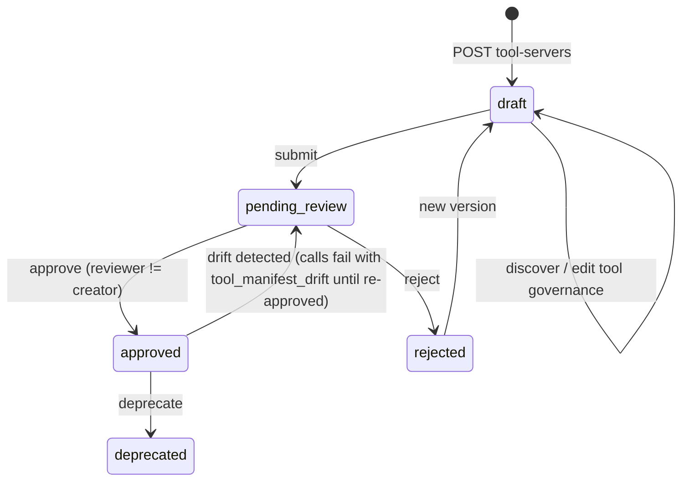
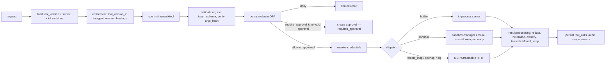

# Spec 08: Tool registry, data connections and MCP host (`ar_domain.tools`, `mcp-gateway`)

Registry endpoints are served by `api`. Execution is done by `mcp-gateway` (`services/mcp_gateway`, package `ar_mcp_gateway`, port 8002), the **only** component that talks to tool servers. The platform connector runtimes `mcp-sql` and `mcp-openapi` are specified in §10–§11. Owns `data_connections`, `tool_servers`, `tool_server_versions`, `tools`, `tool_versions`, `tool_calls` ([schema §6](../04-data/schema.md#6-tools-ar_domaintools)). Contract: [mcp-integration.md](../05-contracts/mcp-integration.md), [internal-apis §3](../05-contracts/internal-apis.md#3-mcp-gateway-base-httpmcp-gateway8002). Decision: [ADR-0006](../02-architecture/adr/ADR-0006-mcp-tool-protocol.md). PRD: [02-tool-registry](../01-prd/02-tool-registry.md).

## 1. Responsibilities

1. Register tool servers (`remote_mcp`, `openapi`, `sql`) with versions, discovery, manifest hashing, review (four-eyes), approval, deprecation, kill switches.
2. Register data connections (SQL) with allowlists, identity mode and limits.
3. Provide the entitlement-filtered tool catalogue to the runtime (`catalog:resolve`), including semantic tool search.
4. Execute tool calls: validate → policy → approval → credentials → dispatch → result processing → persistence → audit/usage.
5. Host the built-in tool servers in-process (knowledge, memory, files, skills, conversations, web) and forward `sandbox`/`browser` tools to the sandbox.
6. Detect manifest drift (`ToolDriftCheckWorkflow`).

## 2. Lifecycle

`tool_servers.status` mirrors the latest version's review state; `current_version_id` points at the latest **approved** version. Kill switches (`tool_servers.disabled_at`, `tools.disabled_at`) are orthogonal and take effect within 1 s (Valkey invalidation `ar:invalidate:tool_server:{id}`).

## 3. Public API (served by `api`)

Permissions: `tools:read` (list/get), `tools:create` (create servers/versions; owner may edit own drafts), `tools:review` (approve/reject), `tools:disable` (kill switch). Data connections: `secrets:manage` + `tools:create`.

#### GET /api/v1/tool-servers
Query `q`, `kind`, `status`, `owner=me`, `include_builtin` (default true). Item `ToolServer {id, slug, name, description, kind, scope: "tenant"|"platform", status, disabled, owner: {...}, owner_team, current_version: {id, version}|null, tool_count, updated_at}`.

#### POST /api/v1/tool-servers
`tools:create`. Body `CreateToolServer {slug, name, description?, kind, owner_team_id?, version: {version: "1.0.0", endpoint_url?, config, auth_mode, secret_id?, credential_provider_id?}}`. Validation per kind: `remote_mcp` requires `https` URL (or allowed internal http, [mcp-integration §2](../05-contracts/mcp-integration.md)); `openapi` requires `config.openapi.spec_file_id` (an uploaded `files.kind='openapi_spec'`), `base_url`, `operations[]`; `sql` requires `config.sql.data_connection_id`. For `openapi`/`sql` the `endpoint_url` is set by the platform (`AR_MCP_OPENAPI_URL`, `AR_MCP_SQL_URL`) and `auth_mode` for gateway→connector is `internal_jwt`; the configured auth mode in `config.upstream_auth` applies connector→upstream. Response `ToolServer` + `versions[0]`. Then discovery runs automatically (async via `mcp-gateway` `discover`; status visible on the version).

#### GET /api/v1/tool-servers/{server_id}
#### PATCH /api/v1/tool-servers/{server_id}
Owner or `tools:review`. `{name?, description?, owner_team_id?, owner_user_id?}`.
#### DELETE /api/v1/tool-servers/{server_id}
Allowed if no published agent version binds any of its tool versions (409 otherwise with `where_used`).

#### GET /api/v1/tool-servers/{server_id}/versions
Items `ToolServerVersion {id, version, endpoint_url, auth_mode, review_status, manifest_hash, discovered_at, reviewed_by, reviewed_at, review_notes, created_by, created_at, tool_count, discovery_error?}`.

#### POST /api/v1/tool-servers/{server_id}/versions
`tools:create` (owner). Body like `CreateToolServer.version`; `version` must be greater (semver) than all existing. Copies governance overrides from the previous version for tools with identical `name` and `description_hash`.

#### GET /api/v1/tool-servers/{server_id}/versions/{version_id}
Includes `tools: ToolVersion[]` (`{id, tool_id, name, qualified_name, title, description, input_schema, output_schema, annotations, risk_class, proposed_risk_class, data_classification, timeout_s, rate_limit_per_minute, max_result_bytes, idempotent, approval_preview, changed_since_previous: bool}`) and `manifest_diff` vs the previous approved version.

#### POST /api/v1/tool-servers/{server_id}/versions/{version_id}:discover
Owner. Re-runs discovery for a `pending`/draft version (calls `mcp-gateway` `POST /internal/v1/discover`). Response `{tool_count, manifest_hash, errors: []}`. Errors: 502 `upstream_error` with server message, 504 `upstream_timeout`.

#### PATCH /api/v1/tool-servers/{server_id}/versions/{version_id}/tools/{tool_version_id}
Owner (draft) or reviewer (pending). Body `{risk_class?, data_classification?, timeout_s?, rate_limit_per_minute?, max_result_bytes?, idempotent?, approval_preview?, description_override?}`. `description_override` replaces the model-facing description (reviewed text) and recomputes `description_hash`; the upstream description hash is kept in `annotations._upstream_description_hash` for drift checks. Not allowed on approved versions (create a new version).

#### POST /api/v1/tool-servers/{server_id}/versions/{version_id}:submit
Owner. Requires at least one tool and every tool to have `risk_class` confirmed (proposed classes are pre-filled but must be saved once; the UI does it on "Confirm all"). Notification `tool_review_requested` to holders of `tools:review`; outbox `tool_server.review_requested` (reason `new_version`).

#### POST /api/v1/tool-servers/{server_id}/versions/{version_id}:approve
`tools:review`; reviewer ≠ `created_by` (four-eyes, 403 `forbidden` with reason `four_eyes`), except single-admin installs where `tenant.settings.security.allow_self_review=true` (default false). Body `{notes?}`. Sets `review_status='approved'`, server `status='approved'`, `current_version_id`; computes tool embeddings (async, `embed` alias, `dimensions=1024`) for tool search. Emits `tool_server.review_decided`. Audit.

#### POST /api/v1/tool-servers/{server_id}/versions/{version_id}:reject
`tools:review`. Body `{notes}` (required).

#### POST /api/v1/tool-servers/{server_id}:deprecate
Owner or reviewer. Deprecated servers stay callable by already-published agent versions but cannot be newly bound.

#### POST /api/v1/tool-servers/{server_id}:disable
`tools:disable`. Body `{reason}`. Kill switch: all calls fail with `tool_disabled` immediately. Audit `tool_server.disabled`.

#### POST /api/v1/tool-servers/{server_id}:enable
`tools:disable`.

#### GET /api/v1/tools
Flattened catalogue of approved tools visible to the tenant. Query `q` (keyword), `semantic` (bool, uses embeddings), `server_id`, `risk_class`. Item `ToolSummary {tool_id, tool_version_id, qualified_name, title, description, risk_class, server: {id, slug, name}, disabled}`.

#### GET /api/v1/tools/{tool_id}
Current approved version detail + usage stats (calls 7d, error rate, p95 latency from `tool_calls`).

#### POST /api/v1/tools/{tool_id}:disable
`tools:disable`. Body `{reason}`.
#### POST /api/v1/tools/{tool_id}:enable

#### POST /api/v1/tools/{tool_id}:test
Owner or `tools:review`. Body `{tool_version_id?, arguments, dry_run?: bool}`. Calls `mcp-gateway` `POST /internal/v1/tool-calls:test` as the caller (user credentials apply). W2/W3 tools are refused unless `dry_run=true` and the server advertises dry-run support (`config.supports_dry_run`). Response `{status, result_preview, structured, is_error, latency_ms, policy}`. Recorded as a `tool_calls` row with `run_id` of a synthetic test run (`runs.trigger='api'`, conversation NULL) so audit is uniform.

#### GET /api/v1/tool-calls
`audit:read` or `agents:manage_all`. Query `tool_id`, `agent_id`, `user_id`, `status`, `risk_class`, `created_after`, `created_before`. Item `ToolCall` (redacted, as in [spec 06](06-conversations-runs.md)) + `{run_id, agent_id, user_id}`.

#### GET /api/v1/data-connections
#### POST /api/v1/data-connections
Body `{name, engine, dsn: string (stored as secret) | dsn_secret_id, identity_mode, allowlist: {schemas: [], tables: ["schema.table"], columns_deny: ["schema.table.column"]}, row_limit?, statement_timeout_s?, classification?, schema_notes?}`. The DSN must use a **read-only** database role; `:test` verifies it.
#### GET /api/v1/data-connections/{connection_id}
#### PATCH /api/v1/data-connections/{connection_id}
#### DELETE /api/v1/data-connections/{connection_id}
409 if used by a tool server version.

#### POST /api/v1/data-connections/{connection_id}:test
Connects via `mcp-sql` (`POST /internal/v1/connections:test` on mcp-sql, see §10) and checks: connectivity, read-only enforcement (`BEGIN READ ONLY` / attempting `CREATE TEMP TABLE` must fail on engines that support it), allowlisted objects exist. Response `{ok, checks: [{name, ok, detail}]}`.

#### GET /api/v1/data-connections/{connection_id}/schema
Introspected tables/columns within the allowlist (cached 10 min), merged with `schema_notes`.

## 4. `catalog:resolve`

Input `{agent_version_id, user_id, query?, loaded?: [tool_version_id]}` → `{tools: [{model_name: "jira__create_issue", tool_version_id, qualified_name, description, parameters (input_schema), risk_class}], tool_search_active: bool}`.
Steps: read `definition.resolved.tools` → drop disabled tools/servers, tools whose `data_classification` exceeds the user's clearance (`users.attributes.clearance`, default `confidential`), and tools whose server requires `user_oauth` from a provider marked `extra.hide_until_connected=true` that the user has not connected → if tool search active, rank by cosine similarity between `query` embedding and `tool_versions.embedding` (pgvector) and return top_k ∪ pinned ∪ `loaded`. Cached in Valkey `ar:catalog:{agent_version_id}:{user_id}` for 60 s.

## 5. Execution pipeline (`POST /internal/v1/tool-calls:execute`)

Details:
1. **Load**: `tool_versions` by id (cache 5 min, immutable) + server/tool disabled flags (live, Valkey-cached 1 s).
2. **Entitlement**: the tool version must be bound to the run's agent version (`agent_version_bindings kind='tool'`), or be a built-in implicitly allowed (control tools, `files.read` for offloaded results). Else `denied` with reason `not_entitled`.
3. **Rate limit**: token bucket `ar:rl:tool:{tenant_id}:{tool_id}` with `rate_limit_per_minute`; exceeded → `failed` code `tool_rate_limited` (retriable by the model later).
4. **Validation**: JSON Schema 2020-12 (`jsonschema` with format checks); errors are returned to the model as `is_error` with a compact message (no policy evaluation). `args_hash` recomputed (`rfc8785`) and must equal the request's.
5. **Policy**: `ar_domain.policy.service.evaluate(PolicyInput)` → [spec 09](09-policy-approvals.md). Standing approvals are honoured inside policy evaluation.
6. **Approval**: if `require_approval` and no `approval_id`: create `approvals` row (preview rendered from `approval_preview` template + arguments; approver rule from the policy decision), set `tool_calls.status='awaiting_approval'`, outbox `approval.requested`; return `requires_approval`. With `approval_id`: verify `approved`, `consumed_at IS NULL`, `expires_at > now()`, `args_hash` equal, then set `consumed_at`.
7. **Credentials**: by `auth_mode` ([mcp-integration §4](../05-contracts/mcp-integration.md#4-authentication-modes-tool_server_versionsauth_mode)); missing user grant → `credential_required` with `connect_url = {AR_PUBLIC_URL}/connections?provider={slug}`.
8. **Dispatch**: MCP client from the official SDK (`mcp.client.streamable_http`), stateless per call; connection pool per endpoint (`httpx.AsyncClient`, HTTP/2, max 100 connections per host). Progress notifications → relayed to the runtime via the response stream (`text/event-stream` from `tool-calls:execute` when `Accept: text/event-stream`: events `progress`, final `result`). Tasks extension polling as in the contract.
9. **Drift guard**: for remote MCP servers the gateway compares the upstream `tools/list` hash (cached 10 min per server version) to the approved manifest; mismatch → `failed` code `tool_manifest_drift`.
10. **Result processing**: [mcp-integration §7](../05-contracts/mcp-integration.md#7-result-handling-gateway--runtime). **Injection classifier** (when `safety.injection_classifier` and tenant feature on): for results from `openWorldHint=true` tools, `web.fetch`, `browser.snapshot`, knowledge results from sources with `trust='external'`, call the `fast` alias with `ar_mcp_gateway/prompts/injection_classifier.md` (purpose `classifier`, 1 s budget, fail-open); if flagged, prefix the wrapped result with a warning line and set `tool_calls.error.injection_suspected=true`; audit `tool_result.injection_suspected`.
11. **Persist**: `tool_calls` status, `result_preview` (≤ 2 KiB redacted), `result_file_id`, latency; audit event for risk ≥ W1 (`tool.called` with args hash, not arguments); `usage_events(metric='tool_calls')`.

## 6. Policy input (built by the gateway)

`PolicyInput {tenant_id, tool: {qualified_name, server_slug, risk_class, data_classification, annotations}, agent: {id, slug, risk_tier, overrides}, run: {id, trigger, channel, depth, routine_id}, user: {id, groups[], roles[], attributes}, args: <arguments>, time: {now, weekday, hour_local}, standing_approval_ids: []}` ([spec 09 §3](09-policy-approvals.md#3-policy-evaluation)).

## 7. Discovery (`POST /internal/v1/discover`)

Input `{tool_server_version_id, requested_by_user_id, compare_only?: bool}`. Calls `server/discover` + `tools/list` (remote MCP), or asks the connector runtime (`mcp-openapi`/`mcp-sql`) which derives tools from config. Normalises names, validates schemas, proposes risk classes (annotations; `openapi`: GET/HEAD → `R0`, POST/PUT/PATCH → `W2`, DELETE → `W3`; `sql`: `R1`; remote MCP: `readOnlyHint` → `R0`, otherwise `W2` so the call waits for approval), stores manifest/hash, upserts `tools` + `tool_versions`. `compare_only` returns `{manifest_hash, changed: bool, diff}` without writing (used by drift checks).

M22 adds owner-scoped service connections, OpenAPI import (`POST /api/v1/openapi-imports`), a described HTTP tool (`POST /api/v1/described-tools`) and `POST /api/v1/tool-servers/{id}:refresh`. A remote server may use streamable HTTP, SSE, or stdio inside the general-tool sandbox with network off. Tool results from those servers are untrusted data. See [m22-connections](../06-security/m22-connections.md).

## 8. `ToolDriftCheckWorkflow` (`system-worker`, `ar-system`)

Temporal Schedule `tool-drift-check` hourly (`AR_TOOL_DRIFT_INTERVAL`, default `1h`). For each approved remote MCP server version (batched 50 per activity): `discover(compare_only=true)`; if changed, no new version row is created automatically; instead mark the approved version's server `status='pending_review'`, store diff in `review_notes`, notify owner + reviewers (`tool_review_requested`), outbox `tool_server.review_requested` (reason `manifest_drift`). Workflow id `tool-drift-check-{yyyymmddhh}`.

## 9. Built-in tool schemas (platform servers, executed in-process by `mcp-gateway` unless noted)

| Tool | Input | Output / behaviour |
|---|---|---|
| `knowledge.search` | `{query: string, collections?: [slug], top_k?: 1..20 (default definition.knowledge.top_k), filters?: {source_ids?, modified_after?, mime_types?}}` | Hits `[{index, document_id, chunk_id, title, uri, snippet, score, collection}]`; ACL-filtered for the run's user ([spec 10](10-knowledge.md)); registers citation indices with the run |
| `knowledge.get_document` | `{document_id, offset?: int, limit?: int (chars, ≤ 20000)}` | Text page of a document the user can read |
| `knowledge.list_collections` | `{}` | Collections bound to the agent and readable by the user |
| `memory.search` | `{query, scopes?: [user, agent, team, agent_user], top_k?: ≤ 20}` | Facts visible to the run ([spec 11](11-memory.md)) |
| `memory.save` | `{content (≤ 500 chars), scope: user\|agent_user\|agent, category?: preference\|fact\|instruction}` | `agent` scope creates `pending_review` proposals; denied in child runs and when `user_writes=off` |
| `memory.forget` | `{fact_id}` or `{query}` | Deletes the user's own facts (W1) |
| `files.list` | `{scope: conversation\|mine, mime_prefix?}` | Files visible in the conversation / the user's files |
| `files.read` | `{file_id, offset?: int, limit?: int (bytes ≤ 64 KiB)}` | Text (extracted for PDFs/Office via the ingest extractor cache) |
| `files.attach_to_sandbox` | `{file_id, path?: "/workspace/inputs/<name>"}` | Copies into the sandbox |
| `skills.load` | `{skill: slug}` | Skill instructions + asset list; assets copied to `/workspace/.skills/<slug>/` when a sandbox exists ([spec 14](14-skills.md)) |
| `conversations.search_history` | `{query, limit?: ≤ 10}` | Snippets from the user's other conversations with this agent (R1) |
| `web.fetch` | `{url (https), max_chars?: ≤ 50000}` | Readable text via the egress proxy; tenant `egress_allowlist` enforced; requires tenant feature `web_fetch` |
| `sandbox.*`, `browser.*` | see [spec 12 §7](12-sandbox-manager.md#7-sandbox-agent-tools) | Forwarded to `sandbox-agent` |
| `agents.delegate`, `plan.update`, `tools.search` | see [spec 07](07-agent-runtime.md) | Executed by `runtime-worker` |

## 10. `mcp-sql` connector runtime (`connectors/mcp_sql`, port 8010)

- MCP server exposing, per tool server version: `{slug}.list_tables` (R0), `{slug}.describe_table` (R0), `{slug}.run_query` (R1) `{sql: string, params?: object, limit?: int}`.
- Config fetched from `api` `GET /internal/v1/connectors/{tool_server_version_id}/config`.
- Query safety (`ar_mcp_sql.guard`, using `sqlglot` with the engine dialect): parse must yield exactly one statement of type SELECT/WITH…SELECT/UNION; reject DDL/DML, `INTO`, `FOR UPDATE`, functions on a deny list (`pg_sleep`, `dblink*`, `lo_*`, `copy`, `xp_*`, `load_file`…); every referenced table must be in the allowlist; `columns_deny` columns rejected (also via `*` expansion using cached schema); inject `LIMIT row_limit+1`; execute in a read-only transaction with `statement_timeout`.
- Identity modes: `service` (connection DSN), `per_user_mapped` (DSN template with role mapped from `users.attributes.db_role`; `SET ROLE` on Postgres), `passthrough` (token exchange credential as DB password for engines supporting OAuth, e.g. Snowflake/Trino).
- Result: header + rows as compact CSV (≤ `max_result_bytes`) + `structuredContent {columns, rows, truncated}`; truncated flag when > row_limit.
- Internal endpoint `POST /internal/v1/connections:test` (caller `api`).
- Pools: per (tenant, data_connection) `asyncpg`/driver pool, max 5 connections, idle close 5 min.

## 11. `mcp-openapi` connector runtime (`connectors/mcp_openapi`, port 8011)

- Loads the OpenAPI 3.0/3.1 document (file id from config), exposes selected `operationId`s as tools: input schema = merged path/query/header (non-auth) params + JSON body schema; description = summary + description (reviewed).
- Calls `base_url` with upstream auth (`token_exchange` / `user_oauth` / `static_secret` resolved via config endpoint), timeout = tool `timeout_s`; follows no redirects to other hosts; response JSON → structuredContent; non-2xx → `isError` with status and body excerpt.
- Egress via the platform egress proxy with the host allowlist = `base_url` host.

## 12. Configuration (`mcp-gateway`)

| Variable | Default | Purpose |
|---|---|---|
| `AR_MCPG_PORT` | `8002` | |
| `AR_MCP_SQL_URL` | `http://mcp-sql:8010/mcp` | |
| `AR_MCP_OPENAPI_URL` | `http://mcp-openapi:8011/mcp` | |
| `AR_SANDBOX_MANAGER_URL` | `http://sandbox-manager:8003` | |
| `AR_OPA_URL` | `http://opa:8181` | |
| `AR_EGRESS_PROXY_URL` | `http://squid:3128` | For `web.fetch` and remote MCP outside the cluster |
| `AR_MCP_INTERNAL_HTTP_ALLOWED_CIDRS` | cluster CIDRs | |
| `AR_TOOL_RESULT_MAX_FILE_BYTES` | `20971520` | 20 MiB |
| `AR_INJECTION_CLASSIFIER_TIMEOUT_MS` | `1000` | |
| `AR_TOOL_DRIFT_INTERVAL` | `1h` | |
| `AR_PUBLIC_URL` | `http://localhost:3000` | For `connect_url` |

## 13. Failure modes

| Failure | Behaviour |
|---|---|
| Upstream MCP server down | `failed` code `upstream_error`, retried per idempotency rules (runtime); circuit breaker per server (same parameters as model gateway) → fast-fail `tool_server_unavailable` while open. |
| OPA unreachable | **Fail closed**: `denied` with reason `policy_unavailable` (except R0 built-ins `knowledge.*`, `memory.search`, `files.list/read`, `plan.update`, which are allowed by the in-process fallback evaluator). Alert. |
| Approval row conflict (double execute) | Second execution sees `consumed_at` set → returns stored result of the first (idempotency on `tool_calls.idempotency_key`). |
| Result > 20 MiB | Truncated; `warning tool_result_truncated`. |

## 14. Metrics

`ar_tool_calls_total{server,tool,status,risk}`, `ar_tool_call_seconds{server,tool}`, `ar_policy_decisions_total{decision}`, `ar_tool_rate_limited_total`, `ar_tool_drift_detected_total`, `ar_injection_flags_total{server}`, `ar_mcp_upstream_errors_total{server,code}`.

## 15. Test plan

- Unit: name normalisation, schema validation, risk proposal mapping, args hash (JCS vectors from RFC 8785), SQL guard (table of ≥ 60 allowed/denied queries per dialect incl. comment tricks, CTE writes, `SELECT ... INTO`), result neutralisation (zero-width/bidi/ANSI), truncation/offload.
- Integration: discovery against `ar_testing.mcp_echo` (Streamable HTTP, 2026-07-28) and a legacy 2025-11-25 server; drift (change description → calls fail with `tool_manifest_drift` until re-approved); approval single-use and args mismatch rejection; credential_required path; OPA down fail-closed; `mcp-sql` against Postgres testcontainer with read-only role; `mcp-openapi` against a respx-mocked API.
- Contract: conformance suite from `ar_connector_sdk.testing` run against `mcp-sql`, `mcp-openapi`, `mcp_echo`.

## 16. Records server (added by M14-T08)

The built-in MCP server `records` (`records.capture` R1, `records.get` R0, `records.verify` R0) is specified in [spec 21 §1.1](21-records-governance.md#11-built-in-tools). Browser screenshots become evidence only when the runtime calls `records.capture` with `collection_method=browser_screenshot`. This section does not change the servers already listed in §9.
