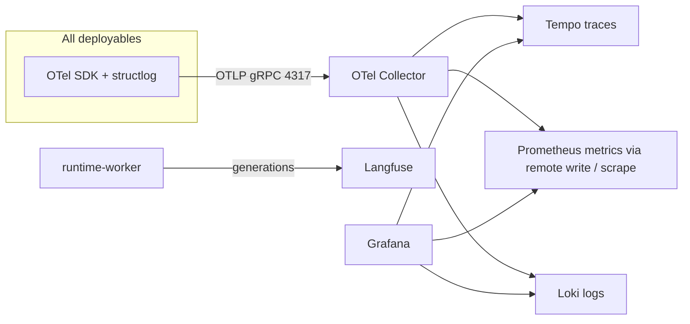

# Spec 18: Observability and evaluation (`ar_common.telemetry`, `ar_domain.evals`)

Observability is cross-cutting (every deployable). Evaluation endpoints are served by `api`; `EvalRunWorkflow` runs on `system-worker` (queue `ar-eval`). Owns `eval_suites`, `eval_cases`, `eval_runs`, `eval_results` ([schema §16](../04-data/schema.md#16-evaluation-ar_domainevals)). Quality strategy: [eval-strategy](../08-quality/eval-strategy.md). PRD: [13-observability](../01-prd/13-observability.md), [14-evaluation](../01-prd/14-evaluation.md).

## 1. Telemetry architecture

- `ar_common.telemetry.setup(service_name)` configures: OTel tracer/meter providers (OTLP exporter `AR_OTEL_EXPORTER_OTLP_ENDPOINT`), auto-instrumentation for FastAPI, httpx, SQLAlchemy, asyncpg, redis, Temporal (`temporalio.contrib.opentelemetry.TracingInterceptor`); Prometheus `/metrics` endpoint (`prometheus-client`) for pull-based scraping; structlog JSON logs with `trace_id`, `span_id`, `tenant_id`, `user_id` (hashed in SaaS logs: `AR_LOG_HASH_USER_IDS=true`), `run_id`, `request_id`.
- **No content in telemetry**: prompts, messages, tool arguments/results are never put on spans, metrics or logs. Allowed: ids, sizes, token counts, hashes, error codes.
- Sampling: parent-based; 100 % for runs with errors (tail sampling in the collector: `status_code=ERROR` or latency > 30 s kept), 10 % otherwise (`AR_TRACE_SAMPLE_RATIO=0.1`).
- Langfuse (self-hosted): `runtime-worker` sends one trace per run with generations (model, tokens, latency, cost) and tool spans. Content capture is controlled per tenant `settings.observability.capture_content` (default `false` in SaaS, `true` in single-tenant installs); when false only metadata is sent. Langfuse project per environment; traces tagged `tenant:{id}`; access restricted to platform operators (SaaS) or tenant admins (single-tenant).

## 2. Dashboards and alerts

Grafana dashboards shipped as JSON in `deploy/helm/agentic-runtime/dashboards/`: `ar-overview` (RPS, errors, latency per deployable), `ar-runs` (runs started/finished, TTFT, step counts, budget exceeded), `ar-models` (gateway latency, tokens, fallbacks, circuit state per model), `ar-tools` (calls, errors, approvals, policy decisions), `ar-ingest` (queue depth, stage latency, failures), `ar-sandboxes` (counts, ensure latency, egress denies), `ar-temporal` (task queue backlog, schedule-to-start latency), `ar-tenants` (top tenants by cost/runs).

PrometheusRule alerts (`deploy/helm/agentic-runtime/templates/prometheusrules.yaml`), each linked to a runbook anchor in [runbooks.md](../07-ops/runbooks.md):

| Alert | Condition | Runbook |
|---|---|---|
| `ARApiHighErrorRate` | 5xx > 2 % for 5 min | `rb-01-api-errors` |
| `ARRunStartLatencyHigh` | p95 `ar_run_start_latency_seconds` > 3 s for 10 min | `rb-02-slow-run-start` |
| `ARRunsStuckQueued` | runs `queued` > 60 s count > 0 for 5 min | `rb-03-runs-stuck-in-queued` |
| `ARModelNoHealthyUpstream` | any alias with all targets open for 2 min | `rb-04-model-upstream-down` |
| `ARTemporalBacklog` | schedule-to-start p95 > 5 s on any queue for 10 min | `rb-05-temporal-backlog` |
| `AROpaUnavailable` | `ar_policy_fallback_total` increasing for 2 min | `rb-06-opa-unavailable` |
| `ARIngestFailures` | failure ratio > 10 % for 30 min | `rb-07-ingestion-failures` |
| `ARRetrievalLatencyHigh` | p95 `ar_retrieval_store_seconds{operation="search"}` > 150 ms for 15 min | `rb-07-ingestion-failures` |
| `ARRetrievalStoreErrors` | `ar_retrieval_store_errors_total{kind="unavailable"}` rate > 0 for 5 min | `rb-07-ingestion-failures` |
| `ARSandboxEnsureSlow` | p95 ensure > 20 s for 10 min | `rb-08-sandbox-capacity` |
| `ARAuditChainBroken` | nightly verification failed | `rb-09-audit-chain-broken` |
| `ARCertificateExpiry` | cert expiry < 14 days | `rb-10-certificates` |
| `ARPostgresReplicationLag` | lag > 30 s | `rb-11-postgres` |
| `ARQueueDepthOutbox` | unpublished outbox events older than 60 s | `rb-13-outbox-backlog` |

SLOs (30-day): API availability 99.9 %; run start latency p95 < 2 s; TTFT p95 (excluding model time) < 300 ms overhead; tool call gateway overhead p95 < 50 ms. Budgets: [performance-budgets](../08-quality/performance-budgets.md).

## 3. In-product observability API

#### GET /api/v1/observability/overview
`usage:read`. Query `from`, `to`, `agent_id?`. Response `{runs: {total, by_status, by_trigger}, latency: {run_p50_ms, run_p95_ms, ttft_p95_ms}, tools: [{qualified_name, calls, error_rate, p95_ms}], approvals: {requested, approved, rejected, expired, median_decision_s}, feedback: {up, down}, cost_micros, top_agents: [...], top_errors: [{code, count}]}` computed from `runs`, `tool_calls`, `approvals`, `message_feedback`, `usage_daily`.

#### GET /api/v1/platform/health
`platform_admin`. Component health `{components: [{name, status: up|degraded|down, detail, checked_at}]}` from each deployable's `/readyz` (via in-cluster service URLs), Temporal, Postgres, Valkey, the configured retrieval store(s) (`RetrievalStore.health()`, pgvector by default, Qdrant when enabled), OPA, Keycloak, object storage, model providers.

Run inspector data comes from [spec 06](06-conversations-runs.md) endpoints (`/runs/{id}`, `/steps`, `/tool-calls`, `/events`) plus `trace_url` / `langfuse_url`.

## 4. Evaluation

### 4.1 Concepts
- **Suite**: set of cases for an agent (or reusable: `agent_id NULL`, e.g. platform red-team suites), kind `functional|retrieval|safety|red_team`, with a gate config `GateConfig {required: bool, min_pass_rate: 0.9, max_regression_pct: 5.0, must_pass_tags: ["safety"]}`.
- **Case**: `EvalInput {messages: [string] (multi-turn: each string is a user turn), files?: [file_id], as_user?: {attributes: {...}, groups: [...]}` (simulated principal attributes for policy/ACL checks, applied to a synthetic eval principal), `variables?: {}`}`, `assertions: [Assertion]`, `tool_mocks: [ToolMock]`, `tags`.
- **Assertion** types (`ar_contracts.evals.Assertion`, discriminated by `type`):

| type | Params | Pass rule |
|---|---|---|
| `contains` / `not_contains` | `value`, `case_sensitive?` | substring in final text |
| `regex` | `pattern` (RE2) | match |
| `json_schema` | `schema` | final text parses as JSON and validates |
| `tool_called` | `tool` (qualified), `args_match?: {path: value}`, `min_times?` | in run's tool_calls |
| `tool_not_called` | `tool` | absent |
| `citation_present` | `min?: 1`, `document_ids?` | citations in final message |
| `refusal` | – | judge determines the agent declined |
| `answer_similarity` | `reference`, `threshold: 0.8` | cosine of embeddings (`embed` alias) |
| `llm_judge` | `rubric`, `threshold: 0..1`, `judge_alias?: "reasoning"` | judge score ≥ threshold (prompt `ar_system/prompts/judge.md`, JSON output `{score, reason}`) |
| `max_latency_ms` / `max_cost_micros` / `max_steps` | `value` | from run usage |
| `no_policy_denials` | – | no `denied` tool calls |

- **ToolMock** `{tool, match_args?: {path: value}, result: {text?, structured?} | error: {code, message}}`. In eval runs, `mcp-gateway` returns mocks for matching calls; **all `W2`/`W3` tool calls are mocked or denied** (never executed) in eval runs; `R0`/`R1`/`W1` calls execute for real unless mocked (suite option `mock_all_tools: true` forces mocks for everything).

### 4.2 `EvalRunWorkflow(eval_run_id)` (queue `ar-eval`, id `eval-{eval_run_id}`)
1. Load suite + cases; resolve agent version (draft, published, explicit version) and optional model alias override (applied as a run-level override; only for `evals:manage`).
2. For each case (concurrency `AR_EVAL_CONCURRENCY=4`): create conversation (`channel='eval'`, owner = triggering user) and run (`trigger='eval'`, `runs.eval_context` = `{suite_id, case_id, tool_mocks, as_user, mock_all_tools}`), post each user turn sequentially awaiting each run, then score assertions (`score_eval_case` activity) → `eval_results`.
3. Summary `{cases, passed, pass_rate, mean_scores, cost_micros, p95_latency_ms, gate_passed, regressions: [case_id]}` vs baseline; `eval.completed` outbox; notification `eval_completed`.
4. If `trigger='publish_gate'` → `agents.service.complete_gated_publish(agent_version_id, passed)`.

### 4.3 API
Permissions: `evals:manage` (suites/cases), `evals:run` (start runs).

#### GET /api/v1/eval-suites
Query `agent_id`, `kind`. Item `EvalSuite {id, name, description, kind, agent: {id, name}|null, gate, case_count, last_run: {id, pass_rate, status, created_at}|null}`.
#### POST /api/v1/eval-suites
#### GET /api/v1/eval-suites/{suite_id}
#### PATCH /api/v1/eval-suites/{suite_id}
#### DELETE /api/v1/eval-suites/{suite_id}
#### GET /api/v1/eval-suites/{suite_id}/cases
#### POST /api/v1/eval-suites/{suite_id}/cases
#### PATCH /api/v1/eval-suites/{suite_id}/cases/{case_id}
#### DELETE /api/v1/eval-suites/{suite_id}/cases/{case_id}
#### POST /api/v1/eval-suites/{suite_id}/cases:import
Body `{file_id}` (JSONL: one case per line; or YAML list; `files.kind='eval_dataset'`) → `{imported, errors: [{line, msg}]}`.
#### POST /api/v1/eval-suites/{suite_id}/cases:from-conversation
Body `{conversation_id, message_id, assertions?}` → creates a case from the conversation's user turns up to `message_id`, default assertion `llm_judge` with rubric derived from the feedback comment.
#### POST /api/v1/eval-suites/{suite_id}:run
`evals:run`. Body `{agent_version_ref: "draft"|"published"|int, model_alias_override?, baseline_eval_run_id?, tags?: [..] (subset of cases)}` → `202 EvalRun`.
#### GET /api/v1/eval-runs
Query `suite_id`, `agent_id`, `status`.
#### GET /api/v1/eval-runs/{eval_run_id}
#### GET /api/v1/eval-runs/{eval_run_id}/results
Items `EvalResult {case: {id, name, tags}, passed, scores, output_text, latency_ms, cost_micros, run_id}`.
#### POST /api/v1/eval-runs/{eval_run_id}:cancel
#### GET /api/v1/feedback
`evals:manage`. Thumbs-down/up feedback across the tenant for agents the caller can edit: `{message_id, conversation_id, agent, rating, reasons, comment, created_at}` (conversation content visible only if the caller can view the conversation or the user shared it; otherwise only metadata).

### 4.4 Eval context propagation
Eval runs carry the case's mocks and simulated principal in `runs.eval_context jsonb` (NULL for non-eval runs, [schema §5](../04-data/schema.md#5-conversations-messages-runs-ar_domainconversations-ar_domainruns)). `mcp-gateway` reads it when `trigger='eval'` to apply mocks and the W2/W3 never-execute rule; `ar_domain.policy` and knowledge retrieval use `as_user` attributes/groups (layered on the triggering user's real principals, never broadening them) for the synthetic principal.

### 4.5 Platform suites
`evals/redteam/` (prompt injection via tool output and documents, data exfiltration via links/images, cross-user memory leak, approval bypass attempts, secret disclosure) and `evals/functional/` samples are installed into each tenant as reusable suites by `TenantProvisioningWorkflow` (kind `red_team`), and run in CI nightly against real reference models and on every PR against `fake-llm` scenarios.

### 4.6 Groundedness grader

Assertion type `groundedness` (`ar_contracts.evals.Assertion`): params `{min_grounded_ratio: 0.9, mode: strict|preferred}`. Pass when the case ran with at least that grounding mode and `grounded_claims / claims >= min_grounded_ratio`. A case with zero claims passes. The platform suite `evals/golden/groundedness/` ships with the product and is a publish gate (`gate.required=true`, `must_pass_tags: ["groundedness"]`) for any agent whose published definition sets `output.grounding=strict`. Agents with grounding `off` or `preferred` are not gated by this suite. The grader reads the stored `GroundingReport`; it does not call a model.

## 5. Metrics

`ar_eval_runs_total{status,trigger}`, `ar_eval_case_seconds`, `ar_eval_pass_rate{suite}` (last run gauge), `ar_eval_judge_calls_total`.

## 6. Test plan

- Unit: each assertion type; gate computation incl. regression vs baseline; JSONL import errors.
- Integration: eval run against `fake-llm` with tool mocks (W2 tool never executed even without mock → denied); publish gate success/failure path; from-conversation case creation.
- Observability: test that a run produces one trace with expected span names (in-memory span exporter); log redaction test (no message text in captured logs).

## 7. Run records and re-performance

Record mode is `spec.assurance.record_mode`: `off` (default) or `on` ([ADR-0022](../02-architecture/adr/ADR-0022-run-records.md), [OQ-29](../open-questions.md)). When it is `on`, `finalize_run` starts `RunRecordSealWorkflow` (`ar-system`, id `run-record-{run_id}`) after the run reaches a terminal status.

The sealed manifest (`ar_contracts.records.RunRecordManifest`) is:

| Field | Source |
|---|---|
| `agent_version_id`, `definition_hash` | published or draft version that ran |
| `prompt_template_hashes` | SHA-256 of each prompt file used in [spec 07 §4](07-agent-runtime.md#4-context-assembly), keyed by block name |
| `model_id` | provider model id string |
| `model_revision`, `weights_digest` | provider response metadata when present, else null |
| `sampling_params` | `{temperature, top_p, seed, max_output_tokens}` actually sent |
| `retrieved` | `[{collection_id, index_version, chunk_id}]` |
| `output_sha256` | SHA-256 of the final assistant text |
| `tool_io_evidence_id` | evidence item holding the encrypted tool I/O blob |

The tool I/O blob is JSON `{calls: [{tool_call_id, qualified_name, arguments, result}]}` encrypted with the evidence signing key's envelope (AES-256-GCM, DEK wrapped by `AR_EVIDENCE_SIGNING_KEY`) and stored via [spec 21 §1](21-records-governance.md#1-evidence-vault) with `collection_method='run_record'`. Size over `AR_RUN_RECORD_MAX_BLOB_BYTES` fails the seal with audit `run_record.seal_failed` and the run itself stays completed: record mode is assurance, not a reason to fail the user-visible run. The manifest is signed the same way as an evidence manifest. `run_records` is append-only.

Honest limit, shown in the API field `reperformance`: replaying a record calls the pinned model with the recorded tool results substituted and compares the new output hash to `output_sha256`. A difference is divergence, not a failed audit of the original record. The original record stays valid.

#### GET /api/v1/run-records
`run_records:read`. Query `agent_id`, `run_id`, `from`, `to`.

#### GET /api/v1/run-records/{run_record_id}
`run_records:read`. Returns the manifest, signature and verification summary. Tool arguments are not inlined; they are inside the evidence item and follow evidence read rules.

#### POST /api/v1/run-records/{run_record_id}:replay
`run_records:replay`. Body `{model_id?: string}` must equal the recorded `model_id` or be omitted. Starts a replay that uses recorded tool results and does not call live tools. Response `202 {replay_id}`. Audit `run_record.replayed`. When the output hash differs, audit `run_record.replay_diverged` and the replay row stores `{step, field, expected_hash, actual_hash}`.

#### GET /api/v1/run-records/{run_record_id}/replays/{replay_id}
`run_records:read`.
