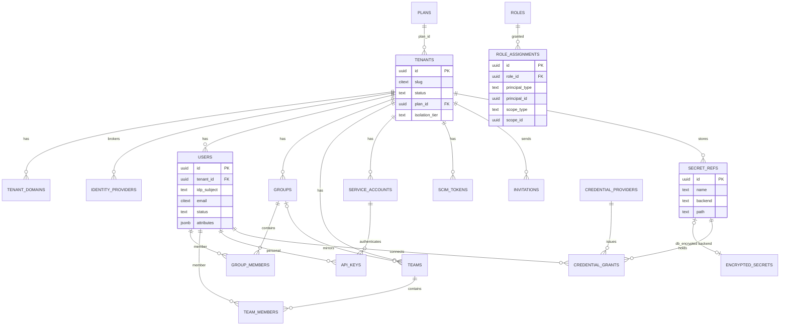
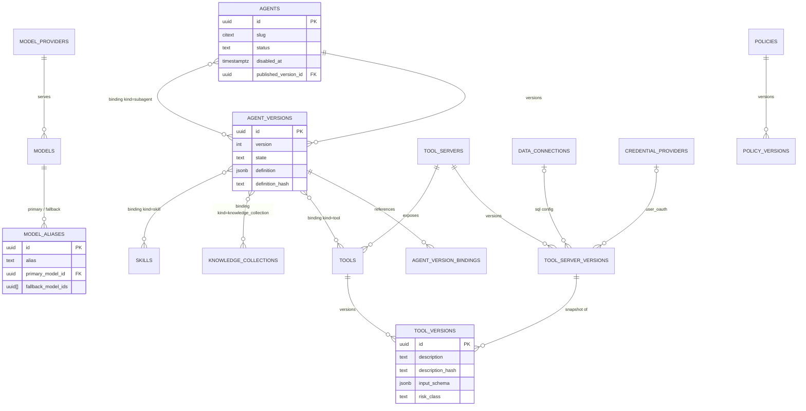
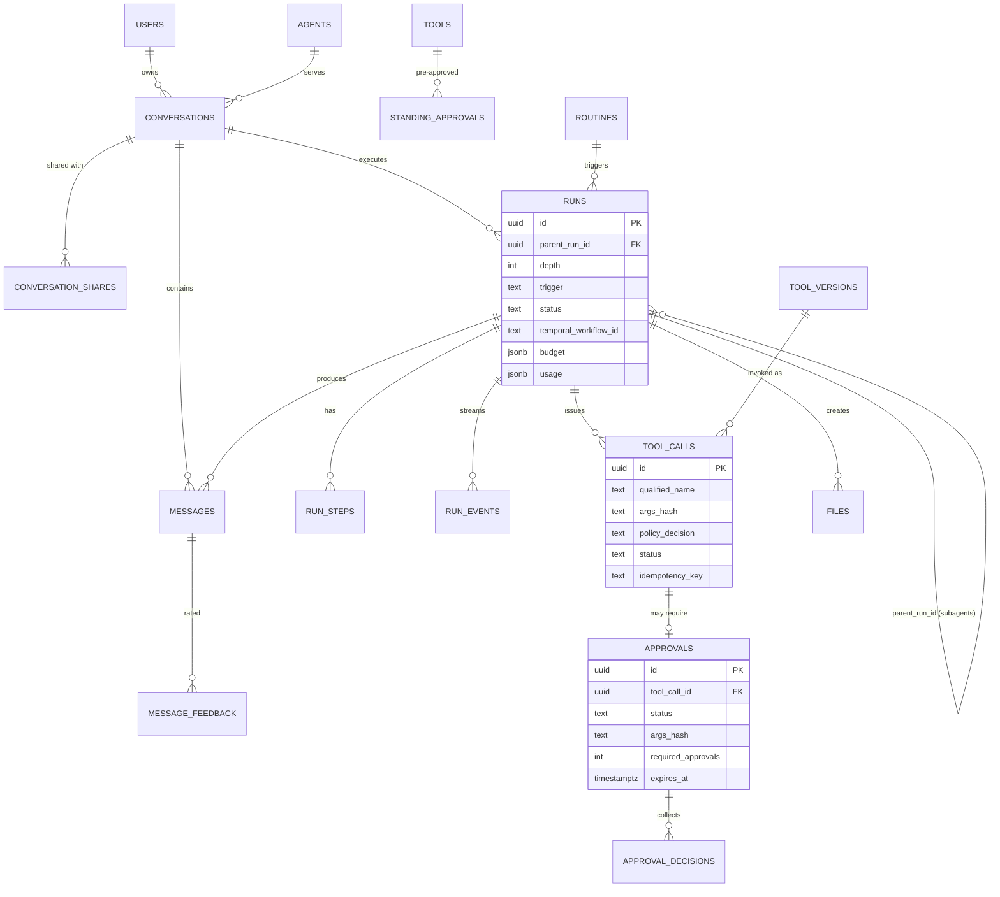
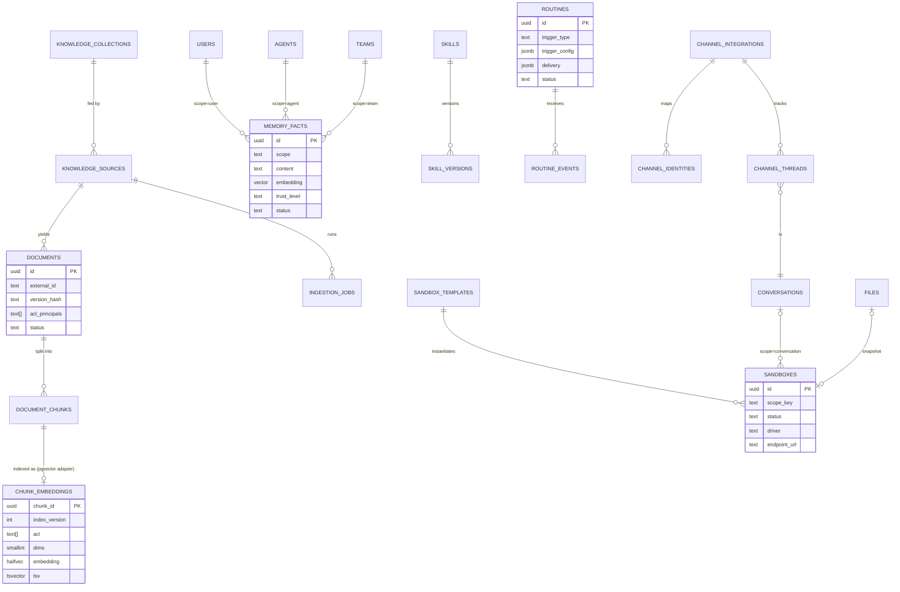
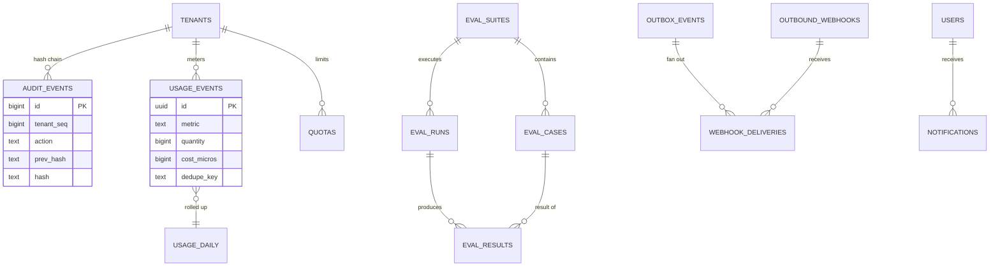

# Entity-relationship diagrams

Columns are abbreviated; the authoritative definition is [schema.md](schema.md). Split into domains for readability. Every entity except `PLANS` and `TENANTS` carries `tenant_id`.

## 1. Identity, tenancy, secrets

## 2. Agents, models, tools, policy

## 3. Conversations, runs, tool calls, approvals

## 4. Knowledge, memory, sandboxes, files, skills, routines, channels

## 5. Audit, usage, evaluation, events

