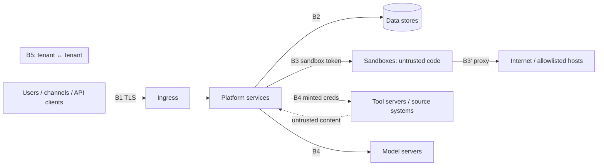

# Threat model

Method: STRIDE per trust boundary plus LLM-specific threats (OWASP Top 10 for LLM Applications categories). Every threat has mitigations that point to specs and a verification test that must exist ([§4](#4-verification)). Task M14-T07 records results in `docs/06-security/verification-log.md`.

## 1. Assets

| Asset | Why it matters |
|---|---|
| Tenant data: conversations, files, knowledge, memory | Confidential company data; personal data under DPDP |
| Credentials: OAuth refresh tokens, delegation tokens, API keys, provider keys, DB DSNs | Grant access to company systems |
| Tool actions (W1–W3) | Real-world side effects (tickets, emails, payments, deployments) |
| Audit trail | Accountability, legal evidence |
| Policies and approvals | The control plane for agent autonomy |
| Model endpoints | Expensive capacity; must never be third-party (G1) |
| Platform integrity (images, chart, supply chain) | Compromise affects every tenant |

## 2. Trust boundaries

B1 external → platform; B2 services → stores; B3 platform → sandboxes (and sandboxes → internet); B4 platform → tools/models/sources (and their returned content back into prompts); B5 tenant ↔ tenant; B6 user ↔ user within a tenant (implicit everywhere).

## 3. Threats and mitigations

| ID | Threat | Boundary | Mitigations | Spec refs |
|---|---|---|---|---|
| T1 | Cross-tenant data access through a missing filter or IDOR | B5 | RLS fail-closed, tenant-scoped repositories, mandatory tenant filter in every `RetrievalStore` query (plus RLS on `chunk_embeddings`), 404-not-403, generated cross-tenant tests | [tenancy-isolation](../02-architecture/tenancy-isolation.md), [rls](../04-data/rls.md) |
| T2 | Agent exceeds the acting user's permissions (confused deputy) | B4 | On-behalf-of identity on every tool call (user OAuth / token exchange / internal JWT `sub`), ACL-filtered retrieval, routines run as owner with delegation token, no privileged service accounts for tools | [spec 03](../03-specs/03-secrets-credentials.md), [spec 08](../03-specs/08-tool-registry-mcp.md) |
| T3 | Indirect prompt injection via tool results, documents, web pages, emails, channel messages | B4 | Untrusted wrapping, tool output never authorises, policy on every call, approvals bound to args hash, injection classifier, W3 always human, guardrails | [prompt-injection](prompt-injection.md), [spec 09](../03-specs/09-policy-approvals.md) |
| T4 | Data exfiltration by the agent (links, images, tool arguments, sandbox network) | B3/B4 | Markdown image/link filter, egress allowlists via Squid, web.fetch allowlist, approval previews show full arguments, DLP-style PII redaction on outputs to external tools | [prompt-injection §6](prompt-injection.md#6-exfiltration-via-images-links-and-tools), [spec 12 §5](../03-specs/12-sandbox-manager.md#5-egress-control) |
| T5 | Tool poisoning / rug pull: malicious tool descriptions or changed manifests | B4 | Review before approval, immutable approved manifests, drift guard (`tool_manifest_drift`), descriptions length-limited and shown to reviewers, tool annotations not trusted for risk (risk class set by reviewer) | [spec 08 §2, §8](../03-specs/08-tool-registry-mcp.md#8-tooldriftcheckworkflow-system-worker-ar-system) |
| T6 | Approval bypass or replay (model changes args after approval, reuses approval) | B4 | JCS args hash, single use `consumed_at`, re-evaluation at execution, expiry, step-up for W3, self-approval rules | [ADR-0015](../02-architecture/adr/ADR-0015-approval-args-hash.md) |
| T7 | Sandbox escape to node / cluster | B3 | gVisor or Kata runtime, non-root, seccomp, no SA token, read-only base, resource limits, dedicated node pool with taints, Falco | [spec 12 §4.1](../03-specs/12-sandbox-manager.md#41-kubernetes-production), [ADR-0013](../02-architecture/adr/ADR-0013-sandbox-isolation.md) |
| T8 | Sandbox lateral movement / SSRF to internal services or metadata endpoints | B3 | Default-deny NetworkPolicy (only Squid + DNS), Squid allowlist + private-CIDR deny, DNS rebinding protection, per-sandbox token | [spec 12 §5](../03-specs/12-sandbox-manager.md#5-egress-control) |
| T9 | Credential theft (tokens in logs, DB dumps, caches) | B2 | Vault/OpenBao or envelope encryption, encrypted Valkey token cache, log scrubbing, secrets never in API/audit, short-lived internal JWTs, minimal per-service Vault policies | [secrets](secrets.md) |
| T10 | Account takeover / session hijack / CSRF | B1 | BFF HttpOnly cookies, CSRF double-submit, SameSite, step-up for sensitive actions, IdP MFA, session revocation on suspension | [authn-authz §7](authn-authz.md#7-session-and-transport-security) |
| T11 | Memory poisoning (persistent malicious instructions) | B4 | Extraction only from user turns + final answer, `instruction` facts need confirmation, agent-scope review, provenance, user visibility and delete | [prompt-injection §5](prompt-injection.md#5-memory-poisoning), [spec 11](../03-specs/11-memory.md) |
| T12 | Audit tampering or repudiation | B2 | Hash chain, append-only trigger, `ar_app` cannot update/delete, nightly verification, Object Lock archive, SIEM streaming | [audit](audit.md) |
| T13 | Denial of service / cost exhaustion (runaway loops, huge inputs, many sandboxes) | B1/B4 | Run budgets, consecutive error limit, quotas, rate limits, concurrency caps, request size limits, circuit breakers | [spec 07](../03-specs/07-agent-runtime.md), [spec 17](../03-specs/17-audit-usage-metering.md) |
| T14 | Data sent to third-party model APIs (sovereignty breach) | B4 | Only operator-registered providers; provider URL deny CIDRs/allowlist; no egress from model-gateway namespace except registered endpoints (NetworkPolicy); audit `model_provider.created` | [spec 04](../03-specs/04-model-gateway.md) |
| T15 | Supply-chain compromise (dependencies, images, sandbox packages) | Platform | Lockfiles, Renovate review, pip-audit/pnpm audit/Trivy, signed images + SBOM, sandbox package mirrors only, no runtime internet pulls | [ci-cd §5](../07-ops/ci-cd.md#5-security-scanning) |
| T16 | Operator over-reach in SaaS (platform admins reading tenant content) | B5 | Support-access grants (tenant-approved, time-boxed, levels), audit of every request, `ar_platform` sessions audited | [authn-authz §6](authn-authz.md#6-support-access-saas) |
| T17 | Sensitive data over-retention or failure to erase (DPDP) | B2 | Retention sweeps, erasure workflow with evidence, no content in telemetry | [data-protection](data-protection.md) |

## 4. Verification

| Threat | Verification (must exist and pass) | Where |
|---|---|---|
| T1 | `test_rls.py` (all tenant tables), `test_cross_tenant.py` (all `{id}` routes), retrieval leak test, cache key lint | `libs/ar_domain/tests/integration`, `services/api/tests/security`, spec 10 §10 |
| T2 | On-behalf-of tests per auth mode; routine runs as owner; ACL retrieval tests | `services/mcp_gateway/tests`, `services/system/tests` |
| T3 | Red-team suite categories `injection_tool_output`, `injection_document`, `injection_email`, `injection_channel` ≥ gate | `evals/redteam/` via EvalRunWorkflow |
| T4 | Exfil rendering tests (web + email + Slack render), egress deny tests, red-team `exfiltration` category | `apps/web` Vitest, `services/channels/tests`, `services/sandbox_manager/tests` |
| T5 | Drift tests (`tool_manifest_drift`), review workflow tests, description limits | `services/mcp_gateway/tests` |
| T6 | Approval replay/mismatch/race tests; W3 step-up test | `services/mcp_gateway/tests`, `services/api/tests` |
| T7 | gVisor e2e escape probes (mount, ptrace, /proc/kcore, kernel modules) fail | nightly kind job |
| T8 | Sandbox → `api`/Postgres/metadata IP connections fail; DNS rebinding test | nightly kind job, `images/squid` tests |
| T9 | Log scrubbing test, secret-not-in-response tests, Valkey cache ciphertext test | `libs/ar_common/tests`, `libs/ar_domain/tests` |
| T10 | CSRF, cookie flags, session revocation, step-up expiry tests; ZAP baseline | `services/api/tests`, CI ZAP |
| T11 | Memory poisoning test | `services/system/tests` |
| T12 | Chain tamper detection test; DB permission test (`ar_app` UPDATE on audit fails) | `libs/ar_domain/tests` |
| T13 | Budget, quota, rate-limit tests; load test | `services/runtime/tests`, `tests/load` |
| T14 | Provider URL validation tests; NetworkPolicy test on kind | `libs/ar_domain/tests`, nightly kind job |
| T15 | CI security workflow gates | `.github/workflows/security.yml` |
| T16 | Support grant level tests | `services/api/tests/security` |
| T17 | Retention per-rule tests; erasure completeness test | `services/system/tests` |
