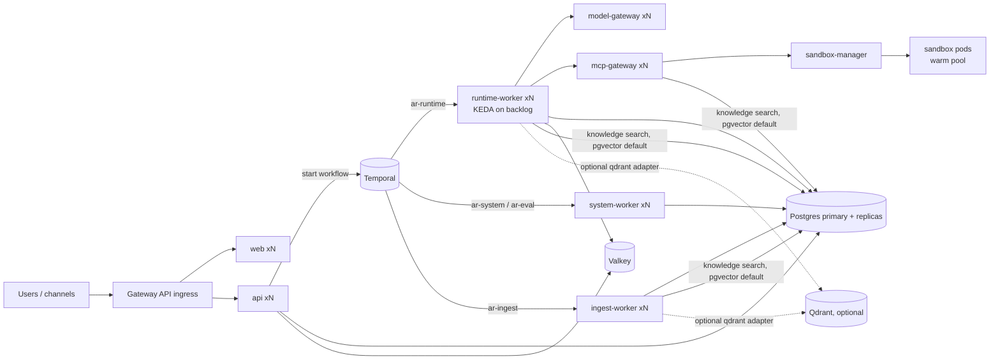

# Scaling and capacity

Target loads are defined in [performance-budgets §3](../08-quality/performance-budgets.md#3-target-load). This document says how each component scales and where the limits are. Tuned values from load tests (M15-T04) are recorded in §5.

## 1. Scaling model

All application deployables are stateless; state lives in Postgres (including knowledge vectors with the default pgvector retrieval adapter), Valkey, Temporal, object storage and, only when the optional qdrant adapter is enabled, Qdrant.

## 2. Per-component guidance

| Component | Scales on | Unit capacity (reference: 1 vCPU / 1 GiB unless stated) | Limits and notes |
|---|---|---|---|
| `api` | HPA CPU 60 %, RPS | ~400 simple req/s per pod; 2,000 SSE connections per pod (async, 2 vCPU / 2 GiB) | SSE per user `AR_SSE_MAX_PER_USER`; DB pool 20 per pod via PgBouncer |
| `runtime-worker` | KEDA: `ar-runtime` workflow+activity backlog, target 20 | 100 concurrent activities, 100 workflow tasks per pod (2 vCPU / 2 GiB); runs are I/O bound on models | Per-tenant fairness: `AR_RUNTIME_TENANT_MAX_ACTIVE_RUNS` ([tenancy-isolation](../02-architecture/tenancy-isolation.md)) |
| `model-gateway` | HPA CPU | ~1,500 streaming req concurrent per pod (2 vCPU) | Real limit is model endpoint capacity: per-model `max_concurrency` semaphores in Valkey ([spec 04](../03-specs/04-model-gateway.md)) |
| `mcp-gateway` | HPA CPU | ~500 tool calls/s per pod | OPA decision latency p99 < 10 ms in-cluster |
| `ingest-worker` | KEDA `ar-ingest` backlog | ~20 pages/s text, ~1 page/s OCR per pod (2 vCPU / 4 GiB) | `AR_INGEST_SYNC_CONCURRENCY`, `AR_INGEST_ACTIVITY_CONCURRENCY` |
| `system-worker` | KEDA `ar-system` | Outbox relay 2,000 events/s per pod | Single active relay per partition key (workflow id) |
| `sandbox-manager` | fixed 2 (leader for pool) | Creates ~10 pods/s; warm pool hides cold start (gVisor ~2–4 s) | `AR_SANDBOX_MAX_PER_TENANT`, namespace ResourceQuota, node pool autoscaler |
| Postgres | Vertical + read replicas | 16 vCPU / 64 GiB primary handles large profile | Hot tables partitioned when > 200 M rows (`run_events`, `usage_events`, `audit_events`, `messages`; [rb-12](runbooks.md#rb-12-partition-a-large-table), OQ-07) |
| Valkey | Vertical; cluster mode for SaaS | 100k ops/s per shard | Streams trimmed by TTL `AR_RUN_STREAM_TTL_S` |
| Temporal | History shards (fixed at creation: 512 for large/saas, 128 small) | ~1,000 workflow state transitions/s per history pod | Shard count cannot change later; choose at install |
| Knowledge retrieval (pgvector, default) | Postgres read replicas (`AR_VECTOR_PG_READ_DSN`) | See §4 | HNSW indexes must fit in `shared_buffers` + page cache for p95 targets |
| Qdrant (optional adapter) | Replicas + sharding per collection | ~10 M chunks per node (8 vCPU / 32 GiB, on-disk vectors + in-RAM HNSW for quantised) | Scalar quantisation enabled for collections > 1 M points |

## 3. Back-pressure and fairness

- Run starts: if a tenant exceeds `AR_RUNTIME_TENANT_MAX_ACTIVE_RUNS`, new runs stay `queued` (after the `run.queued` event, no `run.started` until a slot frees) and start FIFO per tenant.
- Model calls: semaphore wait `AR_MG_SEMAPHORE_WAIT_S` then 429 `rate_limited` → workflow retry with backoff; circuit breaker per provider.
- Quotas: hard token/cost quotas reject with 429 `quota_exceeded` ([spec 17](../03-specs/17-audit-usage-metering.md)).
- Ingestion: per-tenant concurrency limits on sync workflows; large re-index jobs run at lower Temporal priority.
- API: per-tenant and per-user rate limits (Valkey token buckets, [api-conventions](../05-contracts/api-conventions.md)).

## 4. Retrieval store sizing

Default: knowledge retrieval runs on Postgres with the pgvector adapter ([ADR-0009](../02-architecture/adr/ADR-0009-retrieval-stores.md), [spec 10 §7](../03-specs/10-knowledge.md#7-pgvector-adapter-default)).

- **Memory per chunk** (1024 dims, `halfvec`): vector 2 KiB + HNSW graph ~0.3 KiB + `tsvector`/GIN ~1 KiB + row overhead ≈ **4 KiB**. 1 M chunks ≈ 4 GiB, of which the HNSW index (~2.3 GiB) should stay resident in memory.
- **Typical installations** (≤ 5 M chunks, ≤ 20 knowledge queries/s): the primary Postgres of the profile in §2 with `shared_buffers` ≥ 25 % of RAM; no extra component. Expected `knowledge.search` store time p95 ≤ 80 ms at `ef_search=100` (budget: [performance-budgets](../08-quality/performance-budgets.md)).
- **5–20 M chunks or 20–50 queries/s**: route searches to a read replica (`AR_VECTOR_PG_READ_DSN`) sized so the HNSW indexes fit in RAM (e.g. 20 M chunks ≈ 46 GiB HNSW → 64–128 GiB replica); raise `maintenance_work_mem` to 8 GiB and `max_parallel_maintenance_workers` to 4 for index builds during reindex.
- **Beyond ~20 M chunks or sustained > 50 knowledge queries/s**, or when recall at `ef_search ≤ 200` drops below the eval gate: move to the optional Qdrant adapter (`AR_VECTOR_BACKEND=qdrant` + migration, [spec 10 §9](../03-specs/10-knowledge.md#9-migrating-between-backends)) or to a dedicated Postgres cluster for retrieval (point `AR_VECTOR_PG_READ_DSN` at a logical replica of the knowledge tables).
- **Ingestion write load**: ~1,000 chunk upserts/s per primary with HNSW maintenance; large reindexes are throttled by `ReindexCollectionWorkflow` concurrency (8) and run at lower Temporal priority.
- Monitor `ar_retrieval_store_seconds{backend="pgvector",operation="search"}`, index size (`pg_relation_size('ix_chunk_emb_hnsw_1024')`) and buffer hit ratio; alert `ARRetrievalLatencyHigh` (p95 > 150 ms for 15 min, [rb-07](runbooks.md#rb-07-ingestion-failures)).

## 5. Capacity planning formula

For a deployment with `U` active users at peak, `r` runs per active user per minute (default 0.5), average run duration `d` seconds (default 20) and tool calls per run `c` (default 3):
- Concurrent runs ≈ `U × r / 60 × d`; runtime-worker pods ≈ concurrent runs / 80.
- Model concurrency ≈ concurrent runs × 0.7 (fraction of run time in model calls).
- Sandboxes ≈ share of runs using code tools × concurrent runs + warm pool.
- Postgres writes ≈ runs/s × (≈ 40 rows per run incl. steps, events snapshots, usage, audit).

Example (large profile): `U=1,000`, `r=0.5`, `d=20` → ~167 concurrent runs → 3 runtime-worker pods minimum (run 4 for headroom), model concurrency ~120.

## 6. Tuned values

Measured with the in-process probe in `tests/load/harness.py` and recorded in [load-2026-10-28](../08-quality/reports/load-2026-10-28.md).

| Knob | Shipped value | Note |
|---|---|---|
| API pool / HPA | request 1 CPU, limit 2 CPU, 1–2 GiB; HPA CPU 60 %, min 2 (small) or 4 (large), max 30 | SSE grace 60 s, preStop 10 s |
| runtime-worker | 1–2 CPU, 1–2 GiB; `AR_RUNTIME_MAX_CONCURRENT_ACTIVITIES` 100; KEDA threshold 20 on `ar-runtime` | build id from `global.imageTag` when `temporal.workerVersioning` |
| model-gateway, mcp-gateway | 0.5–2 CPU, 512 MiB–1 GiB; HPA min 2 or 3, max 20 | |
| ingest-worker | 1–2 CPU, 2–4 GiB; KEDA on `ar-ingest` | small floor is 1 replica |
| PgBouncer | transaction mode, chart pooler when CloudNativePG is bundled | app `statement_cache_size=0` remains an application setting |
| Valkey | standalone in dev, sentinel (3 pods) in small | not backed up |

The 24 hour soak at 50 % of the §3 target is the nightly Locust entry. This release's committed numbers are the short probe, which stays inside the platform overhead budgets.
