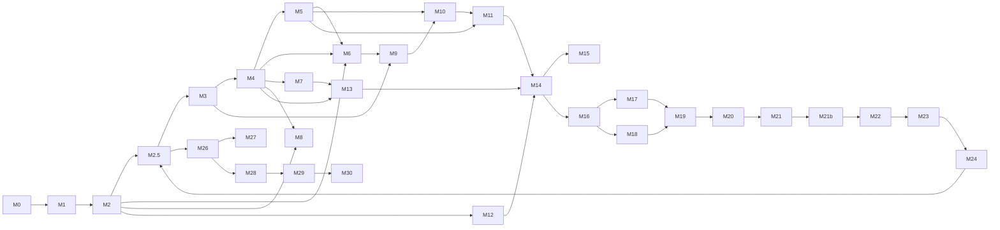

# Plan

This is the record of how the platform was built, milestone by milestone, and the place new work is added. [progress.md](progress.md) says what is done. Open work comes from the owner and from the [November 2026 review](../testing/review-2026-11-05/review-and-remediation-plan.md) ([AGENTS.md](../../AGENTS.md#how-work-is-picked-and-tracked)). A task is sized for one working session (roughly 300–1,500 changed lines including tests), and its dependencies still have to be done first.

## Task format

Every task has:

- **ID** `M{n}-T{nn}` (stable; never renumber — add `M{n}-T{nn}a` if a task must be split).
- **Depends on**: task IDs that must be done first (implicit: all tasks of earlier milestones that are listed as milestone exit criteria).
- **Areas**: files/directories created or changed (paths from [service-decomposition §4](../02-architecture/service-decomposition.md#4-repository-layout)).
- **Spec**: the documents that define behaviour. The spec wins over the task text if they disagree; record the discrepancy in [open-questions](../open-questions.md).
- **Do**: what to build.
- **Done when**: acceptance criteria (all must hold) and **Tests** that must exist and pass in CI.

Progress is tracked in `docs/09-plan/progress.md` (created by M0-T01): one line per task `M1-T03 | done | <commit sha> | notes`.

## Milestones

| # | File | Name | Outcome (exit criteria) | Tasks |
|---|---|---|---|---|
| M0 | [M00-scaffold.md](M00-scaffold.md) | Scaffold & tooling | Monorepo builds, CI green, `make dev` brings up the local stack, fake-llm works, codegen pipeline in place | 12 |
| M1 | [M01-foundation.md](M01-foundation.md) | Data, identity, tenancy, audit, events | Users log in via Keycloak; tenants, users, teams, roles, API keys, secrets, SSO/SCIM; RLS; audit chain; outbox; notifications/webhooks base; admin pages | 16 |
| M2 | [M02-first-chat.md](M02-first-chat.md) | Secrets, model gateway & first chat | A user chats with the default `assistant` agent with streaming over SSE through `model-gateway`; files upload; runs API; usage metered | 13 |
| M2.5 | [M02.5-design-polish.md](M02.5-design-polish.md) | Design polish | The shell, sign-in, chat and admin pages use the design system; Keycloak and a fresh clone work on a laptop whose default ports are taken | 4 |
| M3 | [M03-agent-builder.md](M03-agent-builder.md) | Agent builder & bundles | Builders create, validate, test, publish, roll back agents; bundles import/export; agent catalogue; natural-language builder; content packs | 10 |
| M4 | [M04-tools-mcp.md](M04-tools-mcp.md) | Tools & MCP | Tool servers registered and reviewed; agents call remote MCP, OpenAPI and SQL tools through `mcp-gateway`; OAuth connections; built-ins (files, conversations, web, plan, tools.search) | 10 |
| M5 | [M05-policy-approvals.md](M05-policy-approvals.md) | Policy & approvals | OPA decisions on every tool call; approvals in web; standing approvals; simulation; output sign-off; segregation of duties | 9 |
| M6 | [M06-sandboxes.md](M06-sandboxes.md) | Files, sandboxes & browser | Agents run code and browse in isolated sandboxes with egress control and produce artifacts | 9 |
| M7 | [M07-knowledge.md](M07-knowledge.md) | Knowledge | Collections from uploads and connectors with ACL-aware hybrid retrieval (pgvector default behind a `RetrievalStore` port; optional Qdrant adapter) and citations; strict grounding | 11 |
| M8 | [M08-memory-context.md](M08-memory-context.md) | Memory & context management | User/agent/team memory with extraction and review; context compaction | 5 |
| M9 | [M09-subagents-skills.md](M09-subagents-skills.md) | Subagents & skills | Delegation to subagents as child workflows; versioned skills | 4 |
| M10 | [M10-routines.md](M10-routines.md) | Routines | Scheduled, webhook, event and poll triggers with delivery | 5 |
| M11 | [M11-channels.md](M11-channels.md) | Channels | Slack, Teams, email, OpenAI-compatible API, widget | 8 |
| M12 | [M12-usage-quotas.md](M12-usage-quotas.md) | Usage, quotas & billing | Quotas and plan limits enforced; usage reports and dashboards | 4 |
| M13 | [M13-observability-eval.md](M13-observability-eval.md) | Observability & evaluation | Traces, dashboards, alerts, run inspector; eval suites with publish gates; run records (after M14-T08) | 7 |
| M14 | [M14-security-compliance.md](M14-security-compliance.md) | Security hardening & compliance | Guardrails, PII redaction, retention, DPDP erasure/export, audit export, support access, pen-test fixes; immutable records, external participants, pack hooks | 13 |
| M15 | [M15-deployment.md](M15-deployment.md) | Deployment | Helm chart, both deployment modes, DR drills, load tests at budget, release 1.0 | 7 |
| M16 | [M16-grc-foundation.md](M16-grc-foundation.md) | Foundation (removed in M30) | Removed in M30 | 7 |
| M17 | [M17-grc-connectors-ccm.md](M17-grc-connectors-ccm.md) | Connectors (removed in M30) | Removed in M30 | 6 |
| M18 | [M18-grc-workflows.md](M18-grc-workflows.md) | Workflows (removed in M30) | Removed in M30 | 8 |
| M19 | [M19-grc-audit-reporting.md](M19-grc-audit-reporting.md) | Audit desk (removed in M30) | Removed in M30 | 8 |
| M20 | [M20-certification.md](M20-certification.md) | Platform certification | A real OpenAI-compatible model and a browser pass of the product | 4 |
| M21 | [M21-agentic-workspace.md](M21-agentic-workspace.md) | Agentic workspace | Chat is home. Agents plan, act, check and retry with customer limits. A user can create an agent and connect an OpenAI-compatible model. | 4 |
| M21b | [M21b-general-tools.md](M21b-general-tools.md) | General tools | Sandboxed code and shell, a per-run workspace, page fetch, pluggable web search and call-any-API, with per-agent limits and chat cards. | 3 |
| M22 | [M22-connections-mcp-openapi.md](M22-connections-mcp-openapi.md) | Connections, MCP and OpenAPI | Named connections, an MCP client, OpenAPI import and a tool described in plain language, on one registry. | 4 |
| M23 | [M23-data-analysis.md](M23-data-analysis.md) | Data analysis | Durable connections and tools, a read-only database tool, spreadsheets, charts and structured output. | 4 |
| M24 | [M24-document-intelligence.md](M24-document-intelligence.md) | Document intelligence | Upload a file, keep the extraction, and ask an agent to summarise, compare, check, find gaps and rewrite it with citations. | 4 |
| M25 | [M25-knowledge-memory-skills.md](M25-knowledge-memory-skills.md) | Knowledge, memory and skills | Knowledge bases with hybrid retrieval, visible memory, and portable skills on the live agent path. | 4 |
| M26 | [M26-connectors.md](M26-connectors.md) | Connector catalog | Ready-made connectors for mail, chat, calendars, files and work trackers, with honest live-test labels. | 4 |
| M27 | [M27-connectors.md](M27-connectors.md) | Connector batch two | ServiceNow, Salesforce, Zendesk, HubSpot, Okta, Entra ID, and read-only AWS, Azure and Google Cloud, with honest live-test labels. | 4 |
| M28 | [M28-orchestration.md](M28-orchestration.md) | Orchestration | Agents call agents, runs survive a restart, schedules and webhooks start work, and a person can unblock a paused run. | 3 |
| M29 | [M29-exposure.md](M29-exposure.md) | Expose agents | A published agent is callable over a versioned REST API, as an MCP tool, and over A2A, with its own scoped keys. | 4 |
| M30 | [M30-removal.md](M30-removal.md) | Remove the retired pack | The parked industry pack, its schema, screens and flag are gone. General tools stay. | 1 |
| M31 | — | Final certification | Whole-platform certification on a real model ([report](../testing/m31-certification.md)). | 1 |
| M32 | [M32-hardening.md](M32-hardening.md) | Hardening after the Nov 2026 review | Tenant-scoped settings, real builder and cost, scripted paths removed, chart fixes ([review](../testing/review-2026-11-05/review-and-remediation-plan.md)). | 11 |
| M33a | [M33a-trust.md](M33a-trust.md) | Seed SoD and fetch/search trust | A fresh seed can finish a W2 write. Fetch retries transient failures. Search stays off until a key is set. | 1 |
| M33b | [M33b-ocr-vision.md](M33b-ocr-vision.md) | OCR canary and image questions | A scanned page is readable with local tesseract. An agent can ask about an image when a vision model is configured. | 1 |
| M34a | [M34a-office-create.md](M34a-office-create.md) | Office create | An agent creates a DOCX, PDF or XLSX from a title, sections and tables, and the chat can download it. | 1 |
| M34b | [M34b-sheet-power.md](M34b-sheet-power.md) | Sheet power | Spreadsheet SQL runs in DuckDB. A questionnaire xlsx can be filled and downloaded. Charts have themes and a one-slide PPTX. | 1 |
| M35 | [M35-durability.md](M35-durability.md) | Durability and jobs | Schedules can fire from Temporal's clock, file and workspace bytes survive a restart, the chat cache is capped, and long jobs show progress. | 1 |
| M36 | [M36-live-pack.md](M36-live-pack.md) | Connector live pack | A dry-by-default canary reads each built connector when a token is present, and the catalog says built separately from live. | 1 |
| M37 | [M37-browser-tool.md](M37-browser-tool.md) | Browser as a tool | A controlled browser session for sites without a connector, with approval, isolation and a fixture checklist | 1 |
| M38 | [M38-tool-framework.md](M38-tool-framework.md) | Tool framework hardening | The model reads whole results, an approval continues the turn, reads run together, Stop works, and the default limits fit multi-step work ([review](../testing/tools-review-2026-11-05/tools-review.md)). | 17 |
| M38a | [M38a-one-model-path.md](M38a-one-model-path.md) | One model path | Product code reaches a model one way and holds no fake model, scripted turn or demo fixture. The test stand-in lives in `ar_testing`. | 8 |
| M38b | [M38b-real-tenant.md](M38b-real-tenant.md) | A real tenant from an empty database | A seeded tenant of any name signs in, configures every model in the product, and the basic AI flows work with a real model and no built-in data ([run](../testing/fresh-tenant-2026-11-06/report.md)). | 36 |
| M39 | [M39-tool-surface.md](M39-tool-surface.md) | Tool surface | Every tool is described, with a lint. One workspace with edit and search. Tools load on demand. The model chooses skills. | 6 |
| M40 | [M40-computer.md](M40-computer.md) | A real computer | A container for each conversation with document libraries and a Chromium browser. | 6 |
| M41 | [M41-documents-media.md](M41-documents-media.md) | Documents and media | Skills for PDF, DOCX, PPTX and XLSX, image generation and transcription through registered models. | 8 |
| M42 | [M42-measurement-trust.md](M42-measurement-trust.md) | Measurement and trust | Chain tasks scored live for each model, and chat shows what a tool is doing. | 7 |

Total: **320 tasks** across the 60 milestone rows above (M0–M42, including M2.5 and the lettered milestones). Core 1.0 is M0–M15 and includes the core tasks added for any regulated buyer (M3-T09, M3-T10, M5-T08, M5-T09, M7-T11, M13-T07, M14-T08..M14-T13, M1-T16). M16–M19 shipped a pack that M30 removed. M16 started after M14-T13 and could run in parallel with M15. M13-T07 waits for M14-T08 and is not an M13 exit task. M22 follows M21b. M23 follows M22. M24 follows M23. M25 follows M24. M26 follows M25. M27 follows M26. M28 already shipped from M26 and does not wait on M27. M29 follows M28. M30 follows M29. M33a is the seed SoD and fetch/search trust task. M34a follows M32 and adds `documents.create`. M34b follows M34a and moves spreadsheet SQL to DuckDB. M35 follows M34a for durability, Temporal schedules, cache eviction, A2A list and push, and job progress. OCR, vision and the eval gym stay on their own milestones. M36 follows M27 and adds the connector live-pack harness. It does not wait on analytics, Temporal durability, or the browser track. DuckDB and the browser tool are not part of M35. M37 adds the controlled browser on the M6 session. It does not change analytics, durability or the connector catalog. M38 follows M37 and hardens the tool-calling framework. M38a follows M38-T03 and comes before M38-T04. M39 follows M38. M40 follows M39 and replaces the in-process browser of M37. M41 follows M40. M42 follows M38, and its tasks that show browser and document work wait for M40 and M41.

## Dependency graph

M16 does not wait for M15. M13-T07 is the one task that waits for a later milestone (M14-T08). M30 removes the pack that M16–M19 added. M33b follows M32 and adds local OCR plus `image.ask` ([M33b-ocr-vision](M33b-ocr-vision.md)).

The graph allows parallel work after M5 (M6/M7/M8 can proceed in parallel by different agents), but a single agent should simply follow the milestone order.

## Vertical slices and demo checkpoints

| After | Demo |
|---|---|
| M2 | Log in, chat with `assistant`, see streaming, upload a file, view usage events in DB |
| M2.5 | Sign in as any seeded user, switch light and dark, and read a streamed answer in the centred column. Checklist: [m2.5-checklist](../testing/m2.5-checklist.md) |
| M3 | Describe an agent, preview it, apply the draft, publish, roll back, and import a bundle. Checklist: [m3-checklist](../testing/m3-checklist.md) |
| M4 | Agent files a ticket through a registered MCP server (W1), reads a SQL table |
| M5 | W2 call pauses for approval; approver approves in the inbox; run continues |
| M6 | "Analyse this CSV and chart it" produces a PNG artifact from a sandbox |
| M7 | Answers cite SharePoint documents the user can access, not others |
| M10 | A weekly routine posts a summary to Slack |
| M11 | The same agent answers in Teams and Slack with approval cards |
| M12 | A 10,000 token daily quota blocks the next run, and usage exports as CSV. Checklist: [m12-checklist](../testing/m12-checklist.md) |
| M15 | Fresh install on a kind cluster in both modes; DR restore drill passes |

## Visual test

Every milestone must be visually testable before merge. The pull request body includes **How to test visually**:

1. **Start the stack.** Exact commands, usually `make bootstrap && make dev`. When compose is enough, say which profiles. Say which processes must be up (api, web, fake-llm).
2. **Seeded demo.** What `make seed` inserts, how to sign in (**Continue with SSO** as a seeded person; the product has no other way in), and the tenant, agent and model the click-through uses. Chat must work without an external API key.
3. **Checklist.** Numbered steps for every user-visible feature delivered by this milestone and earlier milestones. Each step says what to click or type and what the user should see, including empty, loading and error states.
4. **Host ports.** When the default ports are taken, say which variables to set. `make ports-check` names each busy port and the `.env` assignment that frees it. `make dev AUTO_PORTS=1` picks free ports and rewrites the localhost URLs (`AR_PG_HOST_PORT` updates `AR_DATABASE_URL`, `AR_PORT` updates the API listen port and `API_PROXY_URL`). Defaults stay 5432, 6379, 7233, 8000 and the rest of the [local port table](../07-ops/local-dev.md#5-host-ports).

Playwright in `apps/web/e2e` walks the same paths and saves screenshots. A milestone does not merge on green unit tests alone when it changes a screen.

## Migration mapping

Alembic revisions are created by the tasks listed in [migrations §3](../04-data/migrations.md#3-initial-revision-plan). A task that creates a revision must use exactly that revision number and name.

## Cross-cutting rules for every task

1. Read [AGENTS.md](../../AGENTS.md) "never skip" rules.
2. Every new endpoint: router + service + OpenAPI regenerated (`make gen`) + permission check + audit (if it changes state) + tests (unit + integration + cross-tenant case).
3. Every new table: migration with RLS + model + repository + factory in `ar_testing`.
4. Every new workflow/activity: deterministic workflow code, idempotent activities, Temporal test-env test.
5. Every new UI page: loading/empty/error states, permission gating, Vitest component test, Playwright happy path, axe check.
6. Every new metric, alert, env var or audit action: add it to the owning spec **and** to the catalogues ([environments §3](../07-ops/environments.md#3-variable-catalogue), [audit §3](../06-security/audit.md#3-catalogue)); CI `docs` job checks this.
7. Dev seed data grows with the product: `scripts/seed.py` (created in M1-T03; idempotent; runs `ar_domain.seed.apply()`) seeds tenant `dev` and the four `@dev.local` users; M2 adds the `fake-llm` provider, aliases `reasoning`, `fast`, `vision`, `embed`, `rerank`, team `everyone` and the published `assistant`; M3 adds the sample agent `Helpdesk` and the built-in `builder`; M4-T06 adds the `mcp-openapi` petstore tool server; M7-T01 adds a sample collection with three markdown documents. Each addition is part of that task's Done-when ([local-dev §2](../07-ops/local-dev.md#2-make-targets-the-only-entry-points)).
8. **Visual test.** Every milestone pull request includes a **How to test visually** section: exact local start commands, seeded demo login and data, and a numbered click-through of every user-visible feature so far. See [Visual test](#visual-test).
