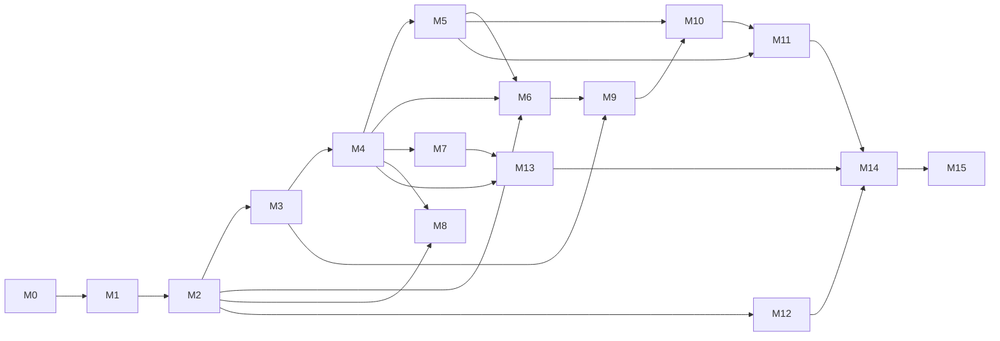

# Implementation plan

This is the ordered backlog an implementing agent follows. **Work strictly in milestone order; inside a milestone, pick the lowest-numbered task whose dependencies are all done** ([AGENTS.md](../../AGENTS.md#how-to-pick-the-next-task)). Each task is sized for one agent session (roughly 300–1,500 changed lines including tests).

## Task format

Every task has:

- **ID** `M{n}-T{nn}` (stable; never renumber — add `M{n}-T{nn}a` if a task must be split).
- **Depends on**: task IDs that must be done first (implicit: all tasks of earlier milestones that are listed as milestone exit criteria).
- **Areas**: files/directories created or changed (paths from [service-decomposition §4](../02-architecture/service-decomposition.md#4-repository-layout)).
- **Spec**: the documents that define behaviour. The spec wins over the task text if they disagree; record the discrepancy in [open-questions](../open-questions.md).
- **Do**: what to build.
- **Done when**: acceptance criteria (all must hold) and **Tests** that must exist and pass in CI.

Progress is tracked in `docs/09-plan/progress.md` (created by M0-T01): one line per task `M1-T03 | done | <commit sha> | notes`.

## Milestones

| # | File | Name | Outcome (exit criteria) | Tasks |
|---|---|---|---|---|
| M0 | [M00-scaffold.md](M00-scaffold.md) | Scaffold & tooling | Monorepo builds, CI green, `make dev` brings up the local stack, fake-llm works, codegen pipeline in place | 12 |
| M1 | [M01-foundation.md](M01-foundation.md) | Data, identity, tenancy, audit, events | Users log in via Keycloak; tenants, users, teams, roles, API keys, secrets, SSO/SCIM; RLS; audit chain; outbox; notifications/webhooks base; admin pages | 15 |
| M2 | [M02-first-chat.md](M02-first-chat.md) | Secrets, model gateway & first chat | A user chats with the default `assistant` agent with streaming over SSE through `model-gateway`; files upload; runs API; usage metered | 13 |
| M3 | [M03-agent-builder.md](M03-agent-builder.md) | Agent builder & bundles | Builders create, validate, test, publish, roll back agents; bundles import/export; agent catalogue | 8 |
| M4 | [M04-tools-mcp.md](M04-tools-mcp.md) | Tools & MCP | Tool servers registered and reviewed; agents call remote MCP, OpenAPI and SQL tools through `mcp-gateway`; OAuth connections; built-ins (files, conversations, web, plan, tools.search) | 10 |
| M5 | [M05-policy-approvals.md](M05-policy-approvals.md) | Policy & approvals | OPA decisions on every tool call; approvals in web; standing approvals; simulation | 7 |
| M6 | [M06-sandboxes.md](M06-sandboxes.md) | Files, sandboxes & browser | Agents run code and browse in isolated sandboxes with egress control and produce artifacts | 9 |
| M7 | [M07-knowledge.md](M07-knowledge.md) | Knowledge | Collections from uploads and connectors with ACL-aware hybrid retrieval (pgvector default behind a `RetrievalStore` port; optional Qdrant adapter) and citations | 10 |
| M8 | [M08-memory-context.md](M08-memory-context.md) | Memory & context management | User/agent/team memory with extraction and review; context compaction | 5 |
| M9 | [M09-subagents-skills.md](M09-subagents-skills.md) | Subagents & skills | Delegation to subagents as child workflows; versioned skills | 4 |
| M10 | [M10-routines.md](M10-routines.md) | Routines | Scheduled, webhook, event and poll triggers with delivery | 5 |
| M11 | [M11-channels.md](M11-channels.md) | Channels | Slack, Teams, email, OpenAI-compatible API, widget | 8 |
| M12 | [M12-usage-quotas.md](M12-usage-quotas.md) | Usage, quotas & billing | Quotas and plan limits enforced; usage reports and dashboards | 4 |
| M13 | [M13-observability-eval.md](M13-observability-eval.md) | Observability & evaluation | Traces, dashboards, alerts, run inspector; eval suites with publish gates | 6 |
| M14 | [M14-security-compliance.md](M14-security-compliance.md) | Security hardening & compliance | Guardrails, PII redaction, retention, DPDP erasure/export, audit export, support access, pen-test fixes | 7 |
| M15 | [M15-deployment.md](M15-deployment.md) | Deployment | Helm chart, both deployment modes, DR drills, load tests at budget, release 1.0 | 7 |

Total: **130 tasks**.

## Dependency graph

The graph allows parallel work after M5 (M6/M7/M8 can proceed in parallel by different agents), but a single agent should simply follow the milestone order.

## Vertical slices and demo checkpoints

| After | Demo |
|---|---|
| M2 | Log in, chat with `assistant`, see streaming, upload a file, view usage events in DB |
| M4 | Agent files a ticket through a registered MCP server (W1), reads a SQL table |
| M5 | W2 call pauses for approval; approver approves in the inbox; run continues |
| M6 | "Analyse this CSV and chart it" produces a PNG artifact from a sandbox |
| M7 | Answers cite SharePoint documents the user can access, not others |
| M10 | A weekly routine posts a summary to Slack |
| M11 | The same agent answers in Teams and Slack with approval cards |
| M15 | Fresh install on a kind cluster in both modes; DR restore drill passes |

## Migration mapping

Alembic revisions are created by the tasks listed in [migrations §3](../04-data/migrations.md#3-initial-revision-plan). A task that creates a revision must use exactly that revision number and name.

## Cross-cutting rules for every task

1. Read [AGENTS.md](../../AGENTS.md) "never skip" rules.
2. Every new endpoint: router + service + OpenAPI regenerated (`make gen`) + permission check + audit (if it changes state) + tests (unit + integration + cross-tenant case).
3. Every new table: migration with RLS + model + repository + factory in `ar_testing`.
4. Every new workflow/activity: deterministic workflow code, idempotent activities, Temporal test-env test.
5. Every new UI page: loading/empty/error states, permission gating, Vitest component test, Playwright happy path, axe check.
6. Every new metric, alert, env var or audit action: add it to the owning spec **and** to the catalogues ([environments §3](../07-ops/environments.md#3-variable-catalogue), [audit §3](../06-security/audit.md#3-catalogue)); CI `docs` job checks this.
7. Dev seed data grows with the product: `scripts/seed.py` (created in M1-T03; idempotent; runs `ar_domain.seed.dev.run()`) seeds tenant `dev` and the four `@dev.local` users; M2-T01 adds the `fake-llm` provider and aliases `reasoning`, `fast`, `vision`, `embed`, `rerank`; M3-T01 adds the sample agent `Helpdesk`; M4-T06 adds the `mcp-openapi` petstore tool server; M7-T01 adds a sample collection with three markdown documents. Each addition is part of that task's Done-when ([local-dev §2](../07-ops/local-dev.md#2-make-targets-the-only-entry-points)).
