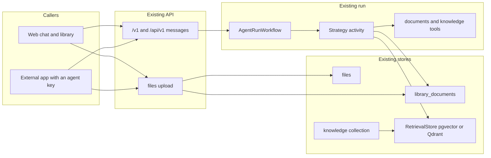
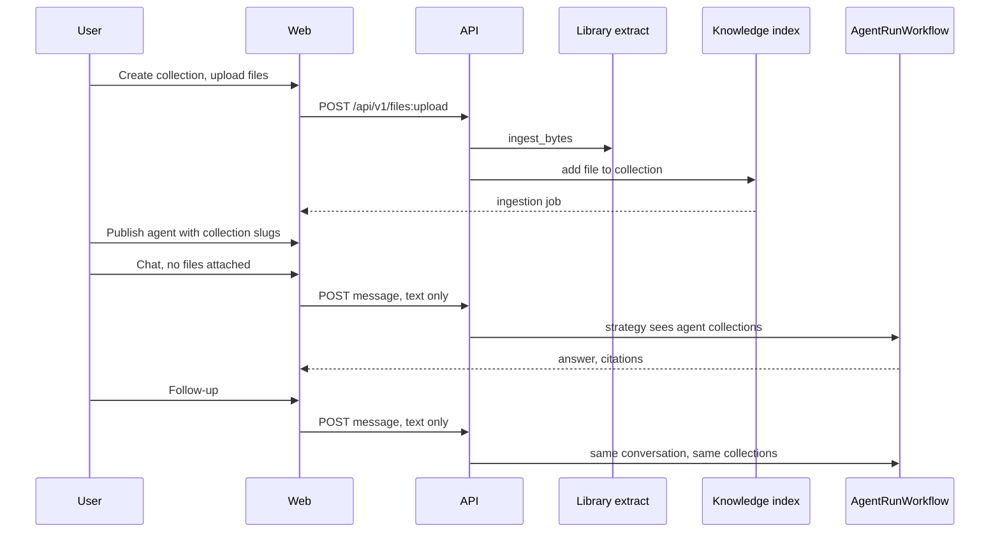
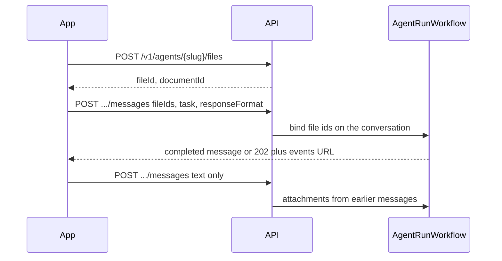
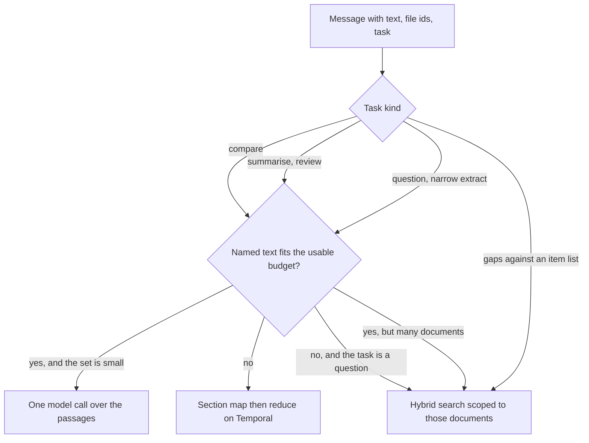

# Document tasks over stored and inline files

Design only. No product code in this change. Status: proposed, waiting on Bala
([OQ-151](../open-questions.md)). Date: 2026-11-20.

A person or an external application names one or more documents, stored or sent
with the request, and asks for a task: review, compare, find gaps, compose,
summarise, extract, or ask a question. The request goes to ordinary chat or to
a specialised agent. A follow-up stays in the same conversation and does not
resend the files.

This document says what already exists, what to add, and how hard each piece
is. It extends the library, the knowledge index, and the `/v1` agent API. It
does not add a third document store or a separate task service.

## 1. How hard this is

Most of the journey is already built. The missing piece is one request that
names stored files and inline files, chooses a reading strategy, and keeps
those files on the conversation.

| Slice | Rating | Why |
|---|---|---|
| Name stored files on a chat or agent call, and follow up without resending | Medium | Upload, library extract, conversation attachments, `/v1` messages, `responseFormat`, and SSE already exist. The call cannot yet name a library or knowledge document that was not attached to this thread. |
| Put a document that fits into the prompt, with page citations | Easy | Passages, anchors, and the citation drawer exist. The prompt currently shows about 1,500 characters of each attachment. Raising that to the context budget is a change in one place. |
| Hybrid search limited to the named documents | Medium | pgvector and Qdrant already do hybrid search, rerank, ACL, and `min_score`. Search is scoped to collections, not to a list of documents. |
| Whole-document review, compare, and gaps when the text does not fit | Hard | Today's tools read at most 12,000 characters, or 40,000 for a self-check, and then stop. A section map-reduce on Temporal is new work, and the quality depends on the model. |
| OCR of a scan, and Office files | Medium for text, hard for layout | Tesseract and a configured vision model already read scans. Tables in a born-digital DOCX or XLSX are extracted. Tables in a scanned page are not. |
| Demo UI for library, upload, citations, compare | Easy to medium | The screens exist. Ingestion status on the library is decorative, and there is no delete. |

Four pull requests, in [§14](#14-phased-delivery). The first is enough to demo
short documents end to end. The third is the one that makes long-document
compare and gap analysis real, and its urgency depends on the context window
the operator registers ([§8](#8-large-documents)).

On Qwen3-32B's native 32,768-token window, a specialised agent can hold about
20 to 40 pages. Anything longer needs retrieval or map-reduce. On the install's
current example model, `Qwen/Qwen3.8-27B`, the native window is 262,144 tokens,
so a few hundred pages can fit in one call when the GPU actually serves that
length. The strategy reads the registered `context_window`. It does not assume
either card.

## 2. What this extends

Two stores already hold documents. They stay.

| Store | Table | Role today | Role in this design |
|---|---|---|---|
| Chat file | `files` | Bytes, owner, conversation, SHA-256, retention | The public id. Upload once, name it later. Ephemeral files use `retention_until`. |
| Library | `library_documents` | Sync extract: passages, tables, page anchors, hash dedupe | The text the tools and the prompt read. Linked to `files` by hash, as chat upload already does. |
| Knowledge | `knowledge_collections`, `documents`, `document_chunks`, `chunk_embeddings`, `ingestion_jobs` | Async parse, structure-aware chunks, hybrid index, ACL | Predefined libraries, and any file the strategy indexes because it does not fit. |

A collection is the predefined library (a knowledge base, possibly bound to an
agent). A chat upload is an on-the-fly file. Both are `files` rows. The library
row is the extraction. The knowledge document is the index, created when the
file is placed in a collection or when a task needs search over text that does
not fit.

`documents.raw_file_id` already exists and is unused
(`libs/ar_domain/src/ar_domain/knowledge/tables.py:198`). Filling it is the
link. No new document table.



## 3. Sources

Patterns taken from current vendor docs, checked on 2026-11-20. The product
keeps its own names (`files`, collections, `AgentRunWorkflow`). It does not
copy OpenAI object names.

- OpenAI Files. Upload once, id reused, optional expiry. Individual files up to
  512 MB. `expires_after.seconds` is 3,600 to 2,592,000 (1 hour to 30 days),
  anchored at `created_at`. Other files stay until deleted.
  <https://developers.openai.com/api/reference/resources/files>
- OpenAI file search on the Responses API. A vector store is the knowledge
  base. `file_search` takes `vector_store_ids`, can set `max_num_results`, and
  can filter on file metadata. The model call returns a `file_search_call` and
  a message with file citations. File search is the recommended path for large
  files; `input_file` is for files that go straight into the request.
  <https://developers.openai.com/api/docs/guides/tools-file-search>
- OpenAI file inputs. `input_file` accepts `file_id`, base64 `file_data`, or
  `file_url`. PDF can send text and page images. Other office types send
  extracted text only, so charts inside a DOCX are dropped unless the caller
  converts to PDF.
  <https://developers.openai.com/api/docs/guides/file-inputs>
- OpenAI conversation state. `previous_response_id` with `store: true` chains
  turns so the file is not resent. The Assistants migration guide also offers
  a Conversation object instead of chaining response ids. The Assistants API
  itself was turned off on 26 August 2026. Vector store ids survived that
  shutdown and are what `file_search` uses.
  <https://developers.openai.com/api/docs/guides/conversation-state>
  <https://developers.openai.com/api/docs/assistants/migration>
- Assistants file-search defaults, from the v2 FAQ (the API is retired; the
  numbers are the precedent, not a spec to copy): 800-token chunks, 400-token
  overlap, at most 20 chunks in context. The FAQ also records the gaps that
  matter here: no image parsing inside documents, and no retrieval over CSV.
  <https://help.openai.com/en/articles/8550641-assistants-api-v2-faq>
- ChatGPT Projects. Files, instructions, and chats stay together. A later chat
  in the project sees the files without a new upload. Plan limits are small
  (5, 25, or 40 files). Custom GPTs, which held up to 20 knowledge files, are
  scheduled to retire on 11 December 2026; the help centre points ongoing work
  at Projects.
  <https://help.openai.com/en/articles/10169521-projects-in-chatgpt>
  <https://help.openai.com/en/articles/8555545-uploading-files-and-audio-to-chatgpt>
- Qwen3-32B. Native context 32,768 tokens, 131,072 with YaRN. The card warns
  that static YaRN can hurt short prompts, so it should be on only when the
  deployment serves long context.
  <https://huggingface.co/Qwen/Qwen3-32B>
- Qwen3.8-27B. This is the model the README and the live-cert scripts name
  (`README.md:55`, `scripts/certify_live.py`). Native context 262,144 tokens,
  extensible to 1,000,000 with YaRN. The card's 1M figure is the hosted
  service, not the published `config.json`.
  <https://huggingface.co/Qwen/Qwen3.8-27B>

## 4. What exists today

Status is against the journey in §1. "Done" means a caller can use it now.
"Partial" means the mechanism exists and stops short of the journey. "Missing"
means there is no code path.

### 4.1 Done

| Capability | Evidence |
|---|---|
| Library upload, SHA-256 dedupe per tenant, 25 MB cap, sync extract | `MAX_DOCUMENT_BYTES` at `libs/ar_domain/src/ar_domain/documents/library.py:48`. Dedupe returns the existing row at `library.py:186-199`. `POST /api/v1/library-documents` at `services/api/src/ar_api/routers/documents.py:100-117`. Unique `(tenant_id, content_hash)` in migration `20261104_0026`. |
| PDF, DOCX, XLSX, PPTX, TXT, MD, HTML, images | `libs/ar_domain/src/ar_domain/documents/extract.py` (module doc, lines 1-4). PDF via pypdf at `extract.py:166-190`. Office is zip XML. |
| Page cap 600, scanned page detected | `MAX_PAGES = 600` at `extract.py:24`, enforced at `extract.py:186-190`. A PDF page with fewer than 20 characters of text is sent to OCR at `extract.py:205-215`. |
| Local OCR and optional vision OCR | Tesseract on `PATH` (`libs/ar_domain/src/ar_domain/documents/ocr.py:33-36`). Vision alias via `VisionReader` (`ocr.py:71-102`) and `image.ask` with an 8 MB cap (`libs/ar_domain/src/ar_domain/documents/vision.py:38`). |
| Passage chunking with page and heading | Library: 1,000 characters, 120 overlap (`libs/ar_domain/src/ar_domain/documents/chunk.py:16-18`). Knowledge: headings, tables, and code fences, default 512 tokens and 12% overlap (`libs/ar_domain/src/ar_domain/knowledge/chunker.py:33-73`). |
| Anchors and page citations | Library anchors look like `p1-s0`. Chat turns library anchors on attached files into citation chips (`libs/ar_domain/src/ar_domain/documents/cited.py`). The drawer links to `/documents/{documentId}` (`apps/web/src/components/chat/citations.tsx`). |
| Document tools | `documents.list`, `search`, `ingest`, `read`, `outline`, `tables`, `summarise`, `compare`, `crosscheck`, `judge`, `missing`, `rewrite`, `redact`, `extract`, `create`, `ocr`. Dispatch at `libs/ar_domain/src/ar_domain/tools/documents.py:31`. |
| Quote checks | Judge, extract, summarise, and crosscheck keep a claim only when the quote is in the stored passage. Crosscheck refuses a document over 40,000 characters (`libs/ar_domain/src/ar_domain/documents/crosscheck.py:27-28`). |
| Knowledge collections, jobs, hybrid index | Tables at `libs/ar_domain/src/ar_domain/knowledge/tables.py`. `ingestion_jobs` at `tables.py:290-333`, and the bucket is tracked (`libs/ar_domain/src/ar_domain/durable/tracking.py:234`). Ingest is one Temporal activity, `IngestDocumentWorkflow` (`services/ingest/src/ar_ingest/workflows/ingest_document.py:12-20`), which calls `ingest_document_async` (`libs/ar_domain/src/ar_domain/knowledge/pipeline.py:42`). |
| Hybrid search | pgvector: dense cosine plus `tsvector`, fused with reciprocal rank (`libs/ar_domain/src/ar_domain/knowledge/store_pgvector.py`). Qdrant: named dense and sparse vectors, same fusion, optional profile (`compose.yaml:278-284`). Default backend is pgvector (`tables.py:88-89`). |
| Rerank and `min_score` | After fusion, `apply_rerank` drops hits under the caller bar or the model's floor, default 0.2 (`libs/ar_domain/src/ar_domain/knowledge/retrieval.py:57-96`, `libs/ar_domain/src/ar_domain/models/embedding.py:51-52`). The bar is agent `knowledge.min_score`, then tenant `knowledge.min_score`, then `AR_KNOWLEDGE_MIN_SCORE` (`libs/ar_domain/src/ar_domain/knowledge/threshold.py:17-31`). The score used is `rerank_score`, then dense `similarity`. The fusion rank is not a relevance score (`threshold.py:42-48`). |
| Agent default collections | `knowledge.collections`, `autoRetrieve`, `topK`, `minScore` (`libs/ar_contracts/src/ar_contracts/definitions.py:76-81`, `docs/05-contracts/definition-schema.md:71-75`). |
| Chat upload becomes a library document | `POST /api/v1/files:upload` stores the file and, when extract succeeds, adds `documentId` (`services/api/src/ar_api/routers/m2.py:866-889`). |
| Follow-up keeps earlier attachments | `conversation_attachments` walks every user message in the conversation (`libs/ar_domain/src/ar_domain/files/attachments.py:51-96`). A later turn sends text only. The prompt shows a 1,500-character excerpt and the library id (`attachments.py:22-23`, `127-141`). |
| External API | Bearer agent key. `POST /v1/agents/{slug}/files`, `POST /v1/agents/{slug}/conversations`, `POST .../messages` and `POST /v1/agents/{slug}:run` take `text`, `attachmentIds`, `stream`, `responseFormat`, `suggestFollowups` (`services/api/src/ar_api/routers/exposure.py:57-62`). `/v1` waits for the run. `stream: true` is SSE after the run. `GET .../runs/{id}/events` tails the run. |
| Structured output | `responseFormat` is a JSON Schema, Draft 2020-12, checked before the turn (`ar_domain/tools/structured.py`). The same field exists on the web message body (`m2.py:108-113`). |
| Async run with webhook | `POST /api/v1/runs` takes `wait` and `callbackUrl` (`m2.py:130-136`). It does not take files. |
| Tenancy | `library_documents` and the knowledge tables enable tenant RLS. `files` does too. The policy is `tenant_isolation` (`libs/ar_domain/src/ar_domain/migrations/helpers.py`). |
| Library and knowledge screens | `/documents` uploads, lists, shows passages and outline, and runs compare, judge, and rewrite (`apps/web/src/components/documents/screens.tsx`). `/knowledge` creates collections, uploads, and shows documents, search, sources, and jobs. Chat attaches files with the paperclip (`apps/web/src/components/chat/chat-screen.tsx`). |
| Compose deploy | Postgres, Temporal, and the API are the default compose file. ClamAV is profile `scan` (`compose.yaml:272-276`). Qdrant is profile `qdrant`. Tesseract is a package in the API and ingest images, not a service (OQ-61, OQ-73). |

### 4.2 Partial

| Capability | What is there | Where it stops |
|---|---|---|
| One id for a document | A file id resolves to a library row by SHA-256 (`library.py:781-799`). Upload returns both ids. | The message API accepts `attachmentIds` (file ids) only. It has no `documentIds` or collection ids (`exposure.py:57-62`, `m2.py:108-113`). |
| Library search | `documents.search` scores word overlap and returns the page and anchor (`library.py:296-325`, `chunk.py:55-91`). | Passage embeddings are written onto the library row at ingest (`library.py:245-247`) and never read by search. There is no HTTP search on the library router. |
| Knowledge search of a named file | Delete-by-document exists (`store_pgvector.py` around the `document_id` predicate). Hits carry `document_id`, page range, and heading (`searching.py`). | `HybridQuery` has collection targets and no document list (`libs/ar_domain/src/ar_domain/knowledge/store_types.py:80-90`). `knowledge.search` and `POST /api/v1/knowledge/search` cannot be limited to the files named on this request. |
| `min_score` on every path | Chat auto-retrieve uses `retrieval_bar` (`libs/ar_domain/src/ar_domain/workspace/turn.py`). | The `knowledge.search` tool and the search API do not pass `min_score`. With no reranker, hits are returned in search order and `answerable` is false (`retrieval.py:77-78`, `121-123`). |
| Long documents | Library read and grounded tools stop at 12,000 characters (`library.py:49`, `chunk.py:18`). | A longer file is not summarised or compared in sections. Crosscheck returns an error over 40,000 characters (OQ-147). |
| Two parsers | Knowledge PDF calls `pdf_markdown` in `documents.extract` (`libs/ar_domain/src/ar_domain/knowledge/parse.py:195-203`). | DOCX, XLSX, and PPTX are parsed a second time in `parse.py`. CSV is a knowledge kind (`parse.py:39-40`) and is not a library kind. Docling runs only when the ingest extra is installed, and only after the native parsers (`parse.py:206-218`). |
| OCR engines | Tesseract and the vision alias are real. `documents.ocr` reports page progress through `note_job` (`tools/documents.py:209-275`). | Cloud engines are named and return `not_live` unless the tenant has stored an endpoint URL in a named secret, in which case `read_cloud` POSTs the bytes (`ocr.py:17-25`, `libs/ar_domain/src/ar_domain/documents/ocr_cloud.py:26-79`). There is no confidence score and no layout tree. Calling `documents.ocr` with only a `documentId` returns the stored text; it does not re-read the scan (`tools/documents.py:187-204`). |
| Ingest of a chat file into the vector index | Knowledge upload from the collection screen indexes a file. `raw_file_id` is a column. | Chat upload writes the library only. `raw_file_id` is not set. `ingestion_jobs.collection_id` is non-null (`tables.py:320-324`), so an ad-hoc file has nowhere to index until it is placed in a collection. |
| Versions | Rule sets have a version. Knowledge re-ingest skips unchanged bytes. | A library rewrite edits passages in place (`library.py:740-773`). `files` has `sha256` and no unique `(tenant_id, sha256)` (`libs/ar_domain/src/ar_domain/files/tables.py:67`). A changed file is a new row only by accident of the bytes. |
| Retention | `files.retention_until` and an index exist (`files/tables.py:43-47`, `77`). | Nothing sets a caller-chosen TTL on upload. Deleting a library document is not implemented: the documents router has no `DELETE`. Knowledge `delete_document` removes vectors through `memory_index`, then marks the row deleted (`libs/ar_domain/src/ar_domain/knowledge/syncing.py:214-238`). A Qdrant-only collection needs the same call on the Qdrant adapter. |
| Malware scan | `scan_bytes` rejects the EICAR test string when the scanner name is not `none` (`libs/ar_domain/src/ar_domain/files/logic.py:86-96`). The default scanner name is `clamav` (`libs/ar_common/src/ar_common/settings.py:342`). Compose can run `clamav/clamav:1.5.4` on profile `scan`. | The Python function never opens a ClamAV socket. A file without the EICAR marker is `clean`. |
| Agent bound to specific files | An agent binds up to 20 collection slugs. | No `fileIds` on `KnowledgeSpec` (`definitions.py:76-81`). |
| `/v1` async | Web `POST /api/v1/runs` is 202 plus an optional webhook, without files. `/v1` blocks. OQ-149: the `/v1` wait gives up after about a minute (`watch_polls`) and returns the run so far. | A long document task on `/v1` needs `wait: false` and the events URL, which already exists for runs. |
| Research | `POST /api/v1/research/runs` and `/v1/research/runs` run a web search and fetch pipeline on `AgentRunWorkflow`. | It does not read the library. A document task is not a research run. |
| Library UI status | The list shows type and page count, with loading, empty, and error states. | The status badge is a constant "ready". A failed extract is not shown as failed. |
| Context window | The model row has `context_window`. The gateway rejects a prompt that does not fit. Qwen3 registrations only default `enable_thinking` to false (`libs/ar_domain/src/ar_domain/models/options.py:10-17`). | Nothing in the repo stores 32768 or 262144 for these models. The strategy is wrong until an operator sets `context_window` to the length the process actually serves. |

### 4.3 Missing

| Capability | Notes |
|---|---|
| A request field that names stored documents and collections together with new files | The body has `attachmentIds` only. |
| Inline bytes on the message | JSON bodies are capped at 1 MB (`settings.py`, `max_json_body_bytes`). Library and file upload are multipart and allow 25 MB. There is no `file_data` on the message. |
| Per-request strategy (`full`, `retrieve`, `mapReduce`) | Tools pick their own character cap. |
| Section map-reduce and hierarchical summary | OQ-147 records this as not built. |
| Heading alignment across two documents | `documents.compare` sends both documents and stores `document_comparisons`. It has no section aligner. |
| Character offsets inside a page | Anchors and page numbers exist. A citation cannot highlight a range of characters. |
| Retrieval eval for document tasks | Eval suites exist for other gyms. There is no hit-at-k suite for "this question must cite this anchor" and "a miss must abstain". |
| Per-document ACL on the library | Any `chat:use` principal in the tenant can list every library row (`library.py:264-271`). Knowledge documents carry `acl_principals` (`tables.py:196`) and collections have readers and managers. |
| First-class CSV in the library | A CSV that looks like text is stored as one page. Knowledge parse has a CSV path. Spreadsheet SQL is a separate tool (`general.query_table`, DuckDB, 5,000 rows, OQ-60). |

## 5. Journeys

### 5.1 Predefined documents, then many questions

This is the ChatGPT project / vector-store shape. The files are uploaded once.



### 5.2 On-the-fly file, then follow-ups



A file that fits is read from the library passages. A file that does not fit
is indexed into the tenant upload collection (see §7.2) and searched with a
document filter.

### 5.3 Where a task runs



Compare is the exception inside "fits": two long outlines still go through
section alignment when either document uses more than half the usable budget
or has more than 15 headings. A single call over two huge prompts is allowed
only for short documents. Lost-in-the-middle is the reason, not only the
window.

## 6. Data model and API

Contracts are additive and camelCase on the wire. Existing routes stay. A
task is a message, not a new resource.

### 6.1 Files

`files` remains the public object.

| Field | Change |
|---|---|
| `id` | Unchanged. This is the id callers store. |
| `sha256` | Already stored. Add a unique index on `(tenant_id, sha256)` for rows with `deleted_at` null and `retention_until` null, so a durable re-upload returns the same id. An ephemeral upload (a non-null `retention_until`) does not reuse a durable row, and does not shorten a durable row's life. |
| `retention_until` | Already stored. `expiresAfterSeconds` on upload sets it. Allowed range matches the Files API precedent: 3,600 to 2,592,000 seconds. Omit it for a durable file. The existing retention sweep deletes the row. |
| `replacesFileId` | Optional on upload. A different hash creates a new id. Bindings that name the old id are left as they are. There is no "latest version" pointer in v1 of this design. |
| Library link | Unchanged: the library row is found by hash. Response adds `documentId` when extract succeeded, which upload already does for the web route. |
| Knowledge link | Set `documents.raw_file_id` when the file is indexed. |

Dedupe is per tenant. Another tenant's identical bytes are another row. RLS
already hides the other tenant; the unique index includes `tenant_id`.

Versions are new ids on purpose. The library rewrite flow stays a proposal
until a person accepts it. Accepted rewrites keep editing the extraction in
place; that is a text edit, not a file version. A caller who needs the old
bytes keeps the old file id.

### 6.2 Collections

No new collection type. `POST /api/v1/knowledge/collections` is the predefined
library. Membership is the existing "add documents" path. Visibility, readers,
managers, and `acl_principals` stay the access model.

A tenant gets one system collection, slug `uploads`, created on first use by
the strategy when an on-the-fly file must be indexed and the caller did not
name a collection. It uses the same tables, the same ingest workflow, and the
uploader's principals. It is hidden from the collections grid. Deleting the
file deletes its knowledge document.

`knowledge.indexChatUploads` defaults to false. Chat images and small files
are not embedded just because they were attached. The strategy indexes a file
when the task needs retrieval or map-reduce.

### 6.3 Agent default documents

Add to `KnowledgeSpec`, and to the YAML under `knowledge`:

```yaml
knowledge:
  collections: [contracts]
  fileIds: []            # optional extra files, public file ids
  autoRetrieve: true
  topK: 8
  minScore: 0.30
```

`fileIds` is at most 20, the same cap as collections. Publish resolves each
id inside the tenant or the publish fails. The runtime treats these files as
named on every turn, in addition to files the conversation attached.

`autoRetrieve: true` keeps today's behaviour for collection Q&A, with the
document filter applied when `fileIds` or conversation files are set so the
search cannot wander into the rest of the collection.

### 6.4 Message contract

Add fields to the web `MessageBody` and the `/v1` `SendBody`. All optional.
Old clients keep working.

| Field | Meaning |
|---|---|
| `attachmentIds` | Unchanged. New uploads, already the on-the-fly path. |
| `fileIds` | Stored file ids. Same resolution as attachments. Written onto the user message as file content parts, so the next turn finds them without the client sending them again. |
| `collectionIds` | Extra collections for this turn, added to the agent's. Capped at 20 with the agent's list. |
| `task` | `question`, `summarise`, `extract`, `review`, `compare`, `gaps`, `compose`, or `auto`. `auto` inspects the text. The value is a hint to the strategy, not a tool name. |
| `strategy` | `auto`, `full`, `retrieve`, or `mapReduce`. Default `auto`. |
| `items` | Strings or `{id, text}` for gaps and review. The checklist lives on the request, the agent instructions, or a pack. Core has no checklist. |
| `responseFormat` | Unchanged. JSON Schema for extract and for any task that should return structured JSON. |
| `suggestFollowups` | Unchanged. |
| `stream` | Unchanged on `/v1`. |
| `wait` | New on `/v1`, default true (today's blocking call). `false` returns 202 with `runId` and the events URL. |
| `callbackUrl` | New on `/v1`, the same webhook behaviour as `POST /api/v1/runs`. |

`POST /api/v1/runs` gains `fileIds`, `attachmentIds`, `collectionIds`, `task`,
`strategy`, `items`, and `responseFormat`. It already has `wait` and
`callbackUrl`.

The idempotency fingerprint (`libs/ar_domain/src/ar_domain/exposure/runs.py:141-156`)
must include the new fields. `stream` stays out of the fingerprint, as it is
today.

Inline bytes: the JSON body limit is 1 MB
(`libs/ar_common/src/ar_common/settings.py:355`), so a document does not
travel inside the message. The on-the-fly path is the existing multipart upload,
then `fileIds` on the message. That is two HTTP calls and one logical
operation. A true single-call multipart message is an open question
([OQ-151](../open-questions.md)); the default is not to add it.

Binding rule: every id in `fileIds` and `attachmentIds` is copied onto the
user message as a `file` content part. `conversation_attachments` already
reloads those parts on later turns. No `conversation_files` table.

### 6.5 Modes

| Mode | How | When |
|---|---|---|
| Sync | `/v1` with `wait: true` (default). Web chat stays 202 plus SSE, which is what the browser already does. | Short tasks. The `/v1` wait is about a minute today (OQ-149). A longer sync wait is a setting, not a new endpoint. |
| SSE | `/v1` `stream: true`, or `GET /v1/agents/{slug}/runs/{runId}/events`, or the web events route. | The caller wants tokens and progress. |
| Async | `/v1` `wait: false`, or `POST /api/v1/runs`. Optional `callbackUrl`. | Map-reduce, OCR of a long scan, ingest still running. |

Progress uses the run event stream. Section tasks emit the same progress
shape `documents.ocr` already writes with `note_job` (`tools/documents.py:209-220`):
completed, total, label, status. Ingest progress stays on `ingestion_jobs`.

### 6.6 Examples

Upload once:

```http
POST /v1/agents/contract-reviewer/files
Authorization: Bearer ara_…
Content-Type: multipart/form-data

upload=<bytes>
expiresAfterSeconds=86400
```

```json
{
  "id": "2f1c0b2e-6a0d-4e2a-9c3b-1d5e6f708192",
  "documentId": "8a1b2c3d-4e5f-4789-abcd-ef0123456789",
  "name": "schedule-a.pdf",
  "mimeType": "application/pdf",
  "sha256": "…",
  "deduped": false,
  "pageCount": 18,
  "status": "ready",
  "retentionUntil": "2026-11-21T03:00:00Z"
}
```

`status` is `ready` when the library extract finished, `pending` when the
knowledge job is still running and the caller asked to index it, and `failed`
with `errorCode` when extract rejected the file (encrypted, too many pages,
infected).

Task against a stored file and an inline upload, sync:

```json
POST /v1/agents/contract-reviewer/conversations/8a1b…/messages
{
  "text": "What changed in the payment terms?",
  "fileIds": [
    "2f1c0b2e-6a0d-4e2a-9c3b-1d5e6f708192",
    "91aa27c0-1111-4222-8333-444455556666"
  ],
  "task": "compare",
  "responseFormat": {
    "type": "object",
    "properties": {
      "changes": {
        "type": "array",
        "items": {
          "type": "object",
          "properties": {
            "topic": { "type": "string" },
            "left": { "type": "string" },
            "right": { "type": "string" }
          },
          "required": ["topic", "left", "right"]
        }
      }
    },
    "required": ["changes"]
  }
}
```

```json
{
  "id": "…",
  "conversationId": "…",
  "runId": "…",
  "status": "completed",
  "task": "compare",
  "strategy": "full",
  "output": "{\"changes\":[…]}",
  "content": [
    { "type": "text", "text": "{\"changes\":[…]}" },
    {
      "type": "citation",
      "documentId": "…",
      "fileId": "…",
      "anchor": "p4-s2",
      "page": 4,
      "quote": "Payment is due within 30 days."
    }
  ],
  "usage": { "tokensIn": 8400, "tokensOut": 600 }
}
```

Follow-up, no files:

```json
{ "text": "Which of those changes is missing a date?" }
```

Gaps against a caller-supplied list, async:

```json
POST /v1/agents/contract-reviewer:run
{
  "text": "Which of these points does the document cover?",
  "fileIds": ["2f1c0b2e-6a0d-4e2a-9c3b-1d5e6f708192"],
  "task": "gaps",
  "wait": false,
  "items": [
    { "id": "pay-terms", "text": "Payment timing is stated." },
    { "id": "term", "text": "The term and how to end it are stated." }
  ]
}
```

```json
{
  "runId": "…",
  "conversationId": "…",
  "status": "running",
  "eventsUrl": "/v1/agents/contract-reviewer/runs/…/events"
}
```

A gap row reuses the judge shape that already exists: `supported` with a
quote and an anchor, or `notFound` with no citation. The item text is the
caller's. Core does not ship a list of points.

Chat with no specialised agent is the same body on
`POST /api/v1/conversations/{id}/messages`, sent to the conversation's agent
(the built-in assistant when the user did not pick one).

### 6.7 Errors

Existing error codes. No new vocabulary where one exists.

| Situation | Code |
|---|---|
| File id from another tenant, or unknown | 404, as other tenant-owned ids |
| File still `pending_upload` or extract `failed` | 409 `invalid_state` with `errorCode` from extract (`encrypted`, `too_many_pages`, `corrupt`, `text_not_extracted`) |
| Over the byte or page cap | 413, the library message that already names the cap |
| `strategy: full` when the text does not fit | 409 `invalid_state` telling the caller to use `auto` |
| Schema rejected | 422 from `check_response_format` |
| Scanner says infected | 422, the library rejection |

## 7. Security and tenancy on the contract

Every new read filters by `app.tenant_id` and returns 404 for another
tenant's id. That test is required on `fileIds` and `collectionIds`.

Who may name a file:

| Object | Rule |
|---|---|
| File attached to a conversation the caller can read | Yes. This is today's attachment rule. |
| Library row | Today, any `chat:use` user in the tenant. Default for this design: keep that on a single-company install. See OQ-151 if a library should become owner-only. |
| Knowledge document | The collection ACL. A file id whose only copy is in a collection the caller cannot read is 404. |
| Agent key | The key acts as its `created_by_user_id` (`libs/ar_domain/src/ar_domain/exposure/runs.py`). `agent` scope reaches that agent only. `workspace` scope reaches published agents in the tenant. The key does not gain a wider file view than that user. |

Audit, in the same transaction as the write:

| Action | When |
|---|---|
| `file.uploaded` | Already. |
| `library_document.ingested` / `library_document.rejected` | Already. |
| `document.added` / `document.deleted` | Already for knowledge. |
| `document_task.started` | New, on the run. Detail is ids, task, strategy, and byte sizes. No passage text, no file bytes. |

## 8. Large documents

### 8.1 The budget

The strategy uses the model's registered `context_window`. The run's
`budget.maxTokens` (default 80,000, OQ-149) is a ceiling across many steps.
It is not the size of one prompt. A map-reduce spends that run budget one
section at a time. One section prompt must fit the context window.

Qwen3 registration does not set a window (`options.py:10-17`). Until the
operator sets `context_window`, the strategy refuses `full` for any document
over the current 12,000-character retrieval budget and uses retrieval or
map-reduce. Guessing 32,768 or 262,144 in code would be wrong for the other
model.

Worked example, Qwen3-32B, native window 32,768
(<https://huggingface.co/Qwen/Qwen3-32B>). A specialised agent with a short
instruction and a handful of document tools:

| Reserve | Tokens |
|---|---|
| Context window | 32,768 |
| Output | 4,096 |
| Instructions | 2,000 |
| Tool schemas | 1,500 |
| This turn's history | 500 |
| Margin, 15% of the window | 4,915 |
| Left for document text | 19,757 |

At about 3.5 characters per token of English prose, 19,757 tokens is about
70,000 characters, roughly 20 to 40 pages. Two documents split that budget.
A 300-page file does not fit.

The built-in assistant is tighter. Its first prompt is about 10,200 tokens
before any document (OQ-149: about 8,600 of tool text and 1,600 of
instructions). The same table then leaves about 13,000 tokens, roughly 15 to
25 pages.

Worked example, `Qwen/Qwen3.8-27B`, native window 262,144
(<https://huggingface.co/Qwen/Qwen3.8-27B>), same reserves except a 15%
margin of 39,322 and an output reserve of 8,192:

| | Tokens |
|---|---|
| Left for document text | about 210,000 |
| Characters at 3.5 per token | about 740,000 |
| Pages | a few hundred |

That length fits a long contract in one call. It does not fit a library of
them. It also does not fit on a GPU that was started with a smaller
`--max-model-len`. The operator registers the length the process serves.
YaRN to 131,072 (Qwen3-32B) or toward 1,000,000 (Qwen3.8-27B) is an inference
setting, not a product setting. The Qwen3-32B card says to turn YaRN on only
for long prompts.

The character ratio is a planning figure. Knowledge chunks count tokens with
tiktoken `o200k_base` when that extra is installed (`chunker.py:22-30`),
which is not the Qwen tokenizer. The strategy estimates with the same
counter the ingest path uses, multiplies by 1.15, and treats that as the
cost. A later improvement is the model's own tokenizer. It is not required
for the first pull request.

### 8.2 Which strategy

| Task | Fits, one to three documents | Does not fit, or many documents |
|---|---|---|
| Question | Full text. | Scoped hybrid search, `topK` from the agent (default 8), then one answer. |
| Extract to a schema | Full text and one structured call when the schema is small. | One scoped search per field, then one structured call. Tables that were extracted at ingest go in as CSV from `documents.tables`, not as retrieved prose. |
| Summarise | Full text. | Hierarchical: summarise each section, then summarise the summaries. |
| Review | Full text, rubric in `items` or the agent instructions. | Map each section to findings, reduce to one list. |
| Compare | Full text when both are short. Section alignment when either document has more than 15 headings or uses more than half the usable budget. | Align sections, compare each pair, reduce. |
| Gaps | Even when the text fits, one retrieval per item, then the existing quote check. A long prompt is a bad way to notice an omission. | Same, with hybrid search instead of the 12,000-character lexical window. |
| Compose | Reference files by the question rules. The draft is `documents.create` (DOCX, PDF, PPTX, XLSX), which already returns a downloadable file. | Same. |

`strategy: full` on a set that does not fit is a 409, not a silent
truncation. `auto` never truncates without saying so in the run's strategy
field.

### 8.3 Chunks, pages, offsets

Library chunks stay the reading unit for full-text prompts: about 1,000
characters, heading and page kept (`chunk.py:16-18`).

Indexed chunks stay the knowledge chunker: headings split the buffer, tables
and fenced code stay whole under 1.5 times the target, page markers are
`<!-- page:N -->` (`chunker.py:7-9`, `33-73`). Collection `chunking` JSON
already overrides target and overlap (`tables.py:95-100`).

The consolidation in pull request 2 is to parse office files once.
`parse.py` already delegates PDF to `documents.extract`. DOCX, XLSX, and
PPTX should follow, and the library should gain the CSV path `parse.py`
already has. Docling stays the optional fallback it is.

Citations:

| Already | Add |
|---|---|
| `anchor`, `page`, heading, quote that must be a substring | `charFrom` and `charTo` within the passage, so the document screen can highlight the sentence. The screen already scrolls to `#anchor`. |
| Knowledge `page_from`, `page_to`, `heading_path` | The same anchor form as the library (`p{page}-s{n}`) when a knowledge chunk is shown in the document screen, so one citation UI serves both. |

### 8.4 Compare alignment

1. Outlines from `documents.outline` (library headings).
2. Pair headings that match after lower-casing and stripping leading
   numbers.
3. Pair the rest by the lexical overlap score in `chunk.py:85-91` when no
   embedding model is configured, or by cosine of the section heading plus
   the first 200 tokens when one is. A pair under 0.5 lexical overlap or
   0.75 cosine stays unpaired.
4. Unpaired sections are added and removed, with their anchors.
5. Each pair is compared with the quote rule `documents.compare` already
   uses. The stored `document_comparisons` row gains a `sections` array.
   The two-document API stays.

No core list of clause types. A pack or an agent instruction can tell the
model which headings matter. The aligner itself is string and vector
similarity.

### 8.5 Temporal

`AgentRunWorkflow` already runs one activity per model call or tool call
(`services/runtime/src/ar_runtime/workflows/turn.py`). Section work is more
of those activities, not a new workflow type.

| Rule | Value |
|---|---|
| Activity identity | `(run_id, file_id, anchor)`. A retry does not call the model again when that key has a stored section result. |
| Parallelism | `AR_DOCUMENT_TASK_PARALLELISM`, default 2. One GPU on one node. |
| Progress | `note_job` counts, and a run event the web already knows how to show for tools. |
| Heartbeat | The run's existing heartbeat. A section call uses the time left on the run clock (OQ-149). |
| Cap | At most 200 section calls per run. Above that the run finishes with the sections it has and says the rest was not read. |
| Ingest | Unchanged `IngestDocumentWorkflow`. The strategy waits on the job or falls back to lexical retrieve over library passages while the job runs, and says which. |

## 9. OCR and complex formats

### 9.1 When to OCR

The rule in `extract.py:205-215` stays: a PDF page with fewer than 20
characters of extracted text is a scan. An image file always goes through
OCR. A page that already has a text layer does not, including a PDF that
has both a text layer and a picture.

`not_unicode` stays a hard error (`extract.py:199-204`). Garbage from a
broken encoding is not sent to OCR.

### 9.2 Engines

Config, per install, no network required for the default.

| Engine | When | Air gap |
|---|---|---|
| `tesseract` | Default. Binary on `PATH`, packages `tesseract-ocr` and `tesseract-ocr-eng` in the API and ingest images (OQ-73). Languages from the tenant setting when that setting exists; English until it does. | Yes. |
| `vision` | The tenant's vision alias. Off until a model is set. `Qwen/Qwen3.8-27B` has a vision encoder on its card; pointing the alias at it is an operator choice, not a new tool. | Yes, if the model is served locally. |
| Cloud (`google_document_ai`, `aws_textract`, `azure_document_intelligence`) | Stay `not_live` with no secret. With a named secret, `read_cloud` POSTs to that URL. | No. Leave the secret unset. |

The catalogue in `ocr.py:38-68` stays the source of the proof label. A
result records `engine`, `proof` (`unit`, `live`, `contract`, `not_live`),
and, for vision, the model id and the date. That is already how
`documents.ocr` answers.

### 9.3 Layout, tables, quality

Born-digital tables are already CSV on the library row, from DOCX, XLSX,
and HTML. Scanned tables are not. Pull request 4 adds a quality record on
the library metadata, not a new parser framework:

| Signal | Meaning |
|---|---|
| `ocr` | `none`, `tesseract`, or `vision` |
| `pagesOcr` | How many pages took the OCR branch |
| `meanCharsPerPage` | Low values flag a bad read |
| `tableCount` | Tables extracted as structure, not as OCR text |
| `warnings` | `low_text`, `mixed_encoding` |

A scanned table is still text until a layout engine is configured. The
honest demo is: digital XLSX and DOCX show a table; a phone photo of a
table shows OCR text plus `low_text` or a warning when the character count
is thin. A vision model can be asked to transcribe a table as CSV through
the existing `image.ask` path. That is the air-gapped layout option. A
dedicated layout model is out of scope until Bala names one that can be
shipped in the image.

PPTX is slides with page markers, already. CSV becomes a library kind by
calling the knowledge CSV parser, and large sheets stay on
`general.query_table` (5,000 row cap, OQ-60) rather than being stuffed into
a prompt.

### 9.4 Reprocess

`POST /api/v1/library-documents/{id}:reprocess` with optional `engine`.
Runs the same `extract_bytes` on the stored original (`originals.py`) and
replaces passages. If the file is in a collection, it starts
`IngestDocumentWorkflow` the way reingest already does. Audit
`library_document.ingested` with `reason: reprocess`. Calling
`documents.ocr` with only a document id keeps returning the stored text, so
existing agents do not surprise-rewrite a document.

## 10. RAG

The retrieval path stays `search_async` → `RetrievalStore` → `apply_rerank`
→ `retrieval_bar`. Changes:

1. `HybridQuery` gains an optional document-id list, at most 50 ids. Both
   adapters add it next to the tenant, ACL, and classification predicates.
   An empty list means the collection, as today. A non-empty list is an AND.
   The pgvector SQL builder tests must still fail a query that omits tenant
   and ACL.
2. The chat path, `knowledge.search`, and `POST /api/v1/knowledge/search`
   all pass `min_score` from `retrieval_bar`, with the request's
   `minScore` overriding the agent for that turn.
3. Hits under the bar are dropped. The fusion rank is never compared to
   `min_score` (`threshold.py:42-48` already says this). With no reranker,
   dense `similarity` is the score, and a hit with neither score does not
   clear a numeric bar.
4. The answer cites only kept hits. `output.grounding: strict` (already
   implemented) strips an uncited factual sentence.
5. Library `documents.search` uses the index when the file has chunks, and
   the lexical `retrieve` when it does not. The unused passage vectors on
   the library JSON stop being written. They bloat the row and are not the
   index.
6. Metadata filters that already exist (collection, classification, ACL,
   page range) stay. The new one is the document list. A caller does not
   get a general metadata query language in this design.

Evaluation, in the existing eval gym, not a new product:

| Case | Pass |
|---|---|
| Question whose answer is one fixture passage | The cited anchor is that passage, hit at 5 |
| Question with no support in the named files | No citation, and the text says it is not in the documents |
| `minScore` above every hit | Empty hits, not the nearest neighbour |
| Same question, two tenants, one document each | The other tenant's anchor is absent |

Fixtures are the files already used by the document tests. No synthetic
corpus.

## 11. Any task, no domain in core

The strategy picks a reading plan. The words of the task stay with the
caller.

| Task | Reading plan | Where the domain text lives |
|---|---|---|
| Question | §8.2 | The user's message |
| Summarise | §8.2 | The user's message ("five bullets", "for a board") |
| Extract | Scoped fields, then `responseFormat` | The schema on the request, or `output.json_schema` on the agent |
| Review | Sections plus `items` | `items`, agent instructions, or a pack tool that calls `documents.judge` |
| Compare | §8.4 | The two file ids. What "matters" is the user's message |
| Gaps | One search per item, then the judge quote rule | `items` on the request. A pack may supply the items. Core does not. |
| Compose | Read references, `documents.create` for the file | Agent instructions and the user's message |

`documents.judge` and `documents.missing` stay the quote-checking tools.
The strategy calls them per item with a retrieved window instead of the
first 12,000 characters. `documents.crosscheck` stays the single-document
contradiction tool. Over 40,000 characters it becomes a section map with
the same quote rule, which is the follow-up OQ-147 already asks for.

A pack that wants a checklist calls these tools with its own items. It
does not get a core enum of industries, frameworks, or control ids.

## 12. Web UI

The screens exist. The work is to make the status true and to give a long
task a result view that is pleasant to show.

| Journey | Screen | Change |
|---|---|---|
| Library | `/documents` | Upload stays. The badge reads the row status (`ready`, `failed`) instead of a constant. Empty, loading, and error states stay. Add delete, with a confirm. |
| Collection | `/knowledge/{id}` | Already uploads, shows job status, and has a search playground. Show the linked file id and the page count. |
| Chat upload | Composer paperclip | Unchanged. After upload, the chip shows the file name and, when extract is slow, "reading". |
| Pick stored documents | Composer | A picker lists library rows and collection documents the caller can read. Choosing one sends `fileIds`. The chip is the same as an upload. |
| Ingestion | Collection jobs tab, and the chat chip | Job status from `ingestion_jobs`. A failed job shows `error` with a retry that calls reprocess. |
| Citation | Chat chips and the drawer | Unchanged drawer. The "open" link lands on `/documents/{id}#anchor` and the passage highlights `charFrom`–`charTo` when present. |
| Compare | `/documents/compare` | Already a change list with links to anchors. Section pairs from §8.4 render as two columns, left and right, with added and removed sections called out. |
| Review / gaps | New result panel on the message, same components as the check screen | A table of items: supported, not found, quote, page link. This is the demo view. It uses the check screen's table rather than a new visual language. |
| Extract | Message | Pretty-printed JSON when `responseFormat` was set, plus a download of the JSON. Citations sit on the fields that have them. |
| Compose | Message | The file card `documents.create` already returns. |
| Long task | Chat | A progress line, "section 4 of 30", from the run events. Cancel is the existing stop control. |

Light and dark use the tokens in `apps/web/src/app/globals.css`. No new hex
colours. Loading, empty, and error states on every new panel. Strings go
through the existing catalogues.

## 13. Security and operations

| Topic | Design |
|---|---|
| Tenancy | RLS stays on `files`, `library_documents`, and the knowledge tables. New filters are inside those policies. Cross-tenant tests expect 404. |
| Library ACL | Default: tenant-wide for `chat:use`, which is today's behaviour, on a single-company Compose install. Collection ACL applies the moment the file is in a collection. OQ-151 asks whether the library itself should become owner-scoped. |
| Agent keys | Unchanged scopes. A key cannot read a file the owning user cannot read. |
| Size | Library and chat upload: 25 MB (`MAX_UPLOAD_BYTES`, `MAX_DOCUMENT_BYTES`). PDF: 600 pages. Knowledge ingest: `AR_INGEST_MAX_BYTES` default 200 MB (`pipeline.py:29-34`). The strategy refuses a file the extract refused. It does not raise these caps. |
| Type | The tenant MIME allow-list (`files/logic.py:34-49`). Extract's sniffer stays the second check. A mismatch is `unsupported`. |
| Malware | Profile `scan` runs ClamAV, but `scan_bytes` only detects EICAR (`logic.py:86-96`). Pull request 4 wires the socket that `AR_CLAMAV_ADDRESS` already names, and treats a scanner outage as `scan_status: error` and a rejected upload, not as `clean`. Until that lands, the design does not claim malware scanning. |
| PII | `documents.redact` stays a preview. Analysis tools keep the document-analysis profile (OQ-69): dates and identifiers stay unless the tenant opts into full masking. Knowledge ingest does not redact by default. Prompts still wrap untrusted passages with `ar_common.wrapping`. |
| Deletion | `DELETE /api/v1/library-documents/{id}` and the file delete path. If the hash is the only library row, delete the extraction. If `raw_file_id` points at a knowledge document, call `delete_document` on the collection's adapter, pgvector or Qdrant. Retention sweep uses the same function. |
| Audit | §7. No document text in the audit detail, logs, or traces. |
| Quotas | Existing `max_knowledge_documents` and `max_knowledge_bytes`. File bytes count toward the plan storage cap the upload path already checks. No new quota metric in the first pull request. |
| Deploy | Docker Compose, one node. pgvector is the default index. Qdrant stays a profile. No Kubernetes, Helm, or a second replica in this design. Parallel section calls default to 2 so one GPU is not overrun. |

## 14. Phased delivery

Four pull requests. Each leaves the product working. Tests named here are
the ones that pull request adds, on top of `make check`.

### PR 1 — Name files on a turn

**Rating: medium.** **Depends on:** nothing beyond what is on `main`.

**Do**

- Add the message fields in §6.4 except `strategy` values other than
  `auto`, and except map-reduce.
- Resolve `fileIds` to file parts on the user message. Follow-ups send
  text only.
- Agent `knowledge.fileIds`, resolved at publish.
- When the named passages fit the usable budget, put them in the prompt
  with anchors, replacing the 1,500-character excerpt for those files.
  When they do not fit, keep the excerpt and add a line that the file was
  too long for one reading. That line is the honest limit until PR 3.
- `wait: false` and `callbackUrl` on `/v1`.
- Idempotency fingerprint includes the new fields.
- Cross-tenant 404 tests. Audit `document_task.started`.

**Done when:** an app uploads a 10-page PDF once, asks a question on
`/v1`, gets a citation, and asks a follow-up without sending the id again.
The web composer can pick that library document.

**Tests:** API tests for the new fields, a follow-up that omits `fileIds`,
a second tenant's id returning 404, fingerprint stability.

**Risk:** low. The attachment path is the one chat already uses.

### PR 2 — Index on demand, search the named files

**Rating: medium.** **Depends on:** PR 1.

**Do**

- Document-id filter on `HybridQuery` for pgvector and Qdrant, beside
  tenant and ACL.
- Pass `min_score` on the tool and the search API.
- System collection `uploads`, used when a named file does not fit and the
  caller did not place it in a collection. Set `raw_file_id`.
- `documents.search` reads the index when chunks exist.
- Stop writing unused passage embeddings on the library row.
- One office parser: knowledge parse calls `documents.extract` for DOCX,
  XLSX, and PPTX the way PDF already does. Library accepts CSV.
- Retrieval eval cases in §10.

**Done when:** a question over a 200-page file cites a page from that file
and not from another file in the same collection. A hit under `minScore`
is absent. Deleting the file removes its vectors.

**Tests:** both retrieval adapters; the SQL builder still rejects a filter
set with no tenant or ACL; cross-tenant; delete cascade.

**Risk:** medium. A mistake in the filter is a leak. The conformance
suite is the guard.

### PR 3 — Whole-document strategies

**Rating: hard.** **Depends on:** PR 1. PR 2 makes the gaps path better
and is not required for the section loop itself.

**Do**

- The strategy table in §8.2, including the 409 on forced `full`.
- Section map-reduce and hierarchical summary as activities on
  `AgentRunWorkflow`, with the idempotency key and the parallelism cap.
- Compare alignment in §8.4, stored on the existing comparison row.
- `documents.crosscheck` and `documents.judge` use the section or
  retrieval window past their character caps instead of refusing or
  reading only the first window.
- Progress events. The run stops at 200 sections and says so.
- `charFrom` / `charTo` on new chunks.

**Done when:** a compare of two documents that do not fit returns paired
sections with quotes, a gap list of 30 items over a long file returns
`notFound` for an item that is absent, and cancelling the run stops the
next section.

**Tests:** strategy choice against a fake window; idempotent retry of one
section; quote rule still rejects a made-up passage; cancel.

**Risk: high.** Quality is the model plus the split. A bad heading parser
pairs the wrong sections. The first version should prefer "unpaired" over
a wrong pair (the 0.5 / 0.75 floors). Cost on a 300-page file is tens of
model calls; the run's `maxCostMicros` already stops a runaway, and the
section cap is the second stop.

Urgency: if the registered window is 32,768, this PR is the product. If
the registered window is 262,144 and files are short of that, PR 1 and
PR 2 carry the demo, and this PR is the overflow and the compare-quality
path.

### PR 4 — OCR quality, deletion, demo polish

**Rating: medium.** **Depends on:** PR 1. The compare view wants PR 3.

**Do**

- Quality metadata and `:reprocess` (§9).
- `DELETE` on the library, cascading to vectors through the collection's
  adapter.
- Retention sweep calls that delete.
- ClamAV socket when `AR_FILES_SCANNER=clamav` and the profile is up.
  Outage fails closed.
- UI in §12: real status, picker, progress line, gap table, compare
  columns, citation highlight.
- Playwright for the picker, a citation opening the page, and the gap
  table. Light and dark, desktop and a narrow viewport.

**Done when:** a scanned page shows an OCR warning when the text is thin,
a deleted library document no longer appears in search, and the gap table
links to the page.

**Tests:** reprocess replaces passages; delete is 404 afterwards for the
same tenant and for the other; UI states.

**Risk:** medium on the scanner change, because a fail-closed outage
blocks uploads. The default for an install with no ClamAV container stays
`scanner: none` only when the operator sets it. Today the default name is
`clamav` while the code accepts everything but EICAR, so turning on a real
socket is a behaviour change an operator will notice. Call it out in the
pull request.

PR 4 can split into "delete and scanner" and "UI" if the diff passes about
1,500 lines. The plan's task size is that range.

## 15. Open questions for Bala

These are also [OQ-151](../open-questions.md). The default is what an
implementer should build if you do not answer.

1. **Context window the strategy should assume.** Default: the registered
   `context_window`, never a constant. For the demo, which model and which
   served length should we register, Qwen3-32B at 32,768 or `Qwen/Qwen3.8-27B`
   at whatever the GPU holds? This choice decides whether PR 3 is the
   critical path.
2. **Library visibility.** Default: any `chat:use` user in the tenant sees
   every library document, as today. The alternative is owner-only, with
   collections as the way to share. That is a breaking change for anyone
   who already shares a library by uploading it.
3. **Single-call upload.** Default: multipart upload, then a message that
   names `fileIds`. The alternative is a multipart message that carries the
   bytes and the text together. The JSON body cap makes base64 on the
   message a poor fit past a short text file.
4. **Ephemeral default for chat uploads.** Default: chat uploads stay
   durable until deleted, as today. `expiresAfterSeconds` is opt-in. The
   alternative is a tenant TTL for composer uploads.
5. **Version pointer.** Default: a new hash is a new file id, and bindings
   do not move. The alternative is a stable logical id whose "current"
   version agents follow. The second one surprises an agent that was
   pinned to a text it had already cited.
6. **Upload collection.** Default: a hidden `uploads` collection per
   tenant for files the strategy indexes. The alternative is to require
   the caller to name a collection before a long file can be searched,
   and to refuse retrieval until they do.
7. **Scanner fail-closed.** Default in PR 4: a configured ClamAV that does
   not answer rejects the upload. Confirm you want that on the single-node
   install, where a stopped container would block every upload.
8. **Layout engine.** Default: no new model. Digital tables come from the
   Office XML. Scans are tesseract or the vision alias. Name a layout
   engine only if the demo must show a scanned table as a grid.

## 16. Risks

| Risk | Why it matters | Mitigation in the design |
|---|---|---|
| Two parsers drift | A file reads differently in chat and in the index. | PR 2 makes knowledge parse call `documents.extract`. |
| Filter bug leaks another document | Scoped search is the trust boundary. | AND with tenant and ACL, conformance test, cross-tenant API test. |
| 32k window makes every real file a map-reduce | Slow and expensive on one GPU. | Register the window honestly. Prefer the larger model when the GPU can serve it. Cap section calls at 200 and parallelism at 2. |
| 262k window hides weak retrieval | A demo that always fits never exercises search. | The eval set includes a corpus that does not fit the registered window. |
| Quote checker rejects a true paraphrase | The tools require a substring. | Keep that rule. The UI shows "not found" rather than a loose match. |
| ClamAV was never really wired | Shipping PR 4 changes upload behaviour. | Separate note in that pull request. Until then, do not claim scanning. |
| `delete_document` uses the memory index handle | A Qdrant collection can keep vectors after a delete. | PR 2 calls the collection's adapter. |
| `/v1` sync timeout | A one-minute wait returns a still-running run (OQ-149). | Document `wait: false` as the long-task path. Do not stretch the sync wait silently. |

## 17. Out of scope

- A new task service, a new vector store, or a new file table.
- Kubernetes, Helm, or a multi-node index.
- Domain checklists, clause libraries, or industry rubrics in core.
- Audio and image generation (M41). Those stay on their own tools.
- Editing the PDF or DOCX in place beyond `documents.rewrite`, which
  already proposes a text change a person accepts.
- Raising the 25 MB, 600 page, or 5,000 spreadsheet-row caps.
