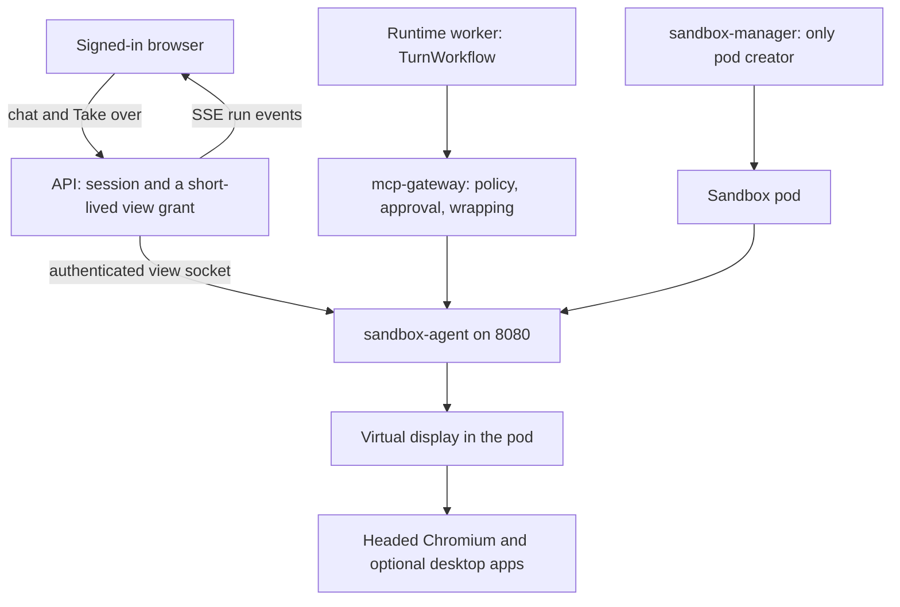

# 01 — A computer for the agent

Status: **partial**. One sandbox pod per conversation already runs commands, files and a real Chromium through Playwright. There is no live view, no human takeover, and no headed desktop. The in-process HTML browser is still the fallback when the pod has no endpoint.

Read on `main` at `e3b029d` (11 Nov 2026). Stage 14 (live-cert fixes) is another branch. This file does not change product code.

North star: a corporate assistant with its own computer ([vision](../../00-overview/vision.md)). The computer is the existing sandbox, not a new service.

## What already exists

| Piece | Status | Evidence |
|---|---|---|
| Only pod creator | done | `KubernetesPods` is documented as the only pod creator. `services/sandbox_manager/src/ar_sandbox_manager/drivers/kubernetes.py:154-159` |
| Hardened pod | done | gVisor runtime class, no service-account token, no host network or host PID. `kubernetes.py:46-49` |
| Network policy | done | Default deny. Ingress only from `mcp-gateway` and `sandbox-manager` on TCP 8080. Egress only to Squid 3128 and DNS. `kubernetes.py:90-125` |
| Agent inside the pod | done | Bearer `AR_SANDBOX_TOKEN`, path confinement, exec timeout. `services/sandbox_agent/src/ar_sandbox_agent/mcp.py:57-63` and `:190-192` |
| Chromium tools | done | `navigate`, `snapshot`, `click`, `type`, `press`, `select`, `hover`, `scroll`, `wait_for`, `screenshot`, `submit_form`, `save_pdf`, `download`, `upload`, tabs. `services/sandbox_agent/src/ar_sandbox_agent/browser.py:26-47` |
| Browser launch | partial | `chromium.launch(args=["--no-sandbox"])` at `browser.py:103`. The call does not request a display, a window manager, or a headed browser. |
| Screenshot artifact | done | PNG stored and emitted as `browser.screenshot`. Contract text calls that event a live view. `libs/ar_contracts/src/ar_contracts/stream.py:311-319` and `docs/05-contracts/stream-events.md:95` |
| Computer panel | partial | Files, sandbox status, artifacts. No pixel stream. `apps/web/src/components/computer/workspace-panel.tsx:15-58` |
| Trusted sign-in | done | `/admin/session`, `/admin/login`. Credentials stay off the model path. `mcp.py:108-140`. MFA returns `needs_human`. `libs/ar_domain/src/ar_domain/sandboxes/browser_auth.py:291-295` |
| Workspace snapshot | partial | `/admin/snapshot` returns a byte count. `/admin/restore` returns `ready` without restoring bytes. `mcp.py:143-157` |
| Tool path | done | Browser and sandbox tools run through `mcp-gateway` (`builtin://browser` / `builtin://sandbox`). `libs/ar_domain/src/ar_domain/tools/handlers.py:62-65` |
| In-process browser | partial | Kept when `endpoint_url` is empty. Recorded as the host fallback in M40-T04c (`docs/09-plan/progress.md`, M40-T04c row). The production rule is the opposite: an empty endpoint means the tool does not run ([agnostic production plan](../agnostic-production-plan.md), boundary law 4). |
| M40-T03 | missing from progress | Kubernetes driver code exists. `progress.md` has M40-T01 through T05e and does not have an `M40-T03` done row. A kind proof of this driver is still the open computer task in [M40](../M40-computer.md). |
| Warm pool | partial | `claim()` exists in `services/sandbox_manager/src/ar_sandbox_manager/warm_pool.py`. It is not on the `ensure_scope` path. |
| noVNC, VNC, WebRTC, CDP client, takeover | missing | No matches under product Python or TypeScript. `takeover` in `docs/06-security/threat-model.md:48` is account takeover, not a desktop handoff. |

## Target architecture

One pod, created only by `sandbox-manager`. The model acts only through `mcp-gateway`. The runtime stays one Temporal activity per tool step (area 02). The display is a process inside that same pod.

Two template modes, one stream:

| Template field | What the pod runs | Who drives it |
|---|---|---|
| `display: browser` (default) | The existing Playwright Chromium, headed on a virtual display | Today's browser tools, plus pointer actions when the page has no stable ref |
| `display: desktop` | Same display, plus a window manager and the apps the template lists (LibreOffice is already in the image) | The same pointer and keyboard tools, still through the gateway |

The view socket terminates on `sandbox-agent` port 8080, which the network policy already allows from the gateway and the manager. The API proxies it with the user's session. The pod does not gain a public 5900 or 6080.

**Take over** pauses the run with the existing workflow `cancel` signal pattern (`services/runtime/src/ar_runtime/workflows/turn.py:20-24`), then accepts pointer and keyboard input on a trusted admin route beside `/admin/login`. While the person holds the display, frames and keystrokes are not sent to the model. Hand-back resumes the run. This is the same trust boundary as stored browser sign-in.

**Step in** is that button. It is not a second control channel and not a VNC password in the page.

Retire, in the same change, the in-process HTML browser on any path where `AR_SANDBOX_DRIVER` is kubernetes. An empty `endpoint_url` returns `sandbox_unavailable`. Dev machines that are allowed an unisolated sandbox keep the Docker launcher already in `ar_common.sandbox_docker`. They do not keep a third browser.

Wire `warm_pool.claim` into `ensure_scope` for the browser and desktop templates so a long task does not wait on a cold image pull. The helper already exists. A second pool implementation is not part of this work.

`/admin/snapshot` and `/admin/restore` gain a real workspace archive in the object store (hash and pointer in Postgres, bytes in the object store). The byte-count stub is removed in that change.

## Gaps

1. No virtual display, so the agent cannot show a window a person can watch.
2. `browser.screenshot` is a stored PNG after a tool call. The UI never plays a stream. `workspace-panel.tsx:45-58` loads files and sandbox status.
3. No pause-and-hand input path. `needs_human` is an audit result of scripted login, not a button.
4. Workspace suspend does not round-trip bytes (`mcp.py:143-157`).
5. Production still has a second browser for the no-endpoint case (M40-T04c note in `progress.md`).
6. The step loop stops at 32 activities (`turn.py:56`). A form with more actions cannot finish. Area 02 removes that cap. This area depends on it.

## Research

The product already matches the control loop these systems describe: the model asks for one action, our code runs it in an isolated computer, the model sees the result.

- OpenAI Operator takes over the remote browser for logins, payment and CAPTCHA, and does not collect what the person types during takeover. [Introducing Operator](https://openai.com/index/introducing-operator/). The current API splits a browser toolset (page text, refs, tabs — what `snapshot` already is) from a computer toolset (screenshots and pointer coordinates). [Computer use](https://developers.openai.com/api/docs/guides/tools-computer-use), [browser and desktop drivers](https://developers.openai.com/api/docs/guides/tools-computer-use-sdk-drivers).
- Anthropic's computer tool runs inside a container with Xvfb, a window manager and applications. The application, not the model, performs each action. Browser-only tasks should stay on the browser toolset. [Computer use tool](https://platform.claude.com/docs/en/agents-and-tools/tool-use/computer-use-tool). The reference image publishes a view port from that same container. [computer-use-demo](https://github.com/anthropics/anthropic-quickstarts/blob/main/computer-use-demo/README.md).
- E2B Desktop is one sandbox with XFCE, x11vnc and noVNC, and a view-only URL. [Computer use](https://docs.e2b.dev/use-cases/computer-use), [desktop template](https://docs.e2b.dev/template/examples/desktop).
- Browserbase live view is an authenticated URL for the session the automation already holds, embedded in the product, with a disconnect event when the browser dies. [Session live view](https://docs.browserbase.com/platform/browser/observability/session-live-view).
- Kasm streams a container desktop to the browser over HTTPS and WebSocket. The browser is a display. The container is destroyed with the session. VNC stays on the inside of the platform. [Logical architecture](https://docs.kasm.com/docs/latest/explanations/reference-architecture/logical-architecture). KasmVNC is a browser-native stream and is not a drop-in RFB server. [KasmVNC](https://kasm.com/kasmvnc/docs/latest/index.html).
- noVNC is the small browser client if the pod speaks RFB on localhost only. [noVNC](https://github.com/novnc/noVNC).

Chosen pattern: Browserbase's session-scoped authenticated view, E2B's single desktop container, and our existing network policy. The stream is proxied on port 8080. It is not a second computer product and not a cluster-wide VNC.

## Contracts and API additions

Additive only. Existing browser tool names and `browser.screenshot` stay.

| Addition | Shape |
|---|---|
| Sandbox template | Optional `display`: `browser` or `desktop`. Default `browser`. Optional `apps`: list of image packages the template already allows. |
| Stream | `computer.view` with `{sandboxId, state: "live"\|"paused"\|"closed"}`. No pixels on the SSE bus. |
| Stream | `computer.takeover` with `{sandboxId, by, state: "requested"\|"active"\|"returned"}`. |
| API | `POST /api/v1/sandboxes/{id}:view` returns a short-lived grant for the signed-in user who can read the conversation. |
| API | `POST /api/v1/sandboxes/{id}:takeover` and `:return`. Both require the conversation owner or `sandboxes:operate`. |
| Agent admin | `POST /admin/input` on the existing trusted channel. The model cannot call it. |
| Error | Existing `sandbox_unavailable` when the pod has no endpoint. |

Pixels, cookies and storage state stay off SSE, audit detail, logs and traces. `browser.screenshot` continues to carry a `fileId`.

## Config surface

| Setting | Where | Default |
|---|---|---|
| `display`, `apps` | Sandbox template row | `browser`, empty app list |
| `AR_SANDBOX_DISPLAY_SIZE` | Env catalogue, pod env | `1280x800` |
| View grant TTL | Tenant setting `computer.viewGrantSeconds` | 60 |
| Takeover required on `needs_human` | Tenant setting `computer.takeoverOnHuman` | true |
| Idle suspend | Existing sandbox lifetime | unchanged |
| Egress hosts | Existing template allow list and Squid | unchanged |

No vendor desktop image is hard-coded. Apps come from the template. The image build already chooses Chromium with `WITH_BROWSER`.

## Security and observability

- The view grant is bound to tenant, user and sandbox id. A cross-tenant id is 404.
- Takeover and return are audited: `computer.takeover_started`, `computer.takeover_ended`. Detail is ids and timestamps, never frames or keystrokes.
- During takeover the worker does not call the model with a screenshot. Operator's rule, and the same rule as `/admin/login`.
- Page text and tool results enter the prompt only through `ar_common.wrapping`.
- Network policy stays default deny. The new socket is on 8080.
- Metrics: `computer_view_sessions`, `computer_takeover_seconds`, sandbox CPU seconds already on `RunUsage.sandbox_cpu_seconds` (`libs/ar_contracts/src/ar_contracts/budget.py:32`). No URLs in metric labels.
- A span per tool step carries the sandbox id and the tool name. It does not carry the page body.

## Stories

### S15-01 Production pod is the only browser

**Acceptance:** With the Kubernetes driver, a browser tool against a sandbox with an empty `endpoint_url` returns `sandbox_unavailable`. The in-process HTML engine is not called. A kind cluster runs `navigate` and `screenshot` in a pod created by `KubernetesPods`, under the existing network policy.
**Proof:** contract (kind). Live later in S15-06.

### S15-02 Headed Chromium on the pod display

**Acceptance:** Template `display: browser` starts a virtual display inside the existing image. Playwright launches headed Chromium on that display. `snapshot`, `click` and `type` keep their current names and results. A pointer tool is added for controls that have no ref. The tool still goes through `mcp-gateway`.
**Proof:** contract (container or kind). Unit for the tool schema.

### S15-03 Authenticated live view

**Acceptance:** The computer panel shows the display while a run is active, and a closed state when the pod is gone. The socket is authorized with the view grant. A user in another tenant receives 404. SSE carries `computer.view` state and no pixels. Refresh resumes the view without a second pod.
**Proof:** contract. The browser proof is part of the stage's visual test.

### S15-04 Take over and hand back

**Acceptance:** Take over pauses the run, stops model screenshots, and sends input only to `/admin/input`. Return resumes the same run and the same pod. `needs_human` from scripted login raises `computer.takeover` when the tenant setting is on. Audit rows exist for start and end. Keystrokes are absent from the audit payload.
**Proof:** contract. Live in S15-06 for a login the script cannot finish.

### S15-05 Desktop template and a real suspend

**Acceptance:** Template `display: desktop` adds the window manager and the apps named on the template, using packages already in the sandbox image. `/admin/snapshot` writes an archive to the object store and `/admin/restore` brings those bytes back into a new pod for the same conversation. The byte-count response is gone.
**Proof:** contract.

### S15-06 Live proof from an empty database

**Acceptance:** A seeded tenant, a real model, and a fresh conversation. The agent opens a page, fills a form, and the person watches it. The person takes over, types, and hands back. The run finishes with the filed result visible in chat. The report names the model id and the date. Without `AR_LLM_API_KEY` the step stays pending and is not labelled live.
**Proof:** live, via the existing `scripts/certify_live.sh` pattern.

## Risks and questions for Bala

1. **Browser first, desktop in the same stage.** The browser template is the path that reuses Playwright. The desktop template is the same pod and the same stream, for GUI apps. Question: must the first live proof include a LibreOffice window, or is a Chromium form enough for this stage?
2. **Cold start.** A desktop image is large. Wiring the existing warm pool is the scaling path. Question: is a per-tenant pool size a setting you want in this stage, or is on-demand create acceptable until measurement says otherwise?
3. **Clipboard and downloads during takeover.** Downloads already become artifacts (`download` in `browser.py:40`). Clipboard text is a secret risk. Question: should takeover clipboard be an artifact the user saves, with the model seeing only the file id after hand-back?
