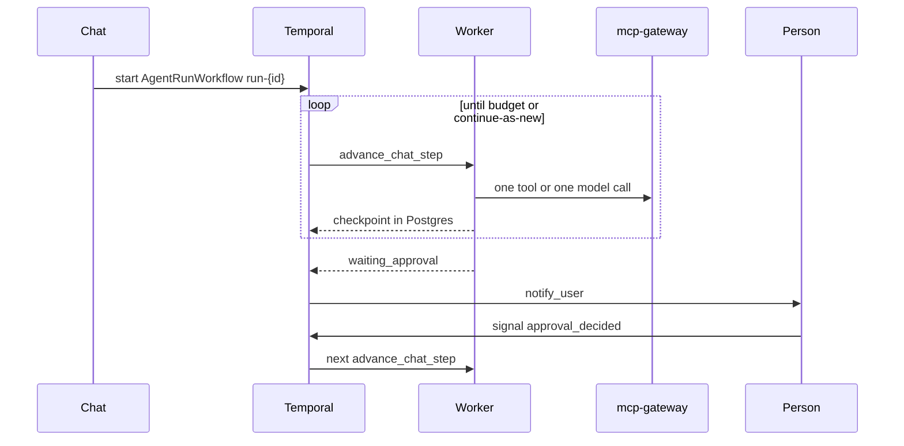

# 02 — Long-running background agents

Status: **partial**. A chat run is already a Temporal workflow with one activity per model or tool step, and a routine already starts that workflow. The workflow stops at 32 steps, a failed run's resume does not start the worker again, and an approval is finished inside the API process.

Read on `main` at `e3b029d`. Pairs with [01](01-agent-computer.md). A computer task that fills a long form is this workflow.

## What already exists

| Piece | Status | Evidence |
|---|---|---|
| One activity per step | done | `TurnWorkflow._steps` docstring: one activity is one model call or one tool call. `services/runtime/src/ar_runtime/workflows/turn.py:52-53` |
| Step activity | done | `advance_chat_step` reloads the run and calls `advance_turn`. Heartbeats are in the activity. `services/runtime/src/ar_runtime/activities/advance_chat_step.py:14-16` |
| Checkpoint | done | `worker_loop` writes `run.checkpoint` so the next activity continues the loop. `libs/ar_domain/src/ar_domain/tools/worker_loop.py:1-4` |
| Chat starts the workflow | done | `workflow_id` `run-{run_id}` and `steps: True` when the worker is connected. `libs/ar_domain/src/ar_domain/chat/service.py:1749-1757` |
| Hard step cap | partial | The loop condition is `while step < 32`. `turn.py:56`. `RunBudget.max_steps` exists and is not what this loop reads. `libs/ar_contracts/src/ar_contracts/budget.py:13` |
| Continue-as-new | missing on the run | The only `continue_as_new` helper is the outbox relay constant. `services/system/src/ar_system/workflows/outbox_relay.py:39`. No call under `services/runtime/`. |
| Cancel signal | done | `TurnWorkflow.cancel`. `turn.py:20-24` |
| Resume HTTP | partial | `resume_run` sets `running`, emits `run.resumed`, and returns. It does not start the workflow. `chat/service.py:2583-2598` |
| Approval wait workflow | partial | `ApprovalWaitWorkflow` waits on signals, default 24h. `services/runtime/src/ar_runtime/workflows/approval_wait.py:17-46`. Nothing under `services/api/` signals `approval_decided`. |
| Approval settle | partial | `settle_approval` runs the tool in the API process. `libs/ar_domain/src/ar_domain/tools/resume.py:1-32`. That breaks the rule that the API does not run the model loop. |
| Routines | done | `RoutineRunWorkflow` starts child `AgentRunWorkflow` with `steps: True`. `services/system/src/ar_system/workflows/routine_run.py:113-146` |
| Schedules | done | Temporal `Schedule` from cron, timezone, jitter, overlap. `libs/ar_domain/src/ar_domain/routines/clock.py:25-49` |
| Research children | done | Research workflow: one activity is one phase or one sub-task. `services/runtime/src/ar_runtime/workflows/research.py:1` |
| In-app approval notice | done | `ApprovalBook._notify` appends a notification. `libs/ar_domain/src/ar_domain/approvals/service.py:554-568` |
| Web push and email | partial | `notify_user` sends web push when the VAPID secret is set and queues email. `libs/ar_domain/src/ar_domain/notifications/dispatch.py:1-6`. The service worker shows the payload. `apps/web/public/sw.js:1-14`. The client registers the worker and does not subscribe (area 08). |
| Fan-out workflow | partial | `NotificationFanoutWorkflow` maps a few topics and is not the worker's registered mail path. Approval email in that file is a fixed address. Extend `notify_user` rather than growing that map. |
| Worker loss | done | A turn the worker lost is marked not resumed. `chat/service.py:1774-1787` |
| SSE resume | done | Run stream supports `Last-Event-ID`. `services/api/src/ar_api/routers/exposure.py:168-172` |

## Target architecture

The background agent is `TurnWorkflow`. A routine, a webhook and a chat message all start that same workflow. Hours of work are many short activities plus continue-as-new. Waiting for a person is a signal, not a sleeping API process.

Continue-as-new runs when the SDK suggests it, after the cancel and approval signals have been drained. The new run keeps workflow id `run-{id}`. Callers keep using the workflow id and do not cache a run id from Temporal's history. State passed forward is the checkpoint key, not the message list. The messages already live in Postgres.

`resume_run` starts or signals that workflow. Flipping the row to `running` is not a resume.

`settle_approval` records the decision and signals the workflow. It does not call the model or the tool. The next `advance_chat_step` does, through the gateway.

Notifications for `approval.requested`, `run.completed` and `run.failed` go through `notify_user` (in-app row, web push, email queue). The fixed address in the fan-out workflow is removed in that change. Copy and targets come from the user's notification settings.

The 32 cap is replaced by `RunBudget.max_steps`, `max_wall_clock_s` and `max_cost_micros`. A routine uses the agent's budget. A chat run uses the same fields.

## Gaps

1. Thirty-two steps end a long computer task or a long research run (`turn.py:56`).
2. No continue-as-new on `TurnWorkflow`, so a run that survived the cap would still hit Temporal's history limit (about 50,000 events or 50 MB).
3. `resume_run` does not schedule (`chat/service.py:2583-2598`).
4. Approval completion runs in the API (`resume.py:13-32`).
5. `ApprovalWaitWorkflow` is unwired.
6. Completion of a background run does not reliably reach web push. Push subscription UI is area 08. This area still emits the notification.
7. `complete_turn` sets `max_tokens` to the literals 1500 and 800 (`chat/service.py:2207-2208`). A long run needs the remaining budget, from configuration.

## Research

- Continue-as-new checkpoints a workflow into a fresh event history with the same workflow id. Drain signals first. Do not call it from inside a signal handler. Pass the smallest state that the new run needs. [Continue-As-New](https://docs.temporal.io/workflow-execution/continue-as-new), [pattern](https://docs.temporal.io/design-patterns/continue-as-new), [history limits](https://temporal.io/blog/very-long-running-workflows).
- Heartbeats already match the long-activity pattern: interval, heartbeat timeout, resume from the last checkpoint. [Long-running activity](https://docs.temporal.io/design-patterns/long-running-activity). Our checkpoint is the Postgres row, which is the right place for N workers.
- A2A's task states `input-required` and `auth-required` are the external shape of the same wait. [Life of a task](https://a2a-protocol.org/latest/topics/life-of-a-task/). Area 04 maps them. This area owns the signal.
- Operator's user confirmation before a significant action is the approval we already have, held open for hours by Temporal rather than by a request thread. [Introducing Operator](https://openai.com/index/introducing-operator/).

## Contracts and API additions

The resume and input routes already exist. Behaviour changes. The JSON stays compatible.

| Addition | Shape |
|---|---|
| `run.resumed` | Already emitted. Add optional `workflowId` so the client can tell a real restart from a status flip. |
| Run resource | Optional `waitReason`: `approval`, `input`, `takeover`, `budget`. Additive. |
| Notification kinds | Reuse `approval_requested`, `run_completed`. Add `run_failed` if the catalogue lacks it. The kind list is the existing check constraint in `libs/ar_domain/src/ar_domain/migrations/versions/20261020_0004_events_core.py:109`. An expand migration adds a value. It does not replace the table. |
| Budget | No new budget object. The loop reads `RunBudget`. |

`POST /api/v1/runs/{id}:resume` keeps its path. After this stage it returns 202 once the workflow has been signalled or started.

## Config surface

| Setting | Where | Default |
|---|---|---|
| `max_steps`, `max_wall_clock_s`, `max_cost_micros` | Agent definition `RunBudget` | The definition's current defaults |
| Approval wait | Tenant setting `approvals.waitSeconds` | 86400, matching `ApprovalWaitWorkflow` |
| Notify on completion | User settings `notifications.email` and the existing push subscription | email off until the user turns it on; in-app on |
| Continue-as-new | Not a customer setting | SDK suggestion, implemented in the workflow |
| Model `max_tokens` | Agent request options, already applied when the provider is real (`chat/service.py:2208`) | Remove the 1500/800 literals in the same change |

## Security and observability

- The signal payload is an approval id and a decision. It does not contain the tool arguments again.
- Resume checks tenant, user and checkpoint, then 404 on a cross-tenant id (the `NotFoundError` in `resume_run` stays).
- Audit `run.resumed` and the existing approval decision in the same transaction as the row change.
- Metrics: step count, wait seconds, continue-as-new count. Labels are tenant and agent id only if those are already bounded. No prompt text.
- A run span attribute `ar.run_id` already matches the Stage 11 note. Add `ar.wait_reason` when waiting. No message content.

## Stories

### S15-07 The step loop follows the budget

**Acceptance:** `TurnWorkflow` continues until the run budget's steps, wall clock or cost says stop, or the model finishes. The literal `32` is gone. `max_tokens` on the model call comes from the remaining budget and the agent options. A test with `max_steps` 40 completes 40 activities.
**Proof:** unit for the workflow history. Contract against Temporal.

### S15-08 Continue-as-new

**Acceptance:** A run whose history reaches the SDK suggestion continues as new with the same workflow id, after pending signals are applied. The new execution loads the checkpoint from Postgres. Child sandboxes are not deleted by the parent close. Cancel still stops the current execution.
**Proof:** contract.

### S15-09 Resume starts the worker

**Acceptance:** `resume_run` on a failed, cancelled or interrupted run that has a checkpoint signals or starts `AgentRunWorkflow`. The chat stream shows new steps. A run with no checkpoint still returns the current invalid-state error. A second resume of a running workflow is idempotent.
**Proof:** contract.

### S15-10 Approval is a signal

**Acceptance:** Deciding an approval writes the decision and signals the waiting workflow. The API process does not execute the tool. The following activity runs the tool through `mcp-gateway` and continues the loop. Reject and expire stop the run. The 24h default remains, and the tenant can set `approvals.waitSeconds`.
**Proof:** contract.

### S15-11 Notify on wait and on done

**Acceptance:** `approval.requested`, `run.completed` and `run.failed` each create one in-app notification through `notify_user`. When a push subscription and a VAPID secret exist, a push is sent whose body is the status, not the answer text. Email uses the user's address and the existing SMTP activity. The hard-coded approvals mailbox is gone.
**Proof:** contract (GreenMail and the push unit). Live is the computer proof in S15-06, which waits and finishes.

## Risks and questions for Bala

1. **One workflow for chat and background.** A "background" flag that starts a second workflow would split the loop. This plan uses one workflow and a notify-on-done setting. Question: should every chat run notify on completion, or only runs the user marks, plus every routine?
2. **Budget defaults.** Raising the step cap without a cost cap lets a run spend without a ceiling. Question: confirm the default `max_cost_micros` and `max_wall_clock_s` you want on the built-in assistant before the cap of 32 is removed.
3. **Overlap with area 01.** Takeover and approval share the wait signal. They ship in one pull request so there is one pause state.
