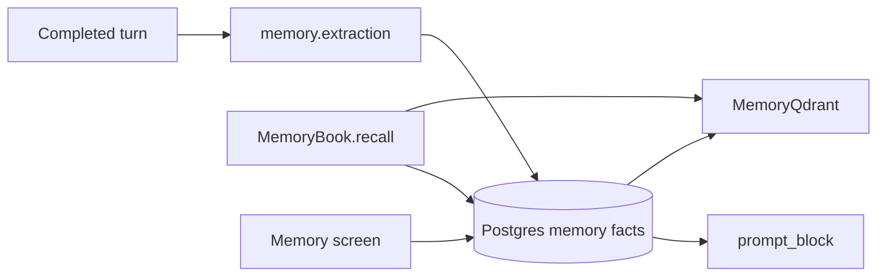

# 03 — Memory and personalisation

Status: **partial**. Per-user, per-agent and per-team facts, a reviewable API, extraction after a turn, and versioned skills are in the product. Qdrant hybrid search for those facts is implemented and not used on the recall path. Skills are authored. Nothing saves a skill from repeated work. A keyword composer still special-cases two agent slugs.

## What already exists

| Piece | Status | Evidence |
|---|---|---|
| Fact store and API | done | `MemoryBook`. List, create, patch, delete. `libs/ar_domain/src/ar_domain/memory/book.py:49`. Router `services/api/src/ar_api/routers/memory.py`. Page `apps/web/src/app/memory/page.tsx` |
| Scopes | done | Recall pool filters by actor, agent and teams. `book.py:746-752`. Agent `MemorySpec.read_scopes` defaults to user and agent. `libs/ar_contracts/src/ar_contracts/definitions.py:85-92` |
| Child runs | done | `memory.save` is denied when the run has a parent. `book.py:327-328` |
| Extraction | done | Post-turn model ops add, update and delete facts. `libs/ar_domain/src/ar_domain/memory/extraction.py`. Chat calls it from `_remember`. `chat/service.py:2340-2361` |
| Preferences | done | Category `preference` on the same fact row. `libs/ar_domain/src/ar_domain/memory/logic.py:25-27` |
| Ranker | done | In-process similarity over the fact rows. `book.py:282-311` |
| Qdrant hybrid | partial | `MemoryQdrant` stores dense and sparse vectors and the embedding model id. Postgres stays the source of the fact. `libs/ar_domain/src/ar_domain/memory/qdrant_memory.py:1-31`. The only caller outside the class is `libs/ar_domain/tests/unit/test_stage11.py`. `MemoryBook.prompt_block` does not use it (`book.py:313-322`). |
| Embeddings | done | Through the model gateway. Dimensions from `AR_PGVECTOR_DIMENSIONS`, default 1024. `libs/ar_domain/src/ar_domain/memory/logic.py:46-48` |
| Limits in code | partial | User 2000 facts, shared 5000, content 500 characters. `logic.py:28-30`. Skill stopwords are a literal set and the overlap bar is `0.34`. `libs/ar_domain/src/ar_domain/skills/match.py:21-50` and `:70` |
| Skills | done | `SkillBook` publish and `skills.load` copy instructions and assets onto the computer. `libs/ar_domain/src/ar_domain/skills/load.py:1-23`. The model chooses `skills.load`. A hint is lexical only. `libs/ar_domain/src/ar_domain/skills/match.py:1-5` |
| Keyword composer | partial, and it should go | `maybe_compose` runs a fixed path when the slug is `research-lead` or `writer` and the text matches a brand-guidelines pattern. `libs/ar_domain/src/ar_domain/skills/turn.py:18-34` |
| Feedback into memory | missing | Thumbs up and down are stored for evals. `chat/service.py:2785-2807`. They do not create a fact. |
| Tenant switch | done | `MemorySettings` on the tenant. `libs/ar_contracts/src/ar_contracts/tenants.py:69-74` |

Knowledge hybrid search (`libs/ar_domain/src/ar_domain/knowledge/searching.py`) is a different store. It stays the document index. Memory facts are not copied into it.

## Target architecture

Postgres is the fact. Qdrant is the index `MemoryQdrant` already describes. The user edits the fact. The index follows. That is Mem0's extract-and-update loop and Letta's editable block, on tables we already have. A skill learned from repetition is a draft in `SkillBook`, published by a person.

Recall reads the index when Qdrant is configured, then loads the rows from Postgres so ACL and scope checks stay in `MemoryBook`. When Qdrant is off, the current ranker remains the one implementation behind the same method. Two recall results must not be merged from two algorithms in one turn.

A thumbs-down with a comment becomes a proposed fact of category `correction`, status in the existing review queue. The user edits or deletes it on the memory screen. It is not applied silently.

A repeated tool sequence (same agent, same ordered tool names, at least the tenant's threshold, across runs) becomes a draft skill whose instructions are a short description the model writes, and whose steps are the tool list. `SkillBook` stores it as a draft. The user publishes it. `maybe_compose` is deleted in that change so a slug and a regex are not a second skill runner.

Child runs still cannot write memory. A correction is written on the parent user.

## Gaps

1. `MemoryQdrant` is unused by recall.
2. Fact caps and the skill-match threshold are literals.
3. Corrections from chat are not proposed into the review queue.
4. No path from a repeated run to a draft skill.
5. `maybe_compose` is a hard-coded second path (`skills/turn.py:22-34`).

## Research

- Mem0 extracts facts, then updates or consolidates them so the store does not grow duplicate rows. Scopes are user, session and agent. [Comparison of the extraction loop](https://forum.letta.com/t/agent-memory-letta-vs-mem0-vs-zep-vs-cognee/88/1). Our extraction prompt already asks for add, update and delete.
- Letta keeps a small always-visible block the agent and the developer can edit, and a larger archival store for search. [Memory blocks](https://docs.letta.com/v1-sdk/memory/memory-blocks/index.md), [why blocks](https://www.letta.com/blog/memory-blocks/). Our `prompt_block` is the visible block. The fact list is the archive. We do not adopt Letta's server or its memory tools as a second API.
- Putting both a vector store and a graph store beside Postgres would be a new system. The hybrid index we have is enough.

## Contracts and API additions

Memory REST stays. Additive fields only.

| Addition | Shape |
|---|---|
| Fact | Optional `source`: `extraction`, `user`, `correction`, `skill`. Default `user` for API creates and `extraction` for the extractor. |
| Fact | Optional `sourceMessageId` when the source is `correction`. |
| Skill draft | `POST /api/v1/skills:propose` with `{agentId, runIds: []}` creates a draft from those runs. Permission `skills:manage`. |
| Settings | Tenant `memory.correctionFromFeedback` boolean, default true. Tenant `memory.skillRepeatCount` integer, default 3. |
| Stream | Existing `memory.saved` and `memory.recalled` stay. Add `skill.proposed` with `{skillId, agentId}`. |

`read_scopes` is unchanged.

## Config surface

| Setting | Where | Default |
|---|---|---|
| Memory on, extraction on | Tenant `MemorySettings` | current defaults |
| `AR_MEMORY_RECALL_MIN_SIM` | Env | existing |
| Fact caps | Tenant settings `memory.maxUserFacts`, `memory.maxSharedFacts`, `memory.maxContentChars` | 2000, 5000, 500, matching today's literals, then delete the literals |
| Qdrant collection | Existing knowledge Qdrant settings, collection name `memory_facts` | off when Qdrant is off (Helm default) |
| Skill match threshold | Tenant setting `skills.matchMinScore` | today's `0.34` at `match.py:70`, then delete the literal |
| Repeat count | `memory.skillRepeatCount` | 3 |

Embedding model id is the tenant's embed alias. It is stored on the point (`qdrant_memory.py:24`). A model change reindexes. It does not mix vectors from two models in one search. Knowledge already returns 409 on an embedding mismatch. Memory uses that same rule.

## Security and observability

- Recall and write stay inside `MemoryBook` with tenant and scope checks. The index query includes `tenant_id`. A point whose Postgres row is missing or is in another tenant is dropped.
- Correction text is user content and enters later prompts through the existing memory block, which is already treated as data in the prompt assembly. It is not a system instruction.
- Audit `memory.created`, `memory.updated`, `memory.deleted` stay. Add `skill.proposed`.
- Metrics: recall count, index lag, proposals. No fact text in labels or traces.
- Erasure already deletes the user's memory (`docs/03-specs/02-identity-tenancy.md` erase route). The Qdrant point is deleted in the same operation.

## Stories

### S17-01 One recall path, with the Qdrant index

**Acceptance:** `MemoryBook.recall` uses `MemoryQdrant` when the deployment has Qdrant, then hydrates Postgres rows and applies `_recall_pool`. With Qdrant unset, the current ranker runs. Results never come from both. A point with a different `embedding_model_id` is excluded. Cross-tenant points are not returned.
**Proof:** unit with the existing double. Contract against Qdrant.

### S17-02 Caps and thresholds are settings

**Acceptance:** The 2000, 5000, 500 and skill-match literals are gone. Defaults match the old numbers. A tenant admin can change them in Simple and Advanced settings. The API rejects a fact over the content cap with the existing validation error.
**Proof:** unit. Contract for the settings PATCH.

### S17-03 Corrections the user can edit

**Acceptance:** A thumbs-down with a comment creates a proposed correction fact for that user and agent. The memory screen lists it, and edit and delete use the current routes. Turning `memory.correctionFromFeedback` off stores the feedback and creates no fact. A child run cannot write the fact.
**Proof:** contract.

### S17-04 A draft skill from repeated work

**Acceptance:** Three runs of the same agent with the same ordered tool names produce one draft skill when the tenant threshold is 3. The draft is invisible to the model until publish. `POST /api/v1/skills:propose` does the same for a chosen set of runs. `maybe_compose` and its slug checks are deleted. Research and document tasks go through `skills.load` or delegation like every other agent.
**Proof:** contract. Live: one real model proposes a draft from three recorded runs, and the user publishes it. Pending when no model key is set.

## Risks and questions for Bala

1. **Who may publish a learned skill?** This plan requires `skills:manage`. Question: may the user who repeated the work publish a personal skill without that permission?
2. **Team facts.** A correction is per user. Question: should a team lead be able to promote a correction into the team scope from the review queue, using the lead check already in `_require_team` (`book.py:739-744`)?
3. **Extractor cost.** Extraction already calls a model after the turn. Running it on every routine for hours will spend budget. Question: confirm extraction stays on, and that it draws from the same run budget area 02 enforces.
