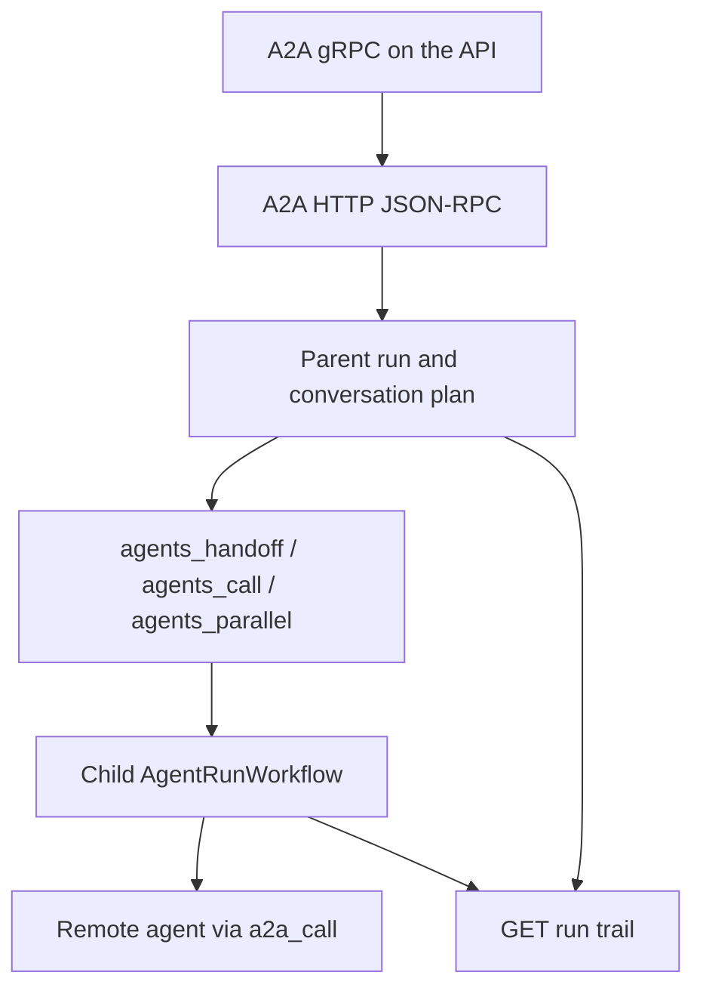

# 04 — Multi-agent work

Status: **partial**. In-tenant handoff, parallel calls, child runs and an external A2A HTTP API are in the product. A gRPC servicer exists and is not mounted by the API. The plan is one conversation's list. There is no single who-did-what document across agents.

**Decided.** Stage 18 speaks A2A protocol `1.0` only. The card we publish today says `0.3.0` (`libs/ar_domain/src/ar_domain/exposure/a2a.py:59`). We are pre-production, so the 0.3 method names and the private proto are replaced, not wrapped. The migration is below.

## What already exists

| Piece | Status | Evidence |
|---|---|---|
| In-tenant tools | done | `agents_call`, `agents_parallel`, `agents_handoff`, `agents_ask`. Handoff text: the caller stops after the handoff. `libs/ar_domain/src/ar_domain/orchestration/engine.py:20-55` |
| Child runs | done | `delegate` emits `subagent.started` and stamps `parent_run_id`. `libs/ar_domain/src/ar_domain/skills/delegate.py:66`, `:120`, `:235` |
| Children API | done | `GET /api/v1/runs/{run_id}/children`. `services/api/src/ar_api/routers/m2.py:952-958` |
| Temporal children | done | `DelegationWorkflow` and `ChildRunWorkflow`. `services/runtime/src/ar_runtime/workflows/delegation.py:15-68` |
| A2A HTTP | done | `POST /v1/a2a` and the agent card. `services/api/src/ar_api/routers/exposure.py:503-573` |
| Card version | partial | `protocol_version` is `0.3.0`. `libs/ar_domain/src/ar_domain/exposure/a2a.py:54-59` |
| External task creates a run | done | `message/send` calls `send_message`. `a2a.py:160-222` |
| External run scheduling | partial | The exposure path posts with `schedule=False` and awaits generation in the API process. `libs/ar_domain/src/ar_domain/exposure/runs.py:350-351` and `:407-414`. Chat uses Temporal when `schedule=True` (`chat/service.py:1734-1758`). |
| Remote agent tool | done | `a2a_call` uses a named secret and the gateway. `a2a.py:567-606`. Handler `libs/ar_domain/src/ar_domain/tools/handlers.py:350-353` |
| gRPC servicer | partial | `A2AService` calls the same `a2a.rpc` methods. `libs/ar_domain/src/ar_domain/exposure/grpc_server.py:24-41`. `serve` binds an insecure loopback port and nothing under `services/` calls it. `grpc_server.py:153-160` |
| Proto | partial | `contracts/a2a/a2a.proto` and generated stubs in `libs/ar_domain/src/ar_domain/exposure/a2a_gen/`. Method names are a subset of the spec. |
| Plan | partial | `plan_update` stores a list of strings on the conversation. `handlers.py:337-345`. The stream contract's `plan.updated` items have id, title and status (`docs/05-contracts/stream-events.md:96`). The stored list has no owner. |
| Attribution | partial | Parent id, child list, `subagent.*` events, audit on model steps. No one read model joins them. |

Area 02 owns the wait signal. This area uses it when a child or an external task is `input-required`.

## Target architecture

Internal agents and external A2A agents are two doors onto one run. The parent holds the plan. Each child appends the steps it owns. The trail is the runs, the events and the audit chain, read by one endpoint.

`exposure/runs.py` starts `AgentRunWorkflow` the way chat does. The API returns the task id and streams or pushes updates. It does not sit inside `generate`.

gRPC is the servicer we have, mounted by the API process behind the same bearer agent key, on the service port the chart already terminates with TLS. `serve()`'s insecure loopback listener stays a test helper. Production does not advertise it.

The conversation plan stores the stream's `PlanItem`, plus optional `ownerAgentId` and `ownerRunId`. `plan_update` accepts the existing list of strings and the object form. Strings still work. Children read the parent plan. They do not write a second plan store.

The trail endpoint reads children, `subagent.*`, plan items and audit rows for those run ids. It does not copy them into a new table.

## Migration to A2A 1.0

Normative source, read 11 Nov 2026: [A2A specification](https://a2a-protocol.org/latest/specification/) (released version 1.0.0). The protocol id on the wire is `1.0` (`Major.Minor`). Patch numbers are not negotiated (§3.6).

Stage 18 serves that version only. A request with a missing `A2A-Version`, or any value other than `1.0`, returns `VersionNotSupportedError` (JSON-RPC `-32009`). The spec says an empty version means 0.3 (§3.6.2). We do not implement that reading. A 0.3 parser next to the 1.0 parser would be a second protocol.

| Today | 1.0 in this stage |
|---|---|
| Card `protocol_version: "0.3.0"` and a top-level `url` (`a2a.py:54-62`) | `supportedInterfaces` with `protocolBinding` `JSONRPC` and `GRPC`. Each entry has `protocolVersion: "1.0"` and its own `url` (§4.4.1, §4.4.6). The top-level transport URL is removed. |
| Snake-case card fields: `default_input_modes`, `default_output_modes`, `security_schemes`, `security`, `capabilities.push_notifications` (`a2a.py:60-78`) | camelCase: `defaultInputModes`, `defaultOutputModes`, `securitySchemes`, `securityRequirements`, `capabilities.pushNotifications` (§5.5). |
| JSON-RPC names in `_IMPLEMENTED` (`a2a.py:30-43`): `message/send`, `tasks/send`, `message/stream`, `tasks/sendSubscribe`, `tasks/get`, `tasks/cancel`, `tasks/list`, `tasks/resubscribe`, `tasks/pushNotificationConfig/set\|get\|list\|delete` | `SendMessage`, `SendStreamingMessage`, `GetTask`, `ListTasks`, `CancelTask`, `SubscribeToTask`, `CreateTaskPushNotificationConfig`, `GetTaskPushNotificationConfig`, `ListTaskPushNotificationConfigs`, `DeleteTaskPushNotificationConfig` (§5.3). |
| States such as `input-required` (`docs/agent-api/a2a.md`) | ProtoJSON names: `TASK_STATE_SUBMITTED`, `TASK_STATE_WORKING`, `TASK_STATE_COMPLETED`, `TASK_STATE_FAILED`, `TASK_STATE_CANCELED`, `TASK_STATE_INPUT_REQUIRED`, `TASK_STATE_REJECTED`, `TASK_STATE_AUTH_REQUIRED` (§4.1.3, §5.5). `waiting_approval` and `waiting_input` map to `TASK_STATE_INPUT_REQUIRED`. Takeover and `needs_human` map to `TASK_STATE_AUTH_REQUIRED`. |
| Private proto `contracts/a2a/a2a.proto`: `tenant_id`, `text`, `state`, and both `TaskSubscription` and `ResubscribeToTask` | The published 1.0 proto. `make gen` regenerates the stubs. The private messages are deleted in the same change. gRPC and JSON-RPC call one task implementation (§5.1). |
| A hard-coded skill `research` on every card (`a2a.py:70-75`) | Skills come from the agent definition. When the definition lists none, the card has one skill whose id is the agent slug. |

`HTTP+JSON` (`POST /message:send` and the rest of the REST column in §5.3) is not a third stack in this stage. The card lists the two bindings we implement.

Contract tests updated in the same pull request: `libs/ar_domain/tests/unit/test_stage11.py`, `libs/ar_domain/tests/unit/test_stage12_grpc.py`, and every assertion of `protocol_version` `0.3.0` or of a 0.3 method name. `docs/agent-api/a2a.md` is rewritten to this table. `a2a_call` sends `A2A-Version: 1.0` and the 1.0 method names.

## Gaps

1. External A2A runs the loop in the API (`runs.py:407-414`).
2. gRPC is unmounted and insecure (`grpc_server.py:153-160`).
3. The plan has no owner (`handlers.py:337-345`).
4. Who-did-what is spread across three APIs and not returned together.
5. The card, the JSON-RPC names, and the private proto are the 0.3 surface. The 1.0 spec has moved the transport URL into `supportedInterfaces` and renamed the methods (§5.3).

## Research

- A2A 1.0 separates discovery (the agent card), a stateful task, messages, artifacts, streaming and push. Agents do not share memory or tools. Protocol version on the wire is `1.0`. [Specification](https://a2a-protocol.org/latest/specification/), [task lifecycle](https://a2a-protocol.org/latest/topics/life-of-a-task/), [concepts](https://a2a-protocol.org/latest/topics/key-concepts/). [Repository](https://github.com/google/A2A).
- Push config on the task is how a caller hears about a long task after disconnect. We already accept push config methods (`a2a.py:30-43`). They should notify through area 02's `notify_user` and the existing webhook signature, not a new sender.
- Opaque agents are the point of A2A. A shared plan inside one tenant is our extension, carried as an artifact or a message part, not as access to the other agent's memory.

## Contracts and API additions

| Addition | Shape |
|---|---|
| Plan item | Additive `ownerAgentId`, `ownerRunId` on `plan.updated` items. Old items without them remain valid. |
| API | `GET /api/v1/runs/{id}/trail` returns `{plan, children, events}` assembled from current stores. Permission `runs:read`. Cross-tenant 404. |
| A2A card | Replaced by the 1.0 card in the migration table. camelCase. `supportedInterfaces[].protocolVersion` is `1.0`. |
| A2A task | States use the `TASK_STATE_*` names in the migration table. |
| gRPC | Official 1.0 methods, served by the API, same tasks as JSON-RPC. Stubs from `make gen`. |
| External run | `SendMessage` starts `AgentRunWorkflow`. The response is a 1.0 Task. |

`agents_handoff` keeps its name and its "you stop" behaviour.

## Config surface

| Setting | Where | Default |
|---|---|---|
| Which agents may be called | Existing agent grants and tool policy | deny unless granted |
| `a2a_call` destination | Named secret and the remote card URL on the tool server | unset, tool hidden until set |
| Max child depth and fan-out | Agent `RunBudget` and existing delegation limits | current code defaults, moved to the definition if they are literals |
| gRPC listen | Chart service port, TLS at the ingress | off until the chart enables the port |

No hard-coded remote agent URL.

## Security and observability

- A child runs with the parent's tenant and the caller's grants, never a broader role. `delegate` already stamps `parent_run_id`.
- `a2a_call` credentials stay in `SecretStore`. The remote body is untrusted and wrapped before it re-enters the prompt.
- gRPC uses the agent API key, tenant match, and TLS. The insecure helper is tests only.
- Trail and children are 404 across tenants.
- Audit `a2a_task.created` stays. Add `agent.handoff` with from-agent, to-agent and run ids.
- Spans: `ar.run_id`, `ar.parent_run_id`, peer address. No task text.
- GenAI attributes are area 05. This area only adds the parent link.

## Stories

### S18-01 External tasks use the worker

**Acceptance:** `SendMessage` with header `A2A-Version: 1.0` creates the run and starts `AgentRunWorkflow`. The API process returns the task and does not call `generate`. `SendStreamingMessage` and `SubscribeToTask` follow the run events. Push config sends the existing signed webhook on terminal states and on `TASK_STATE_INPUT_REQUIRED`. A call that uses `message/send` or omits `A2A-Version` returns `-32009`.
**Proof:** contract.

### S18-02 gRPC on the API

**Acceptance:** The API serves the 1.0 `A2AService` with the agent API key over TLS. `SendMessage`, `GetTask`, `ListTasks`, `CancelTask` and `SubscribeToTask` call the same task code as JSON-RPC. A key from another tenant is not found. The private proto messages are gone. `serve()` on loopback remains for unit tests and is not the process the chart runs. `test_stage11.py` and `test_stage12_grpc.py` assert the 1.0 method names and a `TASK_STATE_*` state.
**Proof:** contract.

### S18-03 A plan with owners

**Acceptance:** `plan_update` accepts a list of strings or a list of objects. Stored items have id, title, status and optional owner. Child runs read the parent plan. `plan.updated` on the parent stream shows the owner. A string-only client still updates the plan.
**Proof:** contract.

### S18-04 The trail

**Acceptance:** `GET /api/v1/runs/{id}/trail` returns the plan, child runs and the subagent events in order. A handoff shows the agent that stopped and the agent that continued. Cross-tenant is 404. The UI run inspector renders that list, with empty, loading and error states.
**Proof:** contract, plus the stage's visual pass.

### S18-05 A2A 1.0 card and contract tests

**Decided:** the protocol id is `1.0`. Breaking changes are listed in the migration table. There is no 0.3 shim.

**Acceptance:** The card has `supportedInterfaces` for `JSONRPC` and `GRPC`, each with `protocolVersion: "1.0"`, camelCase fields, and no top-level transport `url`. It has no `protocol_version: "0.3.0"` and no hard-coded `research` skill. `docs/agent-api/a2a.md` matches the card and the method table. A test loads the card and calls `SendMessage`, `GetTask` and `SubscribeToTask`.
**Proof:** contract.

### S18-06 Live handoff

**Acceptance:** From an empty database, a real model, and two agents the tenant created. One agent hands the conversation to the other. The trail shows both run ids. The second agent finishes the answer. Pending without a model key.
**Proof:** live.

## Risks and questions for Bala

1. **Shared plan across tenants.** A2A says agents do not share internal state. This plan shares a plan only inside one tenant. A remote agent receives a task message, not our plan table. Question: confirm that is the boundary you want.
2. **Handoff and the computer.** A handoff should keep the conversation's sandbox (area 01), not start a second pod. Question: confirm the child reuses the parent sandbox when both agents are allowed that template.
