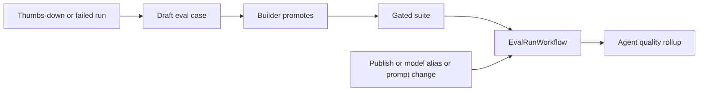

# 05 — Quality loop

Status: **partial**. Thumbs up and down are stored. A builder can turn a conversation into an eval case by hand. Suites, a Temporal eval run, a publish gate, an alias-change rerun and an eval gym all exist. A failed run does not become a case. The UI shows a suite pass rate, not a per-agent score.

## What already exists

| Piece | Status | Evidence |
|---|---|---|
| Feedback | done | Rating `up` or `down`. `libs/ar_domain/src/ar_domain/chat/service.py:2785-2807`. Routes `PUT` and `DELETE` on the message. `services/api/src/ar_api/routers/m2.py:719-734` |
| Inbox | done | `GET /api/v1/feedback`. `services/api/src/ar_api/routers/feedback.py:12-16`. `EvalBook.list_feedback`. `libs/ar_domain/src/ar_domain/evals/book.py:332` |
| Case from a conversation | done, manual | `case_from_conversation` copies user turns and uses the feedback comment as the rubric. `book.py:190-209` |
| Triggers | done | `manual`, `publish_gate`, `schedule`, `ci`. `book.py:24` |
| Publish gate | done | Agent publish runs the gated suite. `libs/ar_domain/src/ar_domain/agents/service.py:849-870` |
| Alias change | done | Patching an alias calls `rerun_gated_suites`. `chat/service.py:914-924` |
| Eval workflow | done | `EvalRunWorkflow` on queue `ar-eval`. `services/system/src/ar_system/workflows/eval_run.py:1-33` |
| Gym | done | `libs/ar_domain/src/ar_domain/evals/gym/runner.py:22-35`. `make eval-gym`. A dry run is not live ([proof labels](../agnostic-production-plan.md)). |
| Repo suites | done | `evals/` and `services/system/src/ar_system/evals/cli.py`. Strategy `docs/08-quality/eval-strategy.md` |
| Tool mocks during eval | done | Gateway calls `prepare` before the tool runs. `services/mcp_gateway/src/ar_mcp_gateway/pipeline.py:14-39` |
| Pass rate in the UI | partial | Suite `lastRun.passRate` on the evals screen. `apps/web/src/components/evals/evals-screen.tsx:208-209` |
| Overview | partial | Counts runs, latency, feedback and cost. It does not score one agent. `libs/ar_domain/src/ar_domain/runs/service.py:40-67`. Route `services/api/src/ar_api/routers/observability.py:27-38` |
| Failed run to a case | missing | No caller creates a case from a failed or thumbs-down run except the explicit API. |
| Trace link | partial | Run `trace_id` becomes a trace URL. Eval results store `run_id`. Spec `docs/03-specs/18-observability-eval.md` |
| GenAI semconv | missing | Spans must not contain prompts. They do not yet set `gen_ai.provider.name` and `gen_ai.request.model`. |

`schedule` is a trigger name used by the alias rerun. There is no nightly Temporal schedule that walks every agent. The publish gate and the alias rerun are the hooks to extend.

## Target architecture

**Decided.** A thumbs-down and a failed run both create a **draft** case on the suite the agent's publish gate already uses. A person promotes a draft before it can fail a publish. Failed-run capture is the tenant flag `evals.caseFromFailedRun` (default false). Thumbs-down capture is `evals.caseFromFeedback` (default true). The gym and the product runner are the same graders. A model or prompt change runs the gated suite, which already happens on publish and on alias update. A prompt change uses that same function.

The per-agent score is a rollup row: latest gated pass rate, thumbs-down count, and run failure rate, over the tenant's window. It is computed by the existing usage rollup worker, not by a new scorer service. The evals screen and the agent page read it.

OpenTelemetry attributes on the model span, from semantic conventions v1.37: `gen_ai.provider.name`, `gen_ai.operation.name`, `gen_ai.request.model`, `gen_ai.response.model`, and token counts. Message content stays off. The conventions record content only when capturing is enabled, and our never-skip rule leaves it disabled. [v1.37.0](https://github.com/open-telemetry/semantic-conventions/releases/tag/v1.37.0), [OpenAI spans](https://github.com/open-telemetry/semantic-conventions/blob/v1.37.0/docs/gen-ai/openai.md).

The gym stays the offline accuracy run. Product suites stay the tenant's cases. They share graders in `ar_domain.evals`. A second judge with a hard-coded model is not added.

## Gaps

1. Thumbs-down and failed runs do not call `case_from_conversation`.
2. Draft versus gated is not a status on the case, so an automatic case would start failing publishes immediately. That is the wrong default.
3. No per-agent score object. The UI has a suite pass rate only (`evals-screen.tsx:208-209`).
4. A prompt-only edit does not call `rerun_gated_suites` (the alias path does, `chat/service.py:914-924`).
5. Model spans lack the GenAI attribute names.

## Research

- The semconv rename from `gen_ai.system` to `gen_ai.provider.name` is the attribute to set. Content attributes are off by default. [Release v1.37.0](https://github.com/open-telemetry/semantic-conventions/releases/tag/v1.37.0).
- A quality gate on publish is already our design and matches a CI eval on the suite, not a live score baked into the answer.
- Lexical overlap stays `not_judged` when no model is configured. A live label requires `AR_LLM_API_KEY` and a named model. [Proof labels](../agnostic-production-plan.md).

## Contracts and API additions

| Addition | Shape |
|---|---|
| Case | Optional `status`: `draft` or `active`. Default `active` so existing cases stay gated. Automatic cases are `draft`. |
| Case | Optional `origin`: `manual`, `feedback`, `failed_run`. |
| API | Existing create-from-conversation gains optional `status`. Omit it and the case is `active`, preserving today's call. |
| API | `POST /api/v1/eval-cases/{id}:promote` sets `active`. Permission `evals:manage`. |
| API | `GET /api/v1/agents/{id}/quality` returns `{passRate, feedbackDown, failedRuns, window}`. Permission `evals:read` or `agents:read` — pick the stricter existing one, `evals:read`, and allow the agent owner. |
| Span | Attributes only. No new public JSON.

`lastRun.passRate` stays on the suite.

## Config surface

| Setting | Where | Default |
|---|---|---|
| Auto case from thumbs-down | Tenant `evals.caseFromFeedback` | true, status draft |
| Auto case from failed run | Tenant `evals.caseFromFailedRun` | false. When true, the case is still a draft |
| Window for the score | Tenant `evals.scoreWindowDays` | 7 |
| Which suite is gated | Existing gate config on the agent | unchanged |
| Judge model | Tenant model alias `judge` | unset means lexical graders only, labelled `not_judged` where the strategy says so |

## Security and observability

- Draft cases are tenant-scoped. Cross-tenant 404.
- Case input may contain the user message. It is stored as eval data, not logged. The trace of the eval run records `run_id` and the assertion type.
- Promote and the automatic create are audited: `eval_case.created`, `eval_case.promoted`.
- The score endpoint returns counts and a rate, not the message text.
- GenAI spans: provider, operation, model, token counts, latency. Content capture remains off.

## Stories

### S17-05 Draft cases from feedback

**Acceptance:** A thumbs-down creates one draft case on the agent's gated suite when `evals.caseFromFeedback` is on, using `case_from_conversation`. The case status is `draft`. It does not change the publish gate until `POST /api/v1/eval-cases/{id}:promote`. A second thumbs-down on the same message does not create a duplicate. With the setting off, feedback is stored and no case is created.
**Proof:** contract.

### S17-06 Failed runs are drafts behind a tenant flag

**Decided:** failed-run capture is per tenant, and every case it creates is a draft.

**Acceptance:** `evals.caseFromFailedRun` defaults to false. When it is true, a run that ends `failed` after a model error creates one draft case. Quota, cancel and `not_resumed` do not. The draft is excluded from the publish gate until a person promotes it. When the flag is false, a failed run creates no case.
**Proof:** contract.

### S17-07 Rerun on prompt change

**Acceptance:** Saving a prompt change on a published agent runs the same `rerun_gated_suites` path as an alias change. Draft cases are excluded. A failing active suite blocks the publish the way it does today.
**Proof:** contract.

### S17-08 Per-agent quality on the screen

**Acceptance:** `GET /api/v1/agents/{id}/quality` returns the rollup. The agent page shows the rate, the thumbs-down count and the failed-run count, with empty, loading and error states. A tenant with no runs sees an empty state, not a zero that looks like a failure.
**Proof:** contract, and the stage visual pass.

### S17-09 GenAI span attributes

Scheduled in Stage 16. `loop/routing.py` has one writer, and that stage owns it. Stage 17 does not edit that file.

**Acceptance:** A model call span sets `gen_ai.provider.name`, `gen_ai.operation.name`, `gen_ai.request.model` and token counts when the provider returns them. The span attributes do not contain messages, tool arguments or tool results. A unit test reads the span and fails if those strings appear.
**Proof:** unit.

### S17-10 Live gate

**Acceptance:** From an empty database, a real model, one promoted case, and a prompt edit. The gated suite runs and the quality endpoint shows the pass rate. The report names the model id. Pending without a key.
**Proof:** live.

## Risks and questions for Bala

1. **One score.** Pass rate, thumbs-down and failures are shown separately. A single blended number hides the cause. Question: confirm the screen shows the three numbers and not one blended grade.
