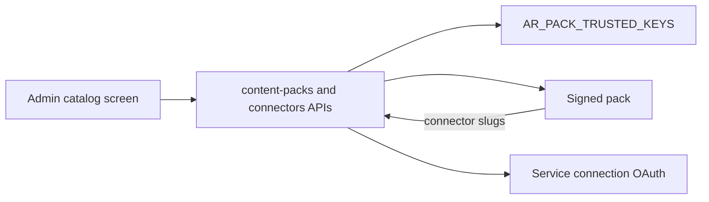

# 07 — Pack and connector marketplace

Status: **partial**. Signed packs install from the API. A connector catalogue and a connector screen exist. There is no browsable catalog of packs in the web app, and the connector list is a large Python tuple in core. That tuple is how new vendors enter the product today. Industry content belongs in packs.

## What already exists

| Piece | Status | Evidence |
|---|---|---|
| Pack manifest and signature | done | Ed25519 over the JCS digest. Unsigned packs refused when a signature is required. Trusted key ids from `AR_PACK_TRUSTED_KEYS`. `libs/ar_domain/src/ar_domain/packs/loader.py:53-75` |
| Boot load | done | Signature requirement follows the environment. `services/api/src/ar_api/main.py:236-246`. `AR_PACKS_DIR` loads the tree. `main.py:419-428` |
| Install API | done | `POST /api/v1/content-packs:install`, upgrade, uninstall. `services/api/src/ar_api/routers/content_packs.py:37-90`. Catalogue `docs/05-contracts/api-catalogue.md:586-590` |
| Pack service | done | Digest, signature gate, audit `pack.signature_rejected`. `libs/ar_domain/src/ar_domain/agents/packs.py:29-44` |
| Shell links | partial | The shell loads `/api/v1/tenant/packs` and shows nav. `apps/web/src/components/app-shell.tsx:94-111`. No `content-packs` route in `apps/web`. |
| Records pack | done | Optional signed pack. Routes 404 when disabled. `packs/records/manifest.json`. `packs/records/src/records_pack/router.py:28-38` |
| Records tables | partial | `evidence_items` was created in a core migration `libs/ar_domain/src/ar_domain/migrations/versions/20261028_0023_m14_records.py:31-34`. Stage 11 moved records-product tables to schema `records_pack` (`progress.md`, Stage 11). New industry tables follow that pack schema, not core. |
| GRC tree | missing | `docs/10-grc-pack/` and `packs/grc` are not in the tree. Examples live in `packs/examples/grc-flows/README.md`. |
| Connector catalogue | done, hard-coded | `CONNECTORS` built in Python. `libs/ar_domain/src/ar_domain/connectors/catalog.py:1044` and the batch modules beside it. |
| Connector API and UI | done | List and install. `services/api/src/ar_api/routers/connectors.py:37-64`. Page `apps/web/src/app/connectors/page.tsx` |
| OAuth | done | Service connection `:authorize`. `services/api/src/ar_api/routers/service_connections.py:129-137`. Connector book fills authorize and token URLs. `libs/ar_domain/src/ar_domain/connectors/book.py:235-248` |
| MCP registration | done | Tool servers, versions, approve. `services/api/src/ar_api/routers/tool_servers.py:61-74`. Gateway is the only MCP client. `docs/05-contracts/mcp-integration.md` |
| Locale recognisers | done | Indian identifiers live in `packs/locale`, not in the core default list. `packs/locale/src/locale_pack/__init__.py:1-13` |

## Target architecture

The marketplace is a catalog screen over two sources the deployment already trusts:

1. Signed packs on disk or installed by `content-packs:install`, verified with the existing loader.
2. Connectors declared by those packs, plus the connectors already installed for the tenant.

A public internet store in core is a second distribution system. Sigstore's lesson is the one to copy: verify the artifact against a trust root you obtained out of band, and record the identity you expected. [Sigstore overview](https://docs.sigstore.dev/about/overview/), [verifying](https://docs.sigstore.dev/cosign/verifying/verify/). Our trust root is `AR_PACK_TRUSTED_KEYS` and the Ed25519 check in `loader.py`. A later option is a Sigstore bundle on the manifest. It does not replace the check we have in this stage.

New connectors stop landing as rows in `catalog.py`. A pack manifest `connectors[]` already exists in the production plan. The catalog API unions installed core connectors and pack connectors. The core tuple stays for the connectors that already ship, until each one is moved. This stage does not rewrite every connector. It stops the next one from being a core edit, and it gives packs a place in the UI.

One-click OAuth is the current `:authorize` flow, opened from the catalog row, with the redirect URL the connector definition already stores. Client ids and secrets stay on the connection, in `SecretStore`.

Industry solutions, including anything that used to live under a GRC name, ship as a pack the customer installs. Core gains no industry route, table, permission or seed.

## Gaps

1. No pack catalog UI. `apps/web` has no content-pack screen.
2. `CONNECTORS` is code (`catalog.py:1044`), so a new vendor is a core change.
3. Pack nav appears only after install (`app-shell.tsx:94-111`). There is no browse step.
4. Signature trust is environment keys. There is no catalog entry that explains who signed a pack in the UI.
5. Core still carries the historical records migration. New work must not add to it.

## Research

- Signed registries (npm provenance, GitHub artifact attestations) attach a verifiable identity to bytes and check it before install. [Sigstore blog on bundles](https://blog.sigstore.dev/cosign-verify-bundles/). We already refuse a bad signature (`loader.py:69-75`). The UI should show the key id and the refusal reason.
- OAuth for connectors stays authorization-code on the connection. The catalog does not collect the token in the page and post it back as a raw secret.
- A marketplace that downloads arbitrary code into the API process breaks the pack rule that core does not import pack modules. Install stays the current loader: the pack's entry is mounted as today (`services/api/src/ar_api/plugins.py`).

## Contracts and API additions

| Addition | Shape |
|---|---|
| API | `GET /api/v1/catalog` returns `{packs, connectors}`. Packs include id, version, signed, keyId, installed. Connectors include slug, verification (`live`, `public`, `not_live` — the labels `catalog.py` already uses), and whether OAuth is configured. Permission `agents:read` for read, install still `packs:manage` and the connector install permission. |
| Pack manifest | `connectors[]` slugs resolved by the pack, not by a new core table. |
| Install | Existing `:install` body. Additive optional `sourceUrl` for a pack the admin pasted. The server downloads only when the host is on the tenant's egress allow list, then runs the same signature check. |
| UI routes | `/catalog` in the web app. Pack pages stay under `/packs/{id}` as the shell already does. |

No new connector JSON shape. The install body the connectors API uses stays.

## Config surface

| Setting | Where | Default |
|---|---|---|
| `AR_PACK_SIGNATURE_REQUIRED` | Env | true outside dev and CI (`main.py` sets this from the env) |
| `AR_PACK_TRUSTED_KEYS` | Env | empty, so an unknown key is refused when signatures are required |
| `AR_PACKS_DIR` | Env | existing |
| Catalog source URL allow list | Tenant setting `catalog.fetchHosts` | empty. Empty means paste-a-file only |
| OAuth client | Per connection, existing | unset until the admin connects |

## Security and observability

- Install of an unsigned or untrusted pack audits `pack.signature_rejected` and returns the existing error. The bytes are not mounted.
- `sourceUrl` is fetched server-side with the SSRF guard used for other outbound fetches. Redirects off the allow list fail.
- OAuth tokens are never returned after create. The catalog shows connected or not.
- Cross-tenant install is 404, consistent with `test_m3_api` and `test_m26_api`.
- A pack's permissions and audit actions are the ones in its manifest. Core does not grow an industry permission for the catalog itself. Catalog read uses `agents:read`.
- Metrics: install success and signature failure, by pack id. No manifest body in the log.

## Stories

### S19-01 Catalog read model

**Acceptance:** `GET /api/v1/catalog` lists installed packs, packs present in `AR_PACKS_DIR` that are not installed, and connectors from core and from installed packs. Each pack row includes the key id and whether the signature verified. A missing signature is listed as unavailable for install when the requirement is on. Another tenant's installed rows are absent.
**Proof:** contract.

### S19-02 Catalog screen

**Acceptance:** `/catalog` browses packs and connectors with empty, loading and error states. Install and uninstall call the existing endpoints. A connector row starts the existing OAuth authorize flow. The shell still shows pack nav after install. Light and dark, 375 and 1280, axe-clean.
**Proof:** contract for the API the page calls. The stage visual pass covers the screen.

### S19-03 A pack can add a connector

**Acceptance:** A fixture pack with `connectors[]` and a valid signature appears in the catalog after it is placed in `AR_PACKS_DIR`. Installing it registers the connector slug. The core `CONNECTORS` tuple is unchanged. A test pack with an untrusted key is refused.
**Proof:** contract.

### S19-04 No new industry in core

**Acceptance:** The stage diff adds no core table, route, permission or seed whose name is an industry or a framework. The domain-agnostic grep still passes. Records stay in `records_pack`.
**Proof:** unit via `scripts/check_domain_agnostic.py` if that script is the CI check, otherwise the stage's grep note in the PR.

## Risks and questions for Bala

1. **Remote fetch.** Paste-a-signed-file is enough for a private catalog. Fetching `sourceUrl` is convenient and is an egress decision. Question: ship paste-only in this stage, and add fetch when `catalog.fetchHosts` is set?
2. **Moving the built-in connectors out of `catalog.py`.** Doing all of them in one stage is a large move with no user-visible change. This plan leaves them and blocks new core entries. Question: confirm that split.
3. **Sigstore bundles.** Ed25519 and `AR_PACK_TRUSTED_KEYS` are the gate now. Question: is a Sigstore bundle in scope, or a later stage?
