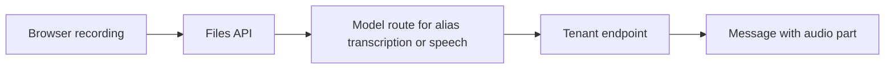

# 08 — Voice and mobile

Status: **partial** on mobile notifications, **missing** on speech and on an installable app. Web Push and a service worker exist. Nothing in the web app subscribes to push. There is no web app manifest. Model capabilities do not include transcription or speech. `audio.transcribe` is a line in the M41 plan and has no code.

## What already exists

| Piece | Status | Evidence |
|---|---|---|
| Transcription plan | missing in code | M41-T07 says `audio.transcribe` calls a registered model and stays off until one is set. `docs/09-plan/M41-documents-media.md:37-39`. No tool by that name in the tree. |
| Capabilities | missing speech | `CAPABILITIES` is `streaming`, `tools`, `vision`. `libs/ar_domain/src/ar_domain/models/aliases.py:49` |
| Vision as the pattern | done | `image.ask` uses a tenant vision alias and is off until set. `libs/ar_domain/src/ar_domain/tools/seed_tools.py:1914-1918` |
| Web Push server | done | `POST /api/v1/notifications/push-subscriptions`. `services/api/src/ar_api/routers/notifications.py:48-62`. Delivery uses the named secret `web_push_vapid_private`. `libs/ar_domain/src/ar_domain/notifications/dispatch.py:1-6` and `subscribe` at `:20-28` |
| Service worker | partial | Shows a push and closes it on click. `apps/web/public/sw.js:1-19`. Registered from `apps/web/src/components/push-worker.tsx:5-12` |
| Push in the client | missing | No `pushManager` use under `apps/web`. The worker is registered and no subscription is posted. |
| Manifest | missing | No `manifest.webmanifest` and no manifest link. `apps/web/src/app/layout.tsx:29-32` is title and description only. |
| Responsive layout | partial | Breakpoints exist, for example `apps/web/src/components/page-header.tsx:13`. There is no installable standalone display. |
| Notification click | partial | The worker closes the notification and does not focus the run. `sw.js:17-19` |

Voice is a model the tenant registers, the same way vision is. The browser speech API sends audio to the browser vendor. That is not a bring-your-own model and it is not the customer's environment. This stage does not use it.

## Target architecture

The microphone records in the browser. Audio bytes go to our API as a file, then to the tenant's transcription model through the model path area 06 owns (`routes_for`). Spoken answers are a file from the tenant's speech model, played in the chat message. Both tools are absent until the alias is set, matching `image.ask`.

The PWA is the existing Next app plus a manifest and the existing service worker. Installability in Chromium needs a manifest with name, 192 and 512 icons, `start_url`, and a display mode of `standalone`, `fullscreen` or `minimal-ui`, served on HTTPS. [MDN install guide](https://developer.mozilla.org/en-US/docs/Web/Progressive_web_apps/Guides/Making_PWAs_installable). A fetch handler on the worker is what makes the shell open offline. The handler caches the shell only, not conversations and not audio.

Push subscribe uses `pushManager.subscribe` and the existing subscription POST. Notification click focuses the conversation URL in the payload. The payload stays title and body, which `sw.js` already parses. Area 02's completion notice is what the user sees. This stage does not invent a second push sender.

Transcription request shape follows the common OpenAI-compatible multipart form: file plus model id. [Speech to text](https://developers.openai.com/api/docs/guides/speech-to-text). The model id is the tenant alias, not a constant in the tool.

## Gaps

1. No `audio.transcribe` or speech synthesis tool.
2. No `transcription` or `speech` capability (`aliases.py:49`).
3. No client push subscription (`push-worker.tsx` only registers).
4. No manifest, so the app is not installable.
5. Notification click does not open the run (`sw.js:17-19`).

## Contracts and API additions

| Addition | Shape |
|---|---|
| Capability | Additive `transcription` and `speech` in `CAPABILITIES`. |
| Aliases | Tenant aliases `transcription` and `speech`, unset by default. |
| Tools | `audio.transcribe` and `audio.speak`, hidden from the model until the alias is set. Results are file ids. |
| Message part | Additive `{type: "audio", fileId, mimeType}` beside the existing file and image parts. Old clients ignore it. |
| Push | Existing subscription body. The client starts sending it. |
| Manifest | `apps/web/public/manifest.webmanifest`, linked from the root layout. |

`/v1` chat completions stay text. Audio is a tool result and a content part, not a new public completions schema, unless a client already receives content parts (Stage 13). The part is additive there.

## Config surface

| Setting | Where | Default |
|---|---|---|
| Transcription alias | Tenant model registry | unset, tool off |
| Speech alias | Tenant model registry | unset, spoken reply off |
| Max audio bytes | Tenant `voice.maxBytes` | 25 MiB, matching the common provider limit, overridable |
| Language hint | User locale already on the profile | passed when the provider accepts a language field |
| VAPID | Named secret `web_push_vapid_private` | unset means subscribe is stored and send stays pending, which `dispatch.py` already does |
| Display | Manifest `display` | `standalone` |

No default vendor host. The alias's endpoint is the host.

## Security and observability

- Audio files use the existing file ACL and malware scan path. They are tenant objects.
- The transcription request goes through the model route. The key is not placed in the tool arguments or the trace.
- The transcript is user content. It enters the next turn as the user message the person accepted, not as a hidden system note.
- Push payloads contain a title, a short status and a path. They do not contain the answer body. That matches area 02.
- Metrics: transcription seconds and speech seconds, as usage events with `cost_micros` when the provider returns usage. No audio in the log.
- The service worker cache must not store `/api/` responses. A shared device would otherwise show another session's shell data from disk. The cache list is the static shell.

## Stories

### S20-01 Transcription alias and tool

**Acceptance:** A model with capability `transcription` can be saved and selected as the `transcription` alias. `audio.transcribe` sends the file to that route and returns a file id plus the text. With no alias, the tool is hidden and a direct call returns the existing not-configured error. Cost lands on `usage_events`.
**Proof:** contract. Live when the tenant's model accepts an audio file. Pending without a key and a speech-capable endpoint.

### S20-02 Spoken answers

**Acceptance:** `audio.speak` calls the `speech` alias and attaches an `audio` content part the chat plays. Off when the alias is unset. The part is ignored by a client that only reads text. `/v1` includes it only inside the existing content array.
**Proof:** contract.

### S20-03 Push subscription and a click that opens the run

**Acceptance:** The signed-in user can enable notifications. The browser subscribes and POSTs to the existing endpoint. A completion push from area 02 opens the conversation on click. Denying permission leaves the in-app inbox working.
**Proof:** contract for the POST. The visual pass covers enable and a local push.

### S20-04 Installable PWA

**Acceptance:** The layout links a manifest with name, 192 and 512 icons, `start_url` and `display: standalone`. The service worker has a fetch handler for the shell and does not cache API responses. At 375 px the chat composer, the catalog link and the memory list are usable. Light and dark both work. Axe-clean on chat.
**Proof:** the stage visual pass, plus a unit check that the manifest JSON has the required members.

## Risks and questions for Bala

1. **Streaming speech.** This stage is file-in, file-out, which matches the tools we have. A realtime duplex socket is a second protocol. Question: is file-in, file-out enough for this stage?
2. **Where the audio is stored.** Reusing the files API means retention and erasure already apply. Question: confirm voice notes follow the user's file retention, not a shorter default.
3. **Icons and name.** The manifest name should be the product name from settings, not a hard-coded brand string, if the white-label name already exists. Question: which setting is the customer-facing app name?
