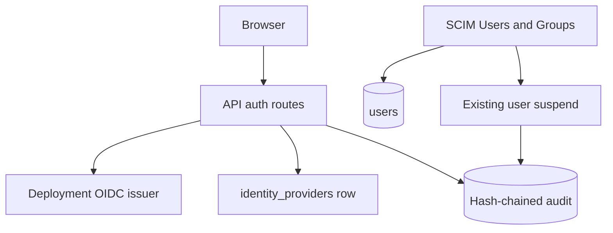

# 09 — Enterprise trust

Status: **partial**. Deployment-wide OIDC, SCIM users and groups, a hash-chained audit log with export, row-level security, and tenant PII masking are in the product. Per-tenant SAML and OIDC federation still store a Keycloak alias and call a broker only when one is attached. Deleting a SCIM user flips a status and does not run the suspend path. Data residency is a tag that must match the deployment, and the product does not yet refuse a mismatch.

## What already exists

| Piece | Status | Evidence |
|---|---|---|
| Production OIDC | done | Authorization code and JWKS bearer checks. Issuer and client are operator settings and are not logged. `services/api/src/ar_api/auth/oidc.py:1-6`. Routes `oidc_start` and `oidc_callback`. `services/api/src/ar_api/auth/routes.py:220-239` |
| Decision | done | Production sign-in is the customer's OIDC provider. A local password is the dev and single-tenant mode and is not the Helm default. [OQ-122](../../open-questions.md) and [ADR-0031](../../02-architecture/adr/ADR-0031-oidc-production-identity.md). |
| Spec drift | partial | Spec 02 says enterprise SSO federation was removed with Keycloak. `docs/03-specs/02-identity-tenancy.md:51-56`. The routes are still mounted. |
| IdP rows | partial | `POST /api/v1/identity-providers` writes `keycloak_alias` and calls `broker.upsert_identity_provider` when `identity.keycloak` is set. `services/api/src/ar_api/routers/domains.py:104-126`. Kinds `oidc` and `saml` are a check constraint. `libs/ar_domain/src/ar_domain/identity/models.py:90` |
| SAML config model | partial | `SamlIdpConfig` exists. `libs/ar_contracts/src/ar_contracts/identity.py:29-38`. No SAML response parser is on the login path. |
| SCIM | done for the resource surface | Service provider config, schemas, Users and Groups. Bearer guard. `services/api/src/ar_api/routers/scim.py:20-170` |
| SCIM deactivate | partial | PATCH uses `scim_set_active` (`scim.py:99-110`). PUT and DELETE set `status` to `deprovisioned` and return (`scim.py:114-134`). The spec's user suspend deletes sessions, revokes personal keys, pauses routines and cancels runs (`docs/03-specs/02-identity-tenancy.md:75-76`). The DELETE handler does not call it. |
| SCIM tokens | done | `services/api/src/ar_api/routers/scim_tokens.py:12-19` |
| Residency | partial | Column default `in`. `libs/ar_domain/src/ar_domain/identity/models.py:63`. Returned on the tenant read. `services/api/src/ar_api/routers/tenant.py:49`. [OQ-16](../../open-questions.md): one region per deployment. The tag must equal the deployment's region. |
| PII masking | done | Presidio. A kind is masked only when the tenant lists it and the score clears the tenant threshold. Defaults are card, email, IBAN and phone. `libs/ar_domain/src/ar_domain/pii/analyzer.py:1-27`. Gateway re-exports it. `services/mcp_gateway/src/ar_mcp_gateway/redaction.py:1-5`. Settings `GET /api/v1/tenant/masking`. `tenant.py:56-66` |
| Locale extras | done | Registered by the locale pack, off until listed. `packs/locale/src/locale_pack/__init__.py:11-13` |
| Audit chain | done | `seal_chain_row` and `chain_hash`. Readers use Postgres, not a process log. `libs/ar_domain/src/ar_domain/audit/read.py:1-28`. Verify route `services/api/src/ar_api/routers/audit.py`. |
| Audit export | done | `POST /api/v1/audit-exports` and GET. `services/api/src/ar_api/routers/access.py:136-152`. Permission `audit:export`. |
| RLS | done | `app.tenant_id` on every tenant transaction. `libs/ar_domain/src/ar_domain/db/session.py:37-48` |
| Erasure | done | Export and erase routes exist. Audit rows are kept. Spec 02 erase section. |

## Target architecture

One identity store. The deployment OIDC issuer stays the operator path for a single-IdP install. A tenant who brings their own IdP uses the existing `identity_providers` row. The login redirect uses that row's OIDC or SAML config. The Keycloak broker call is removed in the same change. Local password stays the documented dev mode.

SAML ships in this stage, optional and off until a tenant adds a row. The row is the existing `identity_providers` table. `kind` is already `oidc` or `saml` (`libs/ar_domain/src/ar_domain/identity/models.py:90`). Login reads that row. There is no second identity store and no Keycloak broker. A tenant with no row keeps the deployment OIDC issuer. The US SSO playbook prefers OIDC and keeps SAML for IdPs that only speak it. [IDManagement SSO playbook](https://www.idmanagement.gov/playbooks/sso/). Validation rules that are not optional:

- OIDC: authorization code and PKCE, `state`, `nonce`, issuer, audience, JWKS, algorithm allow-list. The deployment path in `oidc.py` is the code to reuse for the per-tenant issuer.
- SAML: require a signature, validate it against the certificate pinned on the IdP row, read attributes only from the signed assertion, check audience, recipient and time. Reject unsigned assertions.
- Link users by the IdP's stable subject, not by a mutable email. SCIM and SSO must agree on that subject.

SCIM PUT and DELETE call the same suspend function PATCH should call, so sessions, personal keys, routines and runs stop. [RFC 7644](https://www.rfc-editor.org/rfc/rfc7644.html) requires TLS. Deprovision is the point of SCIM. JIT login alone never removes anyone. [SCIM deprovision checklist](https://mlab.sh/blog/enterprise-sso-scim-security-checklist).

**Decided.** One region per deployment, set by `AR_DEPLOYMENT_REGION`. A tenant whose `data_residency` differs is refused. A write that carries a residency tag other than the deployment's region is refused. Nothing in this process routes a tenant to another region. Another region is another deployment. This is [OQ-16](../../open-questions.md), now enforced.

PII policies stay `analyzer.py` and the masking settings API. This stage adds the admin control for where masking applies (tool results, traces already redacted, exports) using the flags the guardrails module already consults (`libs/ar_domain/src/ar_domain/security/guardrails.py`). It does not add a second redactor.

Audit export stays `AuditExportBook`. The downloaded bundle includes the verify result from `verify_public_chain` so a customer can show the chain without a second log. The export is the existing async file. It does not embed message content.

## Gaps

1. Per-tenant OIDC and SAML are a Keycloak-shaped row (`domains.py:112-125`) and a spec that says the feature was removed (`02-identity-tenancy.md:51-56`).
2. No SAML consume path on login.
3. SCIM DELETE does not suspend (`scim.py:126-134`).
4. Residency is stored and not enforced against the deployment (`models.py:63`, OQ-16).
5. The export exists. The chain verify is a different route. Customers need one download that contains both.

## Contracts and API additions

The IdP create body stays `IdpCreate`. `kind` stays the existing `oidc` | `saml` check. Pre-production, so the Keycloak-shaped response field goes away in this stage rather than lingering as an empty alias.

| Change | Shape |
|---|---|
| IdP response | Drop `keycloak_alias` from the create response. Document the break in spec 02. Do not add a new alias name. |
| Login | `GET /api/v1/auth/oidc/start` takes an optional `idpId`. Omit it and the deployment issuer is used. A row with `kind: oidc` is that tenant's issuer. |
| SAML | `POST /api/v1/auth/saml/acs` consumes the response for a row with `kind: saml`. A tenant with no such row has no SAML endpoint behaviour beyond 404. |
| SCIM | No new resource. PUT and DELETE call suspend. Response shape unchanged. |
| Tenant and data | Create or update of a tenant, and any body field `dataResidency`, returns 409 when the value differs from `AR_DEPLOYMENT_REGION`. |
| Audit export | The export document gains `chain: {ok, fromSeq, toSeq}`. Existing fields stay. |

Spec 02 section 3.2 is rewritten in the same change. It describes per-tenant OIDC and optional per-tenant SAML on `identity_providers`. The sentence that says federation was removed is replaced. The implementing agent edits that spec.

## Config surface

| Setting | Where | Default |
|---|---|---|
| `AR_AUTH_MODE`, `AR_OIDC_*` | Env catalogue, deployment issuer | existing |
| `AR_DEPLOYMENT_REGION` | Env | must match `tenants.data_residency` |
| Per-tenant IdP | `identity_providers.kind` | none. Login uses the deployment issuer. `oidc` and `saml` are optional per tenant |
| Local password | Existing dev mode | off in Helm |
| Masking entities and threshold | Tenant masking settings | card, email, IBAN, phone, score 0.6 (`analyzer.py:21-27`) |
| `AR_PII_LANGUAGE_MODEL` | Env, existing | existing |
| SCIM token | Existing token API | unset |

IdP client secrets go to `SecretStore`. They are not columns in clear text and not part of the audit detail.

## Security and observability

- Per-tenant OIDC uses the checks in `oidc.py`. A token whose issuer is not the row's issuer is rejected.
- SAML certificates are pinned on the row. The certificate inside the response is not the trust anchor.
- Subject linking is the stable id. An email match against another tenant is 404, not a link.
- SCIM tokens stay tenant-scoped. Every write is audited: `user.suspended` on deprovision, using the existing action.
- Suspend's side effects stay the spec 02 list: sessions, personal keys, routines, active runs.
- Residency mismatch on a tenant or on a payload tag is 409 `invalid_state` and an audit row. The tag is not rewritten, and the request is not forwarded.
- Export download requires `audit:export`. The file is the existing export object, scanned and ACL'd like other files.
- Traces for login contain the issuer host and the result code. They do not contain the code, the assertion or the token.
- RLS is unchanged. New queries in this stage run inside the tenant session.

## Stories

### S16-05 Per-tenant OIDC without Keycloak

**Acceptance:** An `identity_providers` row of kind `oidc` is the issuer for that tenant when `idpId` is passed to start. The callback checks state, nonce, issuer, audience and JWKS. `keycloak` is not consulted. A row with no broker configured still works. Cross-tenant idp id is 404. Spec 02 section 3.2 matches the code.
**Proof:** contract.

### S16-06 SAML on the same row

**Decided:** SAML is in this stage, optional per tenant, on the same row as OIDC.

**Acceptance:** A tenant with a `kind: saml` row completes login through `POST /api/v1/auth/saml/acs`. A tenant with no SAML row gets 404 from that consume path and still signs in with the deployment OIDC issuer. An unsigned assertion is rejected. A signature from a certificate other than the pinned one is rejected. The user is linked by subject. Audit `user.login` records the IdP id and not the assertion XML. No new identity table is added.
**Proof:** contract, with a fixture assertion signed in the test.

### S16-07 SCIM deprovision uses suspend

**Acceptance:** SCIM PATCH, PUT and DELETE that deactivate a user run the suspend behaviour: sessions gone, personal API keys revoked, owned routines paused, non-terminal runs cancelled. The user row remains for the audit subject. A SCIM token from another tenant is rejected.
**Proof:** contract.

### S16-08 Residency tag matches the deployment

**Decided:** one region per deployment. Mismatched tags are refused. There is no multi-region router.

**Acceptance:** `AR_DEPLOYMENT_REGION` is the deployment's region. Creating or updating a tenant whose `dataResidency` differs is 409. A request body that sets `dataResidency` to any other value is 409, on the tenant and on any other object that carries the tag. Equal values succeed. The tenant API still returns the tag. No code path selects a different cluster or database from the tag.
**Proof:** contract.

### S16-09 Masking policies stay one pipeline

**Acceptance:** The masking screen edits the entity list and the score threshold, and the tool-result path and the export path both use `analyzer.redact`. A tenant that lists no extra entities keeps the four defaults. A locale pack entity stays off until listed. A test shows a card number masked in a tool result and absent from the trace.
**Proof:** contract.

### S16-10 Export the chain

**Acceptance:** `POST /api/v1/audit-exports` produces a file the admin can download. The file includes the events for the requested range and a `chain` object from the existing verifier. A broken chain is reported in that object and the export still downloads so the customer can see the break. Permission `audit:export`. Cross-tenant 404.
**Proof:** contract.

### S16-11 Live sign-in

**Acceptance:** From an empty database, against a real OIDC issuer the operator configured, a user signs in and calls an agent. The report names the issuer and the date. A SAML live run is pending unless an IdP is configured in that environment. A local password login is not the proof of this story.
**Proof:** live for OIDC. Contract for SAML unless Bala provides an IdP.

## Risks and questions for Bala

1. **Subject versus email.** Linking on email is the usual incident. This plan links on the IdP's stable subject and treats email as a display attribute. Question: confirm that split.
