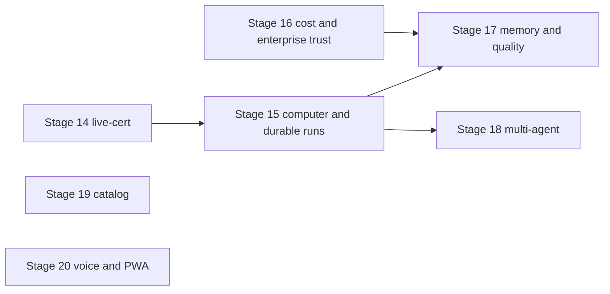

# Next milestones

A build plan for nine areas, grounded in the tree at `e3b029d` (11 Nov 2026). This directory is proposal only. It does not change product code, `progress.md`, the catalogues, or [agnostic-production-plan.md](../agnostic-production-plan.md). When a stage is accepted, the coding agent copies the stage into the production plan and records the result in `progress.md` inside that stage's one pull request.

Stage 14 is the live-cert fix on another branch. These stages start at 15 so they do not reuse that number. Do not open a new M-number. [AGENTS.md](../../../AGENTS.md) tracks future work as stages.

| Area | File | Stage |
|---|---|---|
| A computer for the agent | [01-agent-computer.md](01-agent-computer.md) | 15 |
| Long-running background agents | [02-long-running-agents.md](02-long-running-agents.md) | 15 |
| Memory and personalisation | [03-memory-personalisation.md](03-memory-personalisation.md) | 17 |
| Multi-agent work | [04-multi-agent.md](04-multi-agent.md) | 18 |
| Quality loop | [05-quality-loop.md](05-quality-loop.md) | 17, except S17-09 in Stage 16 |
| Admin and cost controls | [06-admin-cost.md](06-admin-cost.md) | 16 |
| Pack and connector marketplace | [07-marketplace.md](07-marketplace.md) | 19 |
| Voice and mobile | [08-voice-mobile.md](08-voice-mobile.md) | 20 |
| Enterprise trust | [09-enterprise-trust.md](09-enterprise-trust.md) | 16 |

## Why the computer and long runs come first

The north star is an assistant with its own computer ([vision](../../00-overview/vision.md)). The computer and the hours-long run are one loop, and that loop is the one that is blocked:

- `TurnWorkflow` stops at 32 steps (`services/runtime/src/ar_runtime/workflows/turn.py:56`) while `RunBudget.max_steps` is unused (`libs/ar_contracts/src/ar_contracts/budget.py:13`).
- `resume_run` marks a run running and does not start the worker (`libs/ar_domain/src/ar_domain/chat/service.py:2583-2598`).
- Approvals are finished in the API process (`libs/ar_domain/src/ar_domain/tools/resume.py:1-32`), which breaks the rule that the API does not run the model loop.
- The pod, the Chromium tools and the network policy exist (`KubernetesPods` at `services/sandbox_manager/src/ar_sandbox_manager/drivers/kubernetes.py:154`). A live view and takeover do not. An empty endpoint still has an in-process browser fallback (M40-T04c in [progress.md](../progress.md)), against boundary law 4 in the [production plan](../agnostic-production-plan.md).

Memory, evals, quotas, packs, OIDC, SCIM and the connector screen are already far enough along that they can wait, and several of them can be built beside Stage 15 without touching this loop. Evidence for each status is in the area file. A claim of done, partial or missing in those files cites a path and a line read from this tree.

## Sequencing

Sizes are relative: M is a few packages, L crosses a service and the UI, XL is the run loop plus the sandbox image.

| Stage | Areas | Size | After | Parallel with |
|---|---|---|---|---|
| 15 Computer and durable runs | 01, 02 | XL | Stage 14 merged, or `main` if 14 has not landed yet. Rebase if 14 touches the same files. | 16 and 19, under the file fence |
| 16 Budgets, routing, enterprise identity | 06, 09, and story S17-09 | L | Nothing in this plan. Stay off Stage 15's files. | 15, 19, 20 |
| 17 Memory, skills, quality | 03, 05 except S17-09 | L | 15 merged. `feedback.created` and `note_feedback` already exist (`chat/service.py:2817-2838`), so the subscriber can be written ahead, and the PR merges after 15. | 16, 19, 20, once it is not editing Stage 15 files |
| 18 Multi-agent trail | 04 | M | 15 merged. Handoff reuses the conversation sandbox and the wait signal. | 16, 17, 19, 20 after 15 |
| 19 Pack and connector catalog | 07 | M | Nothing in this plan | 15, 16, 17, 18, 20 |
| 20 Voice and installable web | 08 | M | Nothing required. Stay off `loop/routing.py` (Stage 16) and `public/sw.js` is yours alone. | 15, 16, 17, 18, 19 |



Stage 16 points at 17 only because S17-09 lands in `loop/routing.py` during 16, and 17 must not rewrite it. Stages 19 and 20 have no arrow because they do not wait.

One pull request per stage. One CI run. Agents run together only on the pairs the fence allows.

### File fence

| Stage | May edit | Must not edit while another stage is open |
|---|---|---|
| 15 | `services/runtime` workflows and activities for the turn and approval wait, `services/sandbox_manager`, `services/sandbox_agent`, `images/sandbox`, `libs/ar_domain/sandboxes`, `libs/ar_domain/tools/resume.py`, `libs/ar_domain/tools/worker_loop.py`, `libs/ar_domain/chat/service.py`, computer UI, run-stream contracts | `packs/`, `connectors` catalog, `identity`, `scim`, `evals/`, `memory/`, `loop/routing.py` |
| 16 | `usage/`, `loop/routing.py`, quotas and usage UI, `identity`, `auth/oidc.py`, `routers/domains.py`, `routers/scim.py`, audit export, masking settings, tenant residency | `chat/service.py`, `turn.py`, `sandboxes/`, `packs/`, `public/sw.js` |
| 17 | `memory/`, `skills/`, `evals/`, evals UI, agent quality UI. Extend `note_feedback`. | `chat/service.py`, `turn.py`, `sandboxes/`, `loop/routing.py` |
| 18 | `exposure/a2a.py`, `grpc_server.py`, `orchestration/`, `skills/delegate.py`, `workflows/delegation.py`, trail UI | `turn.py`, `sandboxes/runtime.py` until 15 has merged, then reuse the sandbox id it stores |
| 19 | `packs/`, `content_packs` router, `connectors` catalog read model, catalog UI | `catalog.py` rows for existing connectors stay. Add a union, do not rewrite the tuple in the same week as another agent |
| 20 | `models/aliases.py` capabilities, audio tools, `apps/web` manifest and `public/sw.js`, push client | `loop/routing.py`, `chat/service.py` |

If two stages need the same file, the later stage waits. Do not take the file and force the other agent to rebase a hot path.

## Invariants the stages keep

From the [production plan](../agnostic-production-plan.md):

1. `mcp-gateway` is the only tool path.
2. One Temporal activity is one model call or one tool call.
3. `sandbox-manager` (`KubernetesPods`) is the only pod creator.
4. The API process does not run the model loop, a shell, or a browser.
5. Packs are out of process. Core does not import a pack. Industry content is a pack.
6. We are pre-production. Public contracts stay additive where that is the long-term shape. A breaking change is allowed when the plan lists the migration and the old shape is not kept as a second path. Clients come from `make gen`.
7. Shared state lives in Postgres, Valkey or the object store.
8. A feature is live only from an empty database with a real model. A unit test is not that proof.

## Decisions

Bala, 11 Nov 2026. These are closed. The stories and the launch prompts below use them.

1. **Stage 15 live proof** is a watched Chromium form fill. A desktop app such as LibreOffice is a later option on the same pod, not this stage. [01](01-agent-computer.md).
2. **SAML** ships in Stage 16 next to OIDC. It is optional per tenant, uses `identity_providers.kind`, and does not add an identity system. [09](09-enterprise-trust.md).
3. **Eval cases** from thumbs-down and from failed runs are drafts until a person promotes them. Failed-run capture is the tenant flag `evals.caseFromFailedRun`. [05](05-quality-loop.md).
4. **Residency** is one region per deployment (`AR_DEPLOYMENT_REGION`). A tenant or a payload whose tag differs is refused. There is no multi-region routing. [09](09-enterprise-trust.md).
5. **A2A** moves to protocol `1.0`. The card, JSON-RPC, gRPC, and the contract tests change in Stage 18. The migration is in [04](04-multi-agent.md). A 0.3 shim is not kept.

Other questions in the area files are still open. They do not block these five.

## Launch prompts

Each prompt is the whole brief for one coding agent. Paste it as the task. One stage, one branch, one pull request.

### Stage 15 — Computer and durable runs

```
You are implementing Stage 15 of Agentic Runtime: a computer for the agent, and long-running runs, in one pull request.

Read first: AGENTS.md, docs/00-overview/principles.md, docs/09-plan/agnostic-production-plan.md, docs/09-plan/next-milestones/01-agent-computer.md, docs/09-plan/next-milestones/02-long-running-agents.md, docs/03-specs/12-sandbox-manager.md, docs/03-specs/07-agent-runtime.md.

Strict rules (AGENTS.md): no mocks in the product; no fake services; no static customer data; live proof is an empty database and a real model; fix the architecture in place and delete the old path; no bypass; no industry in core; settings instead of literals; reuse what exists; status claims need file evidence; research when unsure; no process-local production state; one pull request for this whole stage; security and observability on every new path. We are pre-production: prefer the long-term shape, and do not keep a compatibility shim. A breaking change must be listed in the plan.

Invariants: mcp-gateway is the only tool path. One Temporal activity is one model or tool step. sandbox-manager KubernetesPods is the only pod creator. The API does not run the model loop.

Do: every story S15-01 through S15-11 in those two files. Reuse the sandbox pod, Playwright tools, trusted /admin/login, TurnWorkflow, worker_loop checkpoints, ApprovalWaitWorkflow, RoutineRunWorkflow and notify_user. Remove the step cap of 32, the resume that only flips a status, the in-process browser on the kubernetes driver, and the snapshot stub that returns a byte count. Do not build a desktop template or launch LibreOffice. Reject display=desktop.

File fence: you may edit the runtime turn and approval workflows, sandbox-manager, sandbox-agent, the sandbox image, ar_domain sandboxes, tools/resume.py, tools/worker_loop.py, chat/service.py, and the computer UI. Do not edit packs, the connector catalog, identity, SCIM, evals, memory, or loop/routing.py. Another agent owns those.

Delivery: one branch, one PR, all stories. Run the full local CI suite, including the web end-to-end job on a production Next build and the kind jobs, before the first push. Push once. If CI is red, one fix commit. Update progress.md and the production plan in that PR. PR body includes a reuse report and How to test visually. Do not merge.

Proof: contract for the pod, the view grant, takeover, continue-as-new, resume and the approval signal. Live only from scripts/certify_live.sh when AR_LLM_API_KEY is set: a fresh tenant, the agent fills a form in Chromium, the person watches, takes over, and hands back. No desktop app. Without a key, leave the live step pending. Do not label a dry run live.
```

### Stage 16 — Budgets, routing, and enterprise trust

```
You are implementing Stage 16 of Agentic Runtime: tenant budgets, model routing, and enterprise identity, in one pull request.

Read first: AGENTS.md, docs/00-overview/principles.md, docs/09-plan/next-milestones/06-admin-cost.md, docs/09-plan/next-milestones/09-enterprise-trust.md, story S17-09 in docs/09-plan/next-milestones/05-quality-loop.md, docs/03-specs/17-audit-usage-metering.md, docs/03-specs/02-identity-tenancy.md, docs/06-security/audit.md, docs/02-architecture/adr/ADR-0031-oidc-production-identity.md, OQ-16 and OQ-122 in docs/open-questions.md.

Strict rules: the same fifteen rules as AGENTS.md. We are pre-production: prefer the long-term shape, and do not keep a compatibility shim. Reuse UsageBook, routes_for, the audit chain, analyzer.redact, auth/oidc.py, and the identity_providers row (kind oidc or saml). Delete the Keycloak broker call on identity provider create in the same change. Do not add a second identity store, LiteLLM, a second redactor, or a response cache in Valkey. Do not hard-code model prices.

Invariants: the model call stays on the existing route path. Secrets stay in SecretStore. SCIM deprovision uses the existing user suspend. Public JSON stays camelCase. Drop keycloak_alias from the IdP create response and record that break in spec 02.

Do: stories S16-01 through S16-11, and S17-09 (GenAI span attributes on the model call). Per-tenant OIDC and optional per-tenant SAML both use identity_providers.kind. A tenant with no row keeps the deployment issuer. Residency is AR_DEPLOYMENT_REGION. Refuse a tenant or a payload whose dataResidency differs. Do not route to another region. Masking stays the one analyzer. The audit export includes the existing chain verify result. Rewrite spec 02 section 3.2 so it describes this federation.

File fence: you may edit usage, loop/routing.py, quotas and usage UI, identity, auth/oidc.py, routers/domains.py, routers/scim.py, audit export, and masking settings. Do not edit chat/service.py, turn.py, sandboxes, packs, or apps/web/public/sw.js.

Delivery: one PR for the whole stage. Full local CI before the first push, including web end-to-end on a production Next build. Push once, then at most one fix commit. Update catalogues (env, audit, API, OpenAPI via make gen) and progress.md in that PR. Reuse report and How to test visually. Do not merge.

Proof: contract for quota block, cost policy, SCIM suspend, SAML rejection of an unsigned assertion, residency 409, and the export. Live OIDC sign-in from an empty database when an issuer is configured. Pending when it is not. Do not use the local password as the live proof.
```

### Stage 17 — Memory, skills, and the quality loop

```
You are implementing Stage 17 of Agentic Runtime: memory, learned skills, and the quality loop, in one pull request. Start the branch only after Stage 15 has merged. Do not redo S17-09; Stage 16 owns the GenAI span attributes.

Read first: AGENTS.md, docs/09-plan/next-milestones/03-memory-personalisation.md, docs/09-plan/next-milestones/05-quality-loop.md, docs/03-specs/11-memory.md, docs/03-specs/14-skills.md, docs/03-specs/18-observability-eval.md.

Strict rules: the fifteen rules in AGENTS.md. We are pre-production: prefer the long-term shape, and do not keep a compatibility shim. Reuse MemoryBook, MemoryQdrant, SkillBook, skills.load, EvalBook.case_from_conversation, and note_feedback. Delete maybe_compose in libs/ar_domain/src/ar_domain/skills/turn.py in this change. Do not add Mem0, Letta, or a second recall merge. Postgres remains the source of a fact. Qdrant is the index.

Do: S17-01 through S17-08 and S17-10. Thumbs-down and failed-run eval cases are drafts until a person promotes them. Failed-run capture is the tenant flag evals.caseFromFailedRun (default false). Thumbs-down capture is evals.caseFromFeedback (default true). Fact caps and the skill-match threshold become tenant settings with the current numbers as defaults. A repeated tool sequence becomes a draft skill the user publishes.

File fence: memory, skills, evals, the evals UI, the agent quality UI. Extend note_feedback. Do not edit chat/service.py, turn.py, sandboxes, or loop/routing.py.

Delivery: one PR. Full local CI before the first push, including the production Next end-to-end job. Push once, then at most one fix commit. Catalogues and progress.md in the PR. Reuse report and How to test visually. Do not merge.

Proof: contract for recall, corrections, the draft skill, draft eval cases, and the quality endpoint. Live: a real model proposes a skill draft and a promoted case runs on prompt edit, from an empty database. Pending without AR_LLM_API_KEY.
```

### Stage 18 — Multi-agent work

```
You are implementing Stage 18 of Agentic Runtime: agent handoff, A2A, a shared plan, and a trail, in one pull request. Start after Stage 15 has merged so the wait signal and the conversation sandbox exist.

Read first: AGENTS.md, docs/09-plan/next-milestones/04-multi-agent.md, docs/agent-api/a2a.md, the A2A 1.0 spec at https://a2a-protocol.org/latest/specification/.

Strict rules: the fifteen rules in AGENTS.md. We are pre-production: move A2A to protocol 1.0 and delete the 0.3 surface in the same change. Do not keep a 0.3 method alias. Reuse orchestration tools, delegate, DelegationWorkflow, exposure/a2a.py, and grpc_server.py. External SendMessage must start AgentRunWorkflow. The API must not call generate. Do not build a second plan store or a second trail table.

Do: S18-01 through S18-06. Follow the migration table in 04-multi-agent.md. Card protocolVersion is 1.0 inside supportedInterfaces. JSON-RPC methods are SendMessage, SendStreamingMessage, GetTask, ListTasks, CancelTask, SubscribeToTask, and the Create/Get/List/Delete push-config methods. Task states are TASK_STATE_*. Replace contracts/a2a/a2a.proto with the published 1.0 proto and regenerate stubs. Missing or non-1.0 A2A-Version returns -32009. Update test_stage11.py, test_stage12_grpc.py, and docs/agent-api/a2a.md. gRPC is mounted on the API with the agent API key and TLS. The insecure loopback serve() stays a test helper. Plan items gain optional owners. GET /api/v1/runs/{id}/trail reads existing rows.

File fence: exposure/a2a.py, grpc_server.py, the proto and generated stubs via make gen, orchestration, skills/delegate.py, workflows/delegation.py, trail UI. Do not fork TurnWorkflow.

Delivery: one PR. Full local CI before the first push. Push once, then at most one fix commit. Update the API catalogue and progress.md. Reuse report and How to test visually. Do not merge.

Proof: contract for the worker-backed A2A task, gRPC auth, the plan owner, and a cross-tenant 404 on the trail. Live: two agents the tenant created, a real model, a handoff, and a trail that shows both run ids. Pending without a model key.
```

### Stage 19 — Pack and connector catalog

```
You are implementing Stage 19 of Agentic Runtime: a browsable catalog of signed packs and connectors, in one pull request. You may start beside Stage 15.

Read first: AGENTS.md, docs/00-overview/principles.md, docs/09-plan/next-milestones/07-marketplace.md, docs/05-contracts/extension-framework.md, docs/09-plan/agnostic-production-plan.md pack section.

Strict rules: the fifteen rules in AGENTS.md. We are pre-production: prefer the long-term shape, and do not keep a compatibility shim. No industry in core. Reuse the pack loader, content-packs install, the connector install API, and service-connection OAuth. Do not add a public internet store. Do not add a new connector by editing the CONNECTORS tuple. A new connector arrives as a signed pack.

Do: S19-01 through S19-04. GET /api/v1/catalog unions packs and connectors. The screen has empty, loading and error states, light and dark, 375 and 1280, and an axe-clean pass. Install uses the existing endpoints. OAuth uses the existing authorize route. An untrusted signature is refused and audited.

File fence: packs, the content-packs router, the catalog read model, catalog UI. Leave existing CONNECTORS rows in place.

Delivery: one PR. Full local CI before the first push, including the production Next end-to-end job. Push once, then at most one fix commit. API catalogue, audit actions, progress.md. Reuse report and How to test visually. Do not merge.

Proof: contract for list, install, untrusted-key refusal, and a pack-provided connector. The domain-agnostic check stays green.
```

### Stage 20 — Voice and the installable web

```
You are implementing Stage 20 of Agentic Runtime: speech to text, spoken answers, and an installable PWA, in one pull request. You may start beside Stage 15. Do not edit loop/routing.py.

Read first: AGENTS.md, docs/09-plan/next-milestones/08-voice-mobile.md, docs/09-plan/M41-documents-media.md section M41-T07, the existing web push path in libs/ar_domain/src/ar_domain/notifications/dispatch.py and apps/web/public/sw.js.

Strict rules: the fifteen rules in AGENTS.md. We are pre-production: prefer the long-term shape, and do not keep a compatibility shim. Follow the vision alias pattern: the tool is hidden until the tenant sets the alias. No browser speech API. No hard-coded vendor host. Audio is a file under the existing file ACL.

Do: S20-01 through S20-04. Add capabilities transcription and speech. Tools audio.transcribe and audio.speak. An additive audio content part. The client subscribes to web push with the existing endpoint. Notification click opens the conversation. A manifest makes the app installable. The service worker caches the shell and does not cache /api/.

File fence: models/aliases.py capabilities, the audio tools, apps/web manifest and public/sw.js, the push client. Do not edit chat/service.py or loop/routing.py.

Delivery: one PR. Full local CI before the first push, including the production Next end-to-end job and an axe-clean chat pass at 375 and 1280. Push once, then at most one fix commit. Catalogues and progress.md. Reuse report and How to test visually. Do not merge.

Proof: contract for the tools off and on, the subscription POST, and the manifest members. Live transcription only when the tenant's model accepts audio. Pending otherwise.
```
